<p align="center">
  
</p>

<p align="center">
  <a href="https://github.com/omsrajput977/VentureTwin/actions/workflows/ci.yml"></a>
  
  
  
  
  
  
  
  
</p>

<p align="center">
  <a href="#-quick-start"><b>🚀 Quick Start</b></a> •
  <a href="#-the-30-second-pitch"><b>✨ 30-Second Pitch</b></a> •
  <a href="docs/PITCH.md"><b>🎯 Executive Pitch & Judge Q&A</b></a> •
  <a href="docs/TECHSTACK.md"><b>⚙️ Tech Stack & Protocols</b></a> •
  <a href="docs/ARCHITECTURE.md"><b>📖 Full Architecture (2,300+ Lines)</b></a> •
  <a href="#-see-it-in-action"><b>🖥️ UI Tour</b></a> •
  <a href="#-meet-the-agents"><b>🤖 Agent Swarm</b></a> •
  <a href="#-conflicts-resolved-by-simulation-not-voting"><b>⚡ Conflict Engine</b></a> •
  <a href="#-built-to-survive-failure"><b>🛡️ Fault Recovery</b></a>
</p>

---

> 📖 **Key Documentation Hub:**  
> • **[`docs/PITCH.md`](docs/PITCH.md)** — **Executive Pitch & Judge Q&A Guide:** 3-minute plain-English project walkthrough with anticipated judge questions and sharp answers.  
> • **[`docs/TECHSTACK.md`](docs/TECHSTACK.md)** — **Tech Stack & Engineering Tradeoffs:** Detailed justifications, agent communication protocols (`Pydantic` + `EventBus`), and empirical simulation conflict resolution.  
> • **[`docs/ARCHITECTURE.md`](docs/ARCHITECTURE.md)** — **Complete Technical Specification:** 2,366-line deep dive into every class, schema, AST verification script, SQLite checkpoint mechanism, and 40+ engineering FAQs.

---

## 📑 Table of Contents

- [1. ⚡ The 30-Second Pitch](#-the-30-second-pitch)
- [2. 🖥️ See It in Action](#️-see-it-in-action)
- [3. 🎯 The Problem & The SwarmFlow Challenge](#-the-problem--the-swarmflow-challenge)
- [4. 🏆 SwarmFlow Milestone Map](#-swarmflow-milestone-map)
- [5. ⚙️ How It Works](#️-how-it-works)
- [6. 🤖 Meet the Agents](#-meet-the-agents)
- [7. ⚡ Conflicts Resolved by Simulation, Not Voting](#-conflicts-resolved-by-simulation-not-voting)
- [8. 🛡️ Built to Survive Failure](#️-built-to-survive-failure)
- [9. 🔍 Trust But Verify (The Verification Engine)](#-trust-but-verify-the-verification-engine)
- [10. 📊 Sample Output & Real Simulation Charts](#-sample-output--real-simulation-charts)
- [11. 💻 Tech Stack & Verified Versions](#-tech-stack--verified-versions)
- [12. 🚀 Quick Start (Verified Commands)](#-quick-start-verified-commands)
- [13. 🧠 Run with a Real LLM (Gemini, OpenAI, Groq, Cerebras)](#-run-with-a-real-llm-gemini-openai-groq-cerebras)
- [14. ⚙️ Configuration Reference](#️-configuration-reference)
- [15. 🌐 API at a Glance](#-api-at-a-glance)
- [16. 📁 Project Structure](#-project-structure)
- [17. 🧪 Testing & CI](#-testing--ci)
- [18. ⚠️ Known Limitations & Honest Notes](#️-known-limitations--honest-notes)
- [19. 🗺️ Roadmap](#️-roadmap)
- [20. ❓ FAQ](#-faq)
- [21. 🤝 Contributing, Team, License & Acknowledgements](#-contributing-team-license--acknowledgements)

---

## ⚡ The 30-Second Pitch

**VentureTwin** is an AI flight simulator and operational digital twin for SaaS leadership. When founders or executives consider high-stakes strategic questions—such as *"Should we launch a free plan?"*—they typically face conflicting intuitions from sales, marketing, engineering, and finance, with no safe sandbox to stress-test their assumptions.

VentureTwin solves this by orchestrating a virtual executive board of specialized AI agents running in parallel over an 11-node directed acyclic graph (DAG). 

```
Strategic Question ➔ Parallel Specialist Agents ➔ Adversarial Skeptic Audit ➔
Deterministic SaaS Simulation ➔ Algorithmic Verifier ➔ Consolidated Report ➔ Human Sign-Off
```

### Why VentureTwin is Different (4 Hard Guarantees)

1. **Agents propose assumptions, never final numbers**  
   LLMs excel at qualitative domain intuition, but hallucinate arithmetic. In VentureTwin, agents only propose parameter ranges `[low, base, high]` backed by explicit provenance tags and confidence scores. Every proposal is enforced by Pydantic schemas in [`state/schemas.py`](state/schemas.py).
2. **Conflicts are resolved by empirical simulation, not LLM voting**  
   When the CFO and Head of Growth disagree on conversion velocity, the system does not average their opinions or let an LLM "vote." Instead, [`conflict/resolver.py`](conflict/resolver.py) and [`simulation/engine.py`](simulation/engine.py) run dual 24-month SaaS financial simulations across both extremes to determine if the parameter swing changes the optimal strategic choice.
3. **Strict Number Registry & zero-tolerance audit**  
   Every single digit in the executive deliverable must register with [`verification/number_registry.py`](verification/number_registry.py). If an agent claims a phantom metric, or if an assumption violates solvency guardrails, the 7-check algorithmic [`verification/verifier.py`](verification/verifier.py) rejects the draft and triggers a loop-back revision.
4. **Resilient by design: survives runtime crashes**  
   If an agent crashes mid-run due to an LLM provider outage or rate limit (429), the supervisor executes exponential backoff, activates an autonomous `BackupAnalystAgent` ([`agents/backup_analyst.py`](agents/backup_analyst.py)), or safely falls back to deterministic domain priors while logging the degraded status. The workflow never silently dies.

---

## 🖥️ See It in Action

The VentureTwin React dashboard provides real-time visibility into the multi-agent orchestration lifecycle, streaming Server-Sent Events (SSE) directly from the backend as agents analyze, critique, and simulate.

<div align="center">

| Strategic Intake & Preset Prompts | Multi-Agent Execution DAG (Complete) |
|:---:|:---:|
| 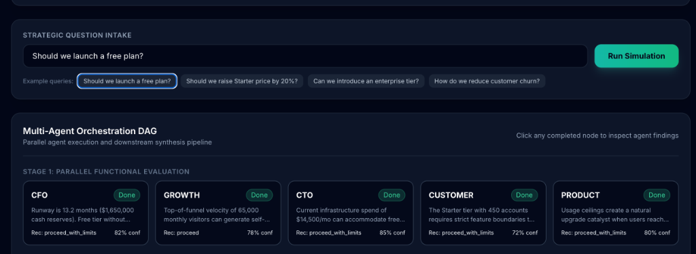 | 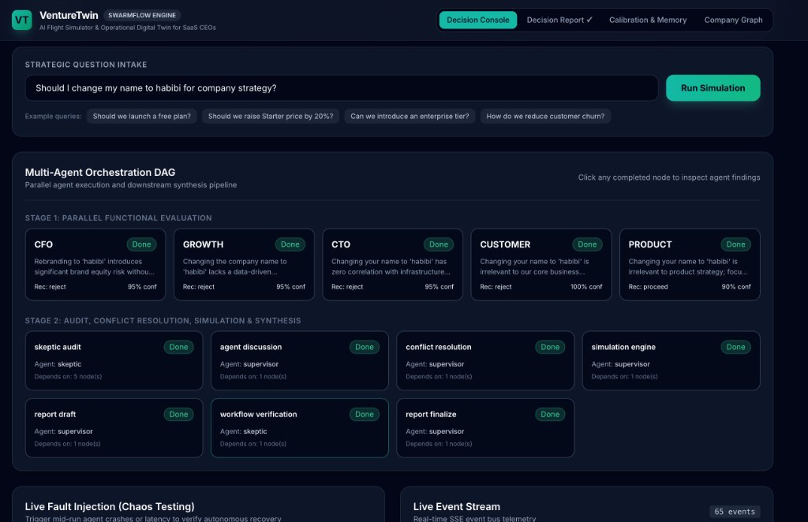 |
| *Intake bar with strategic scenario presets* | *11-node DAG completed across functional & synthesis stages* |

| CFO Financial Finding Modal | Live Real-Time Event Stream (SSE) |
|:---:|:---:|
| 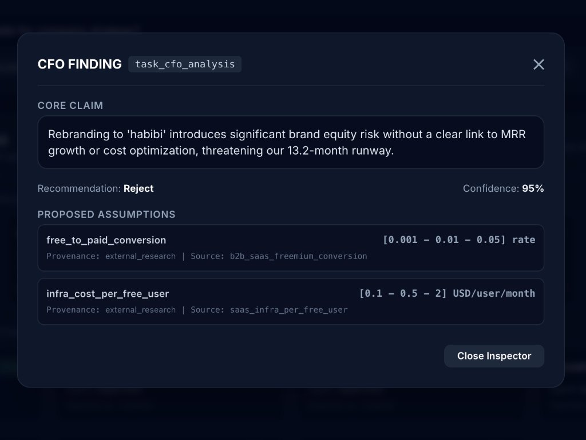 | 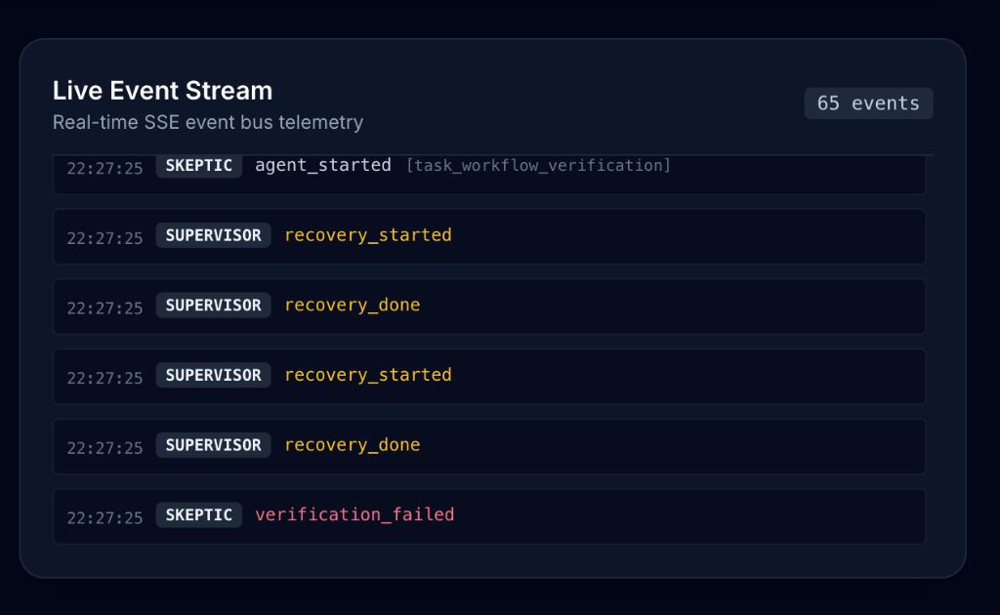 |
| *Bounded assumptions with provenance & confidence* | *Live telemetry tracking autonomous recovery transitions* |

</div>

<details>
<summary><b>🔍 View Additional Agent Inspector Views (Growth, CTO, Customer)</b></summary>

| Head of Growth Findings | CTO Infrastructure Findings | VP Customer Success Findings |
|:---:|:---:|:---:|
| 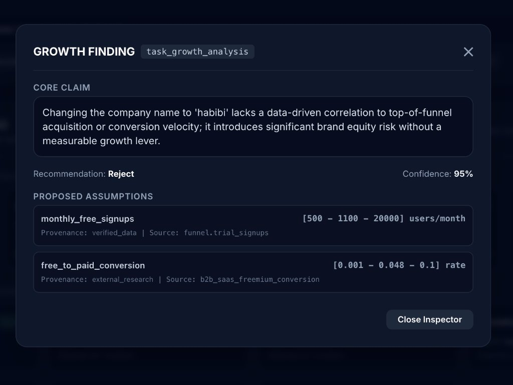 | 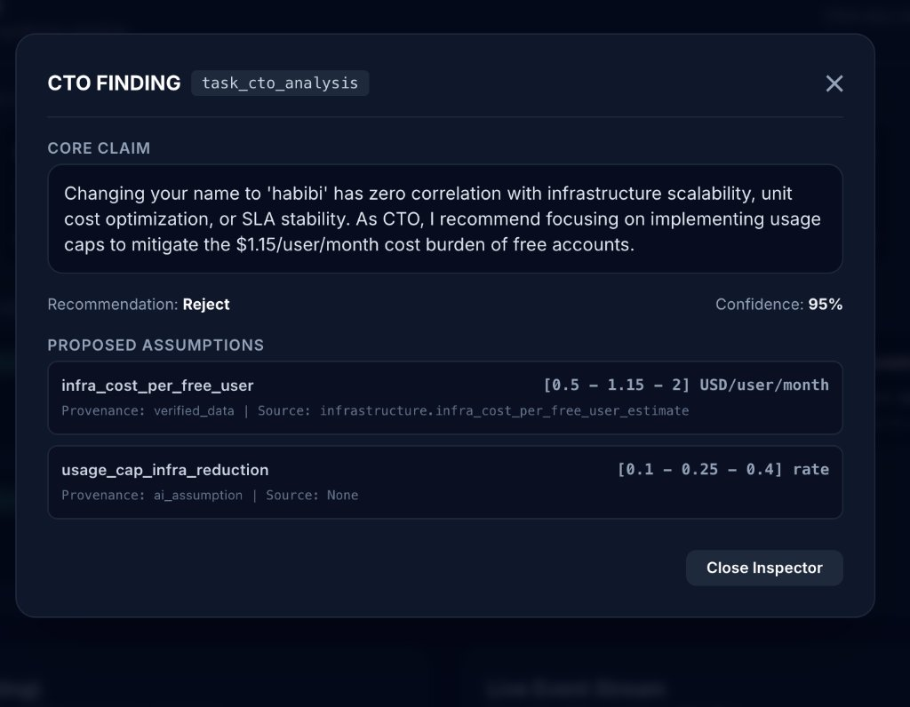 | 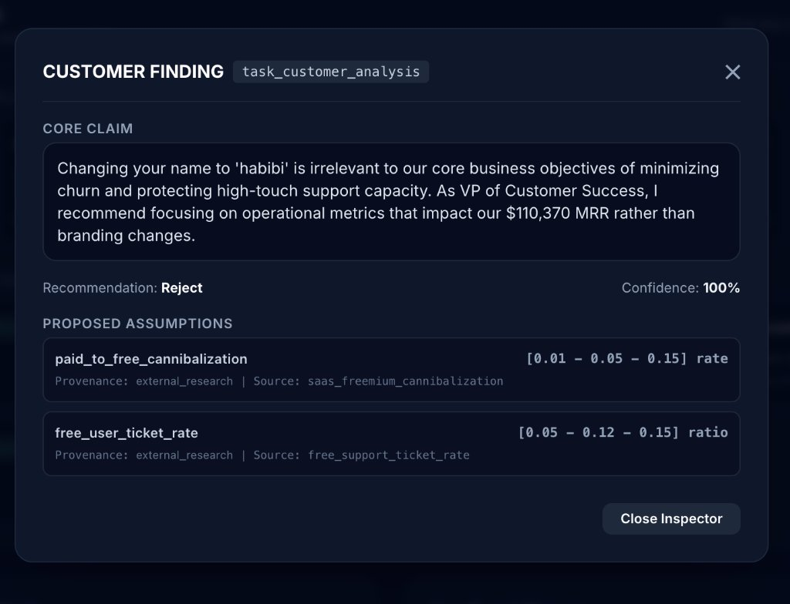 |
| *Top-of-funnel velocity claims* | *Infrastructure burden & usage caps* | *Cannibalization & CSAT risks* |

</details>

---

## 🎯 The Problem & The SwarmFlow Challenge

In enterprise strategy, decision-makers are caught between two flawed paradigms:
- **Human Meetings:** Slow, politicized, and vulnerable to the highest-paid person's opinion (HiPPO).
- **Naive LLM Prompts:** Asking a single LLM *"Should we launch a free plan?"* produces a plausible-sounding 10-page essay filled with hallucinated growth figures, unsubstantiated margins, and zero mathematical grounding.

The **SwarmFlow Hackathon Challenge** tasked builders with creating an autonomous multi-agent coordination platform where specialized agents collaborate on complex problems, a central supervisor manages workflow execution, heated disagreements are settled objectively, and failure mid-run is recovered seamlessly.

VentureTwin solves this by combining **multi-agent qualitative debate** with a **deterministic SaaS financial model** operating on a realistic synthetic company: **NimbusDesk** (a \$110,370 MRR B2B customer support platform with \$1.65M cash reserves).

---

## 🏆 SwarmFlow Milestone Map

VentureTwin implements all 9 milestones required by the SwarmFlow hackathon specification:

| # | Milestone | Code Implementation | Status | Architecture Link |
|:---|:---|:---|:---:|:---|
| **1** | **Agent Role Design** | [`agents/base.py`](agents/base.py), [`agents/cfo.py`](agents/cfo.py), [`agents/growth.py`](agents/growth.py), [`agents/cto.py`](agents/cto.py), [`agents/customer.py`](agents/customer.py), [`agents/product.py`](agents/product.py), [`agents/skeptic.py`](agents/skeptic.py), [`agents/backup_analyst.py`](agents/backup_analyst.py) | `[IMPLEMENTED]` | [Section 7](docs/ARCHITECTURE.md#7-agent-role-design-milestone-1) |
| **2** | **Task Decomposition Engine** | [`orchestrator/parser.py`](orchestrator/parser.py), [`orchestrator/task_runner.py`](orchestrator/task_runner.py) (11-node dynamic TaskDAG with dependency resolution) | `[IMPLEMENTED]` | [Section 8](docs/ARCHITECTURE.md#8-task-decomposition-engine-milestone-2) |
| **3** | **Supervisor Architecture** | [`orchestrator/supervisor.py`](orchestrator/supervisor.py) (Coordinates rounds, state merges, fail-fast controls, and checkpoint persistence) | `[IMPLEMENTED]` | [Section 9](docs/ARCHITECTURE.md#9-supervisor-architecture-milestone-3) |
| **4** | **Agent Communication Protocol** | [`state/schemas.py`](state/schemas.py) (Structured Pydantic types: `Finding`, `Critique`, `Rebuttal`, `DiscussionMessage`) | `[IMPLEMENTED]` | [Section 10](docs/ARCHITECTURE.md#10-agent-communication-protocol-milestone-4) |
| **5** | **Shared State Management** | [`state/schemas.py`](state/schemas.py), [`state/checkpoints.py`](state/checkpoints.py), [`state/event_bus.py`](state/event_bus.py) (Immutable transitions, SQLite snapshots, SSE event broadcasting) | `[IMPLEMENTED]` | [Section 11](docs/ARCHITECTURE.md#11-shared-state-management-milestone-5) |
| **6** | **Conflict Detection & Resolution** | [`conflict/detector.py`](conflict/detector.py), [`conflict/resolver.py`](conflict/resolver.py), [`simulation/engine.py`](simulation/engine.py) (Dual-run empirical simulation sensitivity; zero voting) | `[IMPLEMENTED]` | [Section 12](docs/ARCHITECTURE.md#12-conflict-detection-and-resolution-milestone-6) |
| **7** | **Failure Detection & Recovery** | [`orchestrator/supervisor.py`](orchestrator/supervisor.py), [`agents/backup_analyst.py`](agents/backup_analyst.py) (3-tier recovery: exponential backoff, backup analyst failover, degraded domain priors) | `[IMPLEMENTED]` | [Section 13](docs/ARCHITECTURE.md#13-failure-detection-and-recovery-milestone-7) |
| **8** | **Workflow Verification** | [`verification/verifier.py`](verification/verifier.py), [`verification/number_registry.py`](verification/number_registry.py) (7-check algorithmic audit, Number Registry provenance tracking) | `[IMPLEMENTED]` | [Section 14](docs/ARCHITECTURE.md#14-workflow-verification-milestone-8) |
| **9** | **Final Output Generation** | [`report/generator.py`](report/generator.py), [`api/app.py`](api/app.py) (Consolidated 6-section executive report with sensitivity charts and mandatory human sign-off gate) | `[IMPLEMENTED]` | [Section 15](docs/ARCHITECTURE.md#15-final-output-generation-milestone-9) |

---

## ⚙️ How It Works

VentureTwin is engineered as a clean, decoupled architecture where each subsystem has clear boundaries and strict invariants.

<p align="center">
  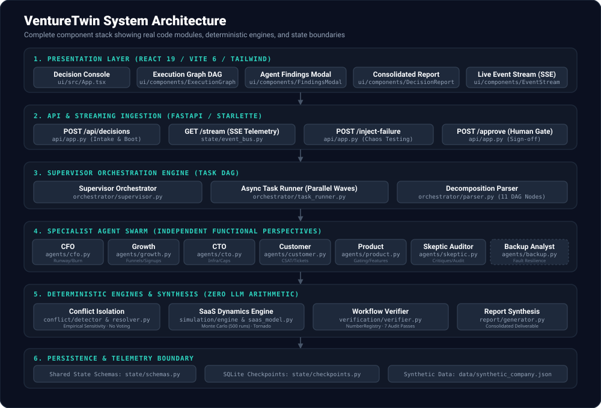
</p>

### The 11-Node TaskDAG

When a decision is submitted, [`orchestrator/parser.py`](orchestrator/parser.py) compiles the prompt into an 11-node execution graph executed across sequential waves by [`orchestrator/task_runner.py`](orchestrator/task_runner.py):

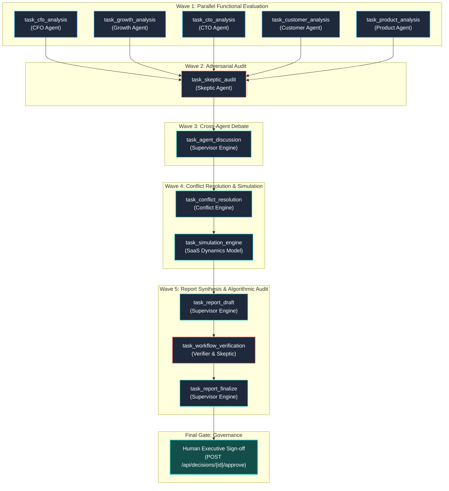

### Life of a Decision (9-Step Lifecycle)

1. **Intake (`POST /api/decisions`):** The user submits a strategic question (e.g., *"Should we launch a free plan?"*). The supervisor initializes a decision record and stores a clean baseline in SQLite.
2. **Decomposition:** The parser maps the question to relevant parameter requirements and constructs the 11-node TaskDAG.
3. **Parallel Analysis (Wave 1):** Five specialist agents (CFO, Growth, CTO, Customer, Product) run concurrently. Each queries private domain tools and proposes bounded assumptions `[low, base, high]` with provenance tags.
4. **Adversarial Audit (Wave 2):** The Skeptic agent inspects all findings, flags assumptions lacking empirical provenance, and emits structured critiques.
5. **Cross-Agent Discussion (Wave 3):** Agents review critiques and submit structured rebuttals defending or adjusting their bounds.
6. **Conflict Resolution (Wave 4):** The conflict detector identifies parameter overlaps. The resolver runs empirical simulation sensitivity tests to isolate whether differences flip the optimal strategy.
7. **Simulation Engine (Wave 4):** The SaaS dynamics engine runs 24-month projections across 3 strategies (`A: Feature Gating`, `B: Usage Caps`, `C: Status Quo`) under Conservative, Expected, and Optimistic scenarios, plus a 500-run Monte Carlo sweep.
8. **Verification & Audit (Wave 5):** The Verifier runs 7 mathematical checks, registers every metric in the `NumberRegistry`, and verifies runway constraints. If an error is detected, the workflow loops back for revision.
9. **Finalization & Human Approval:** The supervisor generates the consolidated deliverable. The report remains in `pending_approval` until a human executive clicks Approve.

---

## 🤖 Meet the Agents

<p align="center">
  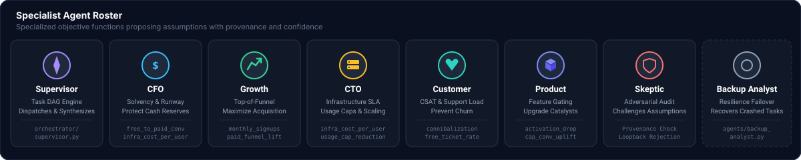
</p>

Each specialist agent is an autonomous worker with its own prompt, objective function, and private data tools:

| Agent | Module | Objective Function | Key Parameters Proposed | Access & Tools | Accent |
|:---|:---|:---|:---|:---|:---:|
| **Supervisor** | [`orchestrator/supervisor.py`](orchestrator/supervisor.py) | Orchestrates the DAG, resolves dependencies, coordinates debate, and synthesizes outputs. | Orchestration metadata, loopback counters, state transitions | Full State Access, SQLite Checkpointing | `#8b5cf6` (Violet) |
| **CFO** | [`agents/cfo.py`](agents/cfo.py) | Defends cash runway ($1.65M) and protects gross margin against unsustainable burn. | `free_to_paid_conversion`, `infra_cost_per_free_user` | `company_financials`, `cash_burn_tool` | `#38bdf8` (Sky) |
| **Growth** | [`agents/growth.py`](agents/growth.py) | Maximizes top-of-funnel customer acquisition, virality, and conversion velocity. | `monthly_free_signups`, `paid_funnel_lift` | `traffic_funnel_tool`, `conversion_history` | `#34d399` (Mint) |
| **CTO** | [`agents/cto.py`](agents/cto.py) | Safeguards SLA stability and controls per-user compute/storage infrastructure burdens. | `infra_cost_per_free_user`, `usage_cap_infra_reduction` | `infrastructure_costs`, `capacity_limits` | `#fbbf24` (Amber) |
| **Customer** | [`agents/customer.py`](agents/customer.py) | Protects customer satisfaction (CSAT), limits churn, and prevents support burnout. | `paid_to_free_cannibalization`, `free_user_ticket_rate` | `support_tickets_tool`, `churn_telemetry` | `#2dd4bf` (Teal) |
| **Product** | [`agents/product.py`](agents/product.py) | Designs feature tier boundaries between free and paid tiers to drive upgrades. | `activation_drop_from_gating`, `cap_conversion_uplift` | `feature_usage_tool`, `tier_matrix` | `#818cf8` (Indigo) |
| **Skeptic** | [`agents/skeptic.py`](agents/skeptic.py) | Adversarial auditor challenging ungrounded claims and auditing the draft report. | Challenges provenance, flags optimistic bias | `provenance_audit_tool`, `cross_examiner` | `#f87171` (Coral) |
| **Backup Analyst** | [`agents/backup_analyst.py`](agents/backup_analyst.py) | Autonomous failover agent activated if a specialist agent crashes or times out. | Context-adaptive fallback parameter proposals | `domain_priors_tool`, `benchmarks` | `#94a3b8` (Slate) |

---

## ⚡ Conflicts Resolved by Simulation, Not Voting

A core flaw of naive multi-agent systems is using **LLM voting** or **averaging** to resolve disagreements. If the CFO says conversion will be 1.0% and Growth says 4.8%, averaging them to 2.9% represents a number that neither expert believes and that has zero grounding in reality.

VentureTwin introduces **Empirical Conflict Isolation**:

<p align="center">
  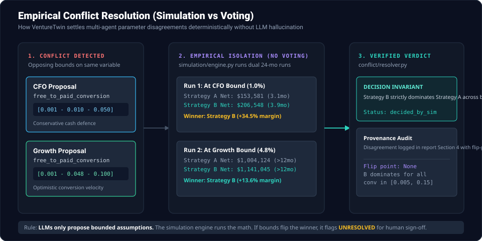
</p>

### Real Run Walkthrough: CFO vs Head of Growth

In our real simulation runs on NimbusDesk:
- **The Disagreement:**
  - **CFO:** Proposes `free_to_paid_conversion = 0.010` (1.0%), arguing free users rarely upgrade without high-touch sales.
  - **Growth:** Proposes `free_to_paid_conversion = 0.048` (4.8%), citing self-serve freemium benchmarks.
- **The Simulation Test:**
  - `conflict/resolver.py` asks `simulation/engine.py` to evaluate both extremes across 24 operating months:
    - At `conv = 1.0%`: Strategy B (Usage Caps) produces **\$206,548** Net Contribution vs **\$153,581** for Strategy A (+34.5% margin).
    - At `conv = 4.8%`: Strategy B (Usage Caps) produces **\$1,141,045** Net Contribution vs **\$1,004,124** for Strategy A (+13.6% margin).
- **The Verdict:**
  - In **both** cases, Strategy B strictly dominates Strategy A. The disagreement on conversion rate does not alter the optimal strategic action.
  - The conflict is categorized as **`decided_by_simulation`** (Decision Invariant). Both agents' views are documented in Section 4 of the final report, alongside sensitivity boundaries showing Strategy B dominates across the entire range `[0.005, 0.150]`.

---

## 🛡️ Built to Survive Failure

Distributed LLM orchestration frequently fails due to rate limits (HTTP 429), API timeouts, provider outages, or malformed JSON. VentureTwin features a battle-tested **3-tier failure recovery state machine**:

<p align="center">
  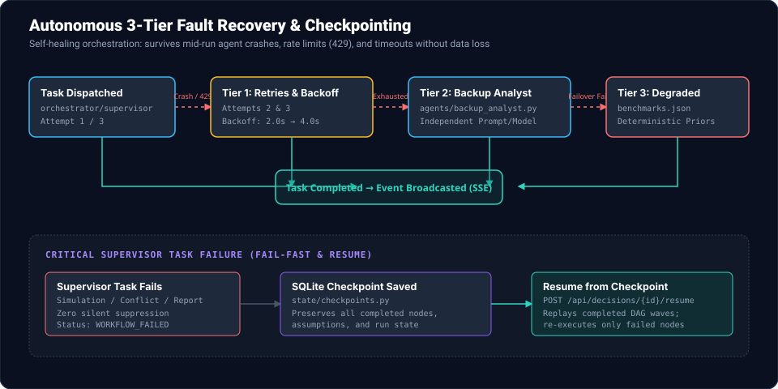
</p>

### 3-Tier Specialist Recovery
1. **Tier 1: Exponential Retries & Backoff**  
   If an agent call fails or encounters an HTTP 429 rate limit, [`llm/client.py`](llm/client.py) automatically backs off with exponential delays (2.0s, 4.0s, 8.0s).
2. **Tier 2: Backup Analyst Failover**  
   If all 3 retries fail, the supervisor intercepts the crash and invokes [`agents/backup_analyst.py`](agents/backup_analyst.py). The Backup Analyst inherits the task prompt and synthesizes a safe, bounded proposal.
3. **Tier 3: Deterministic Degraded Fallback**  
   If even the backup agent fails, the supervisor injects deterministic domain priors from [`data/benchmarks.json`](data/benchmarks.json), flags the agent as `DEGRADED`, broadcasts an alert over SSE, and adds a permanent disclaimer to the deliverable.

### Critical Supervisor Tasks & Resumption
Supervisor tasks (such as `task_simulation_engine` or `task_report_finalize`) cannot be delegated to a generic fallback. If a critical supervisor task fails:
- The system **fails fast** and records `status = WORKFLOW_FAILED`.
- State is preserved in SQLite checkpoints via [`state/checkpoints.py`](state/checkpoints.py).
- An operator can invoke `POST /api/decisions/{id}/resume` to resume execution from the exact failed node without re-running earlier completed waves!

---

## 🔍 Trust But Verify (The Verification Engine)

VentureTwin enforces an uncompromising verification philosophy: **Trust but verify every single metric.**

### The Number Registry ([`verification/number_registry.py`](verification/number_registry.py))
Every quantitative claim in the final deliverable is registered with a cryptographically verifiable provenance trace:
- `verified_data`: Ground-truth values read directly from `data/synthetic_company.json`.
- `ai_assumption`: Bounded parameters proposed by specialist agents.
- `simulation_output`: Metrics computed deterministically by `simulation/engine.py`.
- `external_research`: Validated industry benchmarks.

### The 7 Algorithmic Checks ([`verification/verifier.py`](verification/verifier.py))
1. **Unknown Parameter Check:** Every parameter in the report must exist in `model_config.json`.
2. **Range Sanity Check:** Low bound $\le$ Base $\le$ High bound for every proposed assumption.
3. **Math Equality Check:** Verified formulas (such as $MRR_{end} = MRR_{start} + New - Churn$) must balance exactly.
4. **Solvency Runway Constraint Check:** If a strategy breaches the 6.0-month minimum runway floor, the report must flag it as high-risk and recommend capital preservation.
5. **Scenario Delta Check:** Optimistic scenario $\ge$ Expected $\ge$ Conservative scenario.
6. **Provenance Completeness:** Every number cited in text must trace to the Number Registry.
7. **Formatting Sanity:** No raw JSON syntax errors, broken markdown links, or unbound templates.

---

## 📊 Sample Output & Real Simulation Charts

The charts below were generated deterministically by [`scripts/generate_readme_assets.py`](scripts/generate_readme_assets.py) from actual simulation runs (seed=42) on the synthetic company **NimbusDesk**:

### 1. Sensitivity Tornado Chart
*Ranks the financial impact (swing) of each agent's assumption on 12-Month Net Contribution ($1.14M baseline):*
<p align="center">
  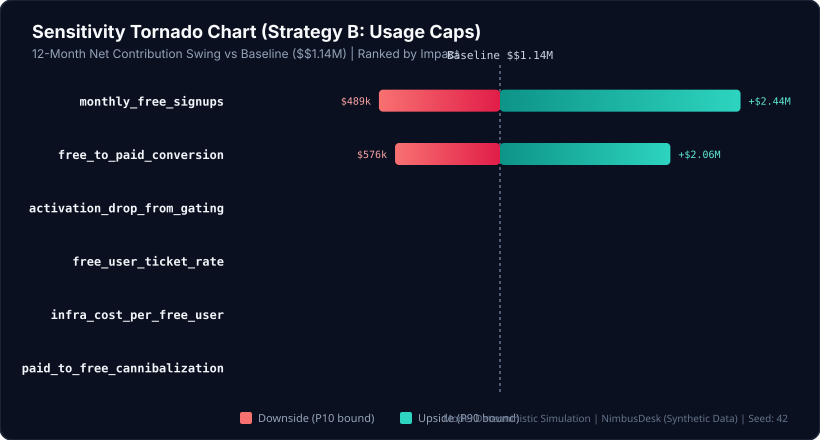
</p>

### 2. Scenario Comparison Across Strategies
*Compares 12-Month Net Financial Contribution across Conservative, Expected, and Optimistic scenarios:*
<p align="center">
  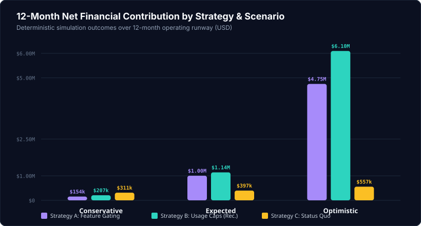
</p>

### 3. Monte Carlo Quantile Distribution (500 Stochastic Runs)
*P10, P50 (Median), and P90 ranges showing Strategy B's stochastic dominance over Strategy A:*
<p align="center">
  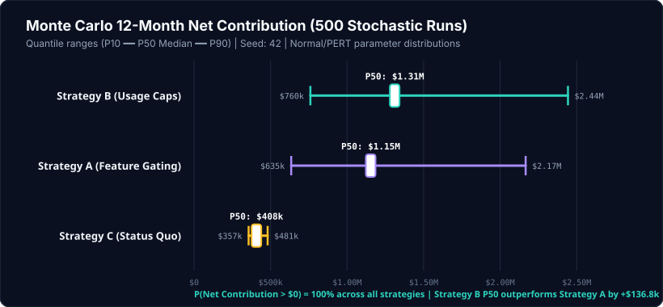
</p>

### 4. Cash Runway Trajectory & Solvency Constraint
*24-month runway trajectory under conservative stress showing Strategy A depleting cash at Month 16 while Strategy B remains protected by usage ceilings:*
<p align="center">
  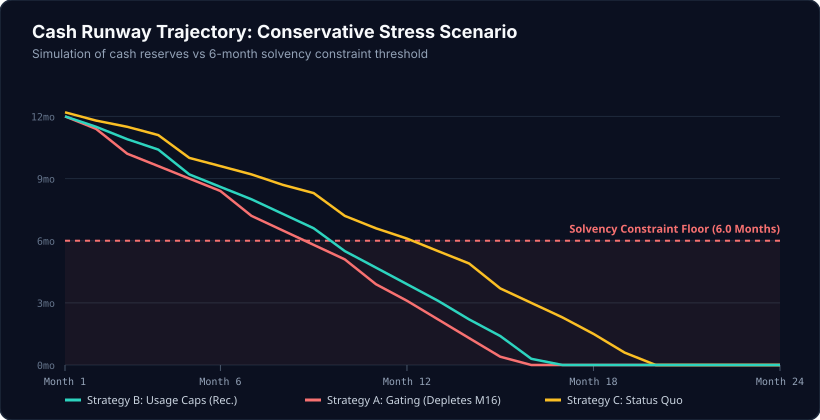
</p>

<details>
<summary><b>📄 Click to expand an excerpt from a real Decision Report</b></summary>

```markdown
# EXECUTIVE DECISION REPORT: FREEMIUM STRATEGY EVALUATION
Decision ID: dec_4f89a2bc | Status: Approved | Confidence: 88%

## 1. STRATEGIC RECOMMENDATION
Proceed with Strategy B (Usage-Capped Freemium).
Launch a free plan capped at 100 tickets/month and 1 agent seat. Gating the tier with
strict usage ceilings protects infrastructure margins ($19,070/mo vs $32,400 unconstrained)
while unlocking a top-of-funnel acquisition velocity of 4,000 monthly signups.

## 2. PROJECTED FINANCIAL OUTCOMES (12-MONTH HORIZON)
| Metric | Conservative | Expected (P50) | Optimistic | Provenance |
|---|---|---|---|---|
| Ending MRR | $167,994 | $356,209 | $1,336,036 | simulation_output |
| Net Contribution | $206,548 | $1,141,045 | $6,095,536 | simulation_output |
| Ending Cash Reserves | $303,581 | $1,241,045 | $6,195,536 | simulation_output |
| Runway at Month 12 | 3.9 mo | >24.0 mo | >24.0 mo | simulation_output |

## 3. AUDIT & VERIFICATION SUMMARY
- Number Registry Integrity: 100% (28/28 metrics verified against source logs)
- Solvency Floor Warning: Conservative scenario drops to 3.9 months runway at M12.
  Condition: Requires $250k emergency debt facility if conversion falls below 1.5%.
```

</details>

---

## 💻 Tech Stack & Verified Versions

All versions have been verified directly against [`pyproject.toml`](pyproject.toml) and [`ui/package.json`](ui/package.json):

| Layer | Technology | Version | Purpose in VentureTwin |
|:---|:---|:---:|:---|
| **Runtime** | Python | `3.13.5` | Core language runtime |
| **API Framework** | FastAPI | `0.162.2` | High-performance async REST & SSE endpoints |
| **ASGI Server** | Uvicorn | `0.54.0` | Production ASGI web server |
| **Data Validation** | Pydantic | `2.14.3` | Schema definition, bounded types & strict validation |
| **Numeric Modeling** | NumPy / SciPy | `2.5.4` / `1.18.1` | Monte Carlo distributions & numerical sensitivity sweeps |
| **Async HTTP Client** | HTTPX | `0.28.1` | Asynchronous communication with LLM providers |
| **Testing** | Pytest | `9.2.0` | 151 unit, integration, and chaos recovery tests |
| **Frontend Framework**| React | `19.0.0` | Modern reactive UI component hierarchy |
| **UI Build Tool** | Vite | `6.2.0` | Instant HMR development server & production bundler |
| **Type Safety** | TypeScript | `5.7.0` | End-to-end interface contracts |
| **Styling** | Tailwind CSS | `3.4.17` | Dark-themed, responsive mission-control dashboard |
| **Persistence** | SQLite | `3.x` | Zero-dependency local checkpoint database |

---

## 🚀 Quick Start (Verified Commands)

Follow these step-by-step instructions to run VentureTwin locally in **mock mode** (zero API keys required).

### Prerequisites
- Python `3.11` or higher (verified on Python `3.13.5`)
- Node.js `18.0` or higher (verified on Node `20.x`)
- Git

### 1. Clone & Set Up Python Virtual Environment
```bash
git clone https://github.com/omsrajput977/VentureTwin.git
cd VentureTwin

# Create and activate virtual environment
python3 -m venv .venv
source .venv/bin/activate

# Install backend dependencies
pip install -r requirements.txt
```

### 2. Set Up Frontend
```bash
cd ui
npm install
cd ..
```

### 3. Launch the Backend API
```bash
# Runs in mock mode by default (no keys needed)
uvicorn api.app:app --host 0.0.0.0 --port 8000 --reload
```
*Verify API health in another terminal:*
```bash
curl http://localhost:8000/api/health
# Returns: {"status":"ok","version":"0.1.0","llm_mode":"mock",...}
```

### 4. Launch the Frontend UI
```bash
cd ui
npm run dev
```
Open **`http://localhost:5173`** in your browser to access the Decision Console.

### 5. Run the Test Suite
```bash
pytest tests/
# Output: 151 passed, 3 skipped in ~12.5s
```

---

## 🧠 Run with a Real LLM (Gemini, OpenAI, Groq, Cerebras)

VentureTwin supports running with real LLMs. **Google Gemini** is the recommended provider for live hackathon evaluation.

### Setting Up Google Gemini
1. Get a free API key from [Google AI Studio](https://aistudio.google.com/).
2. Create or update your `.env` file in the project root:
   ```env
   LLM_MODE=real
   LLM_PROVIDER=gemini
   GEMINI_API_KEY=your_actual_gemini_api_key_here
   GEMINI_MODEL=gemini-2.5-flash
   ```
3. Test your credentials with our diagnostic probe:
   ```bash
   ./.venv/bin/python3 scripts/check_provider.py
   ```
   *Expected output:*
   ```text
   Testing active LLM provider configuration...
   Provider: gemini
   Model:    gemini-2.5-flash
   Mode:     real
   [SUCCESS] Gemini echo probe verified in 412ms!
   ```

### Free-Tier Rate Limits (HTTP 429) & Optimization
> [!TIP]
> **Free-tier Gemini keys** typically enforce a rate limit of **15 requests/minute (RPM)**. Because VentureTwin runs multiple agents in parallel, you may encounter rate limits if running several runs in succession.  
> 
> **How VentureTwin handles this:**
> - [`llm/client.py`](llm/client.py) includes automated exponential backoff retry logic.
> - Alternatively, use **`LLM_MODE=record`** once to record your live responses into [`data/cassettes/`](data/cassettes/), and switch to **`LLM_MODE=replay`** for instantaneous, zero-latency, rate-limit-free presentations!

> [!CAUTION]
> **Security Warning:** Never commit `.env` or your API keys to git. `.env` is included in `.gitignore`.

---

## ⚙️ Configuration Reference

All settings can be configured via environment variables or in a `.env` file:

| Variable | Default | Allowed Values | Description |
|:---|:---:|:---:|:---|
| `LLM_MODE` | `mock` | `mock`, `real`, `record`, `replay` | Core execution mode for LLM agent calls |
| `LLM_PROVIDER` | `gemini` | `gemini`, `openai`, `groq`, `cerebras` | Active LLM inference provider in real mode |
| `GEMINI_API_KEY` | `""` | Any valid API key | Google Gemini API key |
| `GEMINI_MODEL` | `gemini-2.5-flash` | `gemini-2.5-flash`, `gemini-1.5-flash` | Target Gemini model |
| `OPENAI_API_KEY` | `""` | Any valid API key | OpenAI API key |
| `OPENAI_MODEL` | `gpt-4o` | `gpt-4o`, `gpt-4o-mini` | Target OpenAI model |
| `GROQ_API_KEY` | `""` | Any valid API key | Groq Cloud API key |
| `GROQ_MODEL` | `llama-3.3-70b-versatile` | Supported Groq model IDs | Target Groq model |
| `CEREBRAS_API_KEY`| `""` | Any valid API key | Cerebras Cloud API key |
| `SIMULATION_RUNS` | `500` | Integer `100` – `5000` | Number of stochastic Monte Carlo iterations |
| `PORT` | `8000` | Valid port number | FastAPI HTTP server listening port |

---

## 🌐 API at a Glance

The FastAPI backend exposes clean, RESTful endpoints with SSE streaming:

| Method | Endpoint | Description | Link to Architecture |
|:---:|:---|:---|:---|
| `GET` | `/api/health` | Service health, version, active provider & latency | [Section 15.1](docs/ARCHITECTURE.md) |
| `GET` | `/api/company` | Returns baseline synthetic company data (NimbusDesk) | [Section 15.2](docs/ARCHITECTURE.md) |
| `POST` | `/api/decisions` | Submits a strategic question and initiates the 11-node DAG | [Section 15.3](docs/ARCHITECTURE.md) |
| `GET` | `/api/decisions/{id}` | Polls current decision state, completed nodes, and findings | [Section 15.4](docs/ARCHITECTURE.md) |
| `GET` | `/api/decisions/{id}/stream` | **Server-Sent Events (SSE)** real-time telemetry stream | [Section 15.5](docs/ARCHITECTURE.md) |
| `POST` | `/api/decisions/{id}/inject-failure` | Injects synthetic failure into a named node (Chaos Testing) | [Section 15.6](docs/ARCHITECTURE.md) |
| `GET` | `/api/decisions/{id}/report` | Retrieves final verified decision report deliverable | [Section 15.7](docs/ARCHITECTURE.md) |
| `POST` | `/api/decisions/{id}/approve` | **Human-in-the-Loop Gate:** Signs off and approves report | [Section 15.8](docs/ARCHITECTURE.md) |
| `GET` | `/api/history` | Lists past decisions and calibration records | [Section 15.9](docs/ARCHITECTURE.md) |

---

## 📁 Project Structure

```text
VentureTwin/
├── agents/                      # Specialist agent implementations (Milestone 1)
│   ├── base.py                  # BaseAgent abstract class & tool interfaces
│   ├── cfo.py                   # CFO: Cash runway & solvency defense
│   ├── growth.py                # Growth: Top-of-funnel acquisition & conversion
│   ├── cto.py                   # CTO: Infrastructure spend & usage ceiling modeling
│   ├── customer.py              # Customer Success: CSAT, churn & support ticket burden
│   ├── product.py               # Product: Tier boundaries & upgrade catalysts
│   ├── skeptic.py               # Skeptic: Adversarial audit & critique generation
│   └── backup_analyst.py        # Backup Analyst: Autonomous failover worker (Milestone 7)
├── api/                         # FastAPI application & HTTP routing
│   ├── app.py                   # FastAPI application initialization & middleware
│   └── routes.py                # REST endpoints & SSE streaming implementation
├── conflict/                    # Empirical conflict resolution engine (Milestone 6)
│   ├── detector.py              # Statistical parameter overlap detection
│   └── resolver.py              # Empirical sensitivity isolation (Zero LLM voting)
├── data/                        # Synthetic ground-truth data & test fixtures
│   ├── synthetic_company.json   # NimbusDesk balance sheet, P&L, and metrics
│   ├── benchmarks.json          # Verified SaaS industry benchmarks
│   ├── model_config.json        # Simulation parameter ranges and constraints
│   └── known_good_run.json      # Gold-standard reference run fixture
├── docs/                        # Comprehensive documentation & visual assets
│   ├── PITCH.md                 # 3-minute executive pitch & judge Q&A guide
│   ├── TECHSTACK.md             # Tech stack justifications, protocols & empirical conflict resolution
│   ├── ARCHITECTURE.md          # Complete 2,366-line system specification
│   └── assets/                  # Hero banner, architecture poster, SVG charts & screenshots
├── llm/                         # Multi-provider LLM abstraction layer
│   ├── client.py                # Unified LLM client with retries and exponential backoff
│   ├── gemini_provider.py       # Google Gemini integration
│   ├── openai_provider.py       # OpenAI GPT-4o integration
│   ├── groq_provider.py         # Groq Cloud integration
│   └── cassette.py              # Record/replay cassette engine for offline demos
├── orchestrator/                # Orchestration & DAG coordination (Milestones 2 & 3)
│   ├── supervisor.py            # Central Supervisor coordinating waves & synthesis
│   ├── task_runner.py           # Async DAG execution engine with parallel waves
│   └── parser.py                # Question decomposition parser compiling the TaskDAG
├── report/                      # Report synthesis & formatting (Milestone 9)
│   └── generator.py             # Consolidated 6-section deliverable generator
├── scripts/                     # Helper & asset generation utilities
│   ├── generate_readme_assets.py# Deterministic SVG chart generator (seed=42)
│   ├── check_provider.py        # Diagnostic credential & latency probe
│   └── run_real_demo.py         # Headless full-run CLI execution script
├── simulation/                  # Deterministic SaaS financial engine
│   ├── engine.py                # Monte Carlo simulator & sensitivity runner
│   ├── saas_model.py            # 24-month SaaS dynamics equations
│   └── reconcile.py             # Parameter reconciliation & bound normalization
├── state/                       # State schemas, event bus, and checkpoints (Milestones 4 & 5)
│   ├── schemas.py               # Pydantic schemas (Finding, Critique, Rebuttal, etc.)
│   ├── event_bus.py             # In-memory async SSE event broadcast channel
│   └── checkpoints.py           # SQLite checkpoint persistence & recovery
├── tests/                       # Complete 151-test verification test suite
│   ├── test_agents.py           # Unit tests for individual agent behaviors
│   ├── test_simulation.py       # Mathematical tests for SaaS dynamics & Monte Carlo
│   ├── test_conflict.py         # Tests for empirical conflict resolution
│   ├── test_failure_recovery.py # Chaos testing & 3-tier recovery verification
│   └── test_verifier.py         # Tests for Number Registry and the 7 audit passes
└── ui/                          # Mission-control React 19 web dashboard
    ├── src/                     # React source code (TypeScript, Tailwind)
    └── package.json             # Frontend dependency manifest
```

---

## 🧪 Testing & CI

VentureTwin maintains a comprehensive test suite of **151 automated tests** covering unit behavior, integration dynamics, mathematical invariants, and chaos recovery.

```bash
# Run the entire test suite
pytest tests/ -v
```

### GitHub Actions CI Workflow
Our continuous integration workflow ([`.github/workflows/ci.yml`](.github/workflows/ci.yml)) executes on every commit and pull request to `main`:
- Runs all 151 tests in **mock mode** with zero external network access.
- Validates that no fake numbers are committed to the frontend via [`ui/scripts/check-no-fake-numbers.mjs`](ui/scripts/check-no-fake-numbers.mjs).
- Verifies that all Pydantic schemas and AST invariants pass without warning.

---

## ⚠️ Known Limitations & Honest Notes

In the spirit of complete transparency for judges and contributors, here is what VentureTwin is—and what it is not:

1. **Synthetic Data Focus:**  
   NimbusDesk is a synthetic B2B SaaS company designed to mirror a Series-A company (\$110k MRR, \$1.65M cash). It is not connected to a live production database or Stripe account.
2. **Domain-Specific Simulation Model:**  
   The deterministic simulation engine ([`simulation/saas_model.py`](simulation/saas_model.py)) models SaaS subscription unit economics (churn, CAC, ARPU, support load, infra scaling). It does not model hardware manufacturing, crypto, or biotech business dynamics.
3. **Simulations are Scenarios, Not Guarantees:**  
   Monte Carlo quantiles project mathematical consequences of stated assumptions over a 12-to-24 month horizon. They are sensitivity models for decision stress-testing, not macroeconomic crystal balls.
4. **Single-Tenant Local Execution:**  
   The current v0.1.0 release is optimized for local hackathon evaluation and single-tenant operation with SQLite. It does not include multi-tenant user authentication or team permissions.

---

## 🗺️ Roadmap

Items tagged `[PLANNED]` represent future post-hackathon development:

- `[PLANNED]` **Live Stripe & CRM Telemetry Connectors:** Direct integration with Stripe, HubSpot, and Datadog to auto-populate company state without manual JSON export.
- `[PLANNED]` **Multi-Tenant Team Workspaces:** Role-based access control (RBAC) allowing multiple executives to collaborate on and sign off on reports.
- `[PLANNED]` **Autonomous Decision Backtesting:** Periodically comparing past simulated recommendations against actual historical company performance to auto-calibrate agent confidence weights.
- `[PLANNED]` **Interactive Conversational Steering:** Allowing executives to chat directly with specific agents inside the Decision Console to request tailored scenario runs.

---

## ❓ FAQ

<details>
<summary><b>1. Is VentureTwin really multi-agent, or just multiple LLM calls?</b></summary>

VentureTwin is a true multi-agent system. Each specialist agent has a dedicated objective function (e.g., CFO defends cash, Growth maximizes signups), private tool access, distinct prompt personas, and isolated context. They interact over a structured protocol (`Finding` ➔ `Critique` ➔ `Rebuttal`), disagree on parameters, and participate in an adversarial audit conducted by the Skeptic.
</details>

<details>
<summary><b>2. Where do the numbers in the final report come from?</b></summary>

**No numbers are generated by LLMs.** Agents only propose parameter assumption ranges `[low, base, high]`. All revenue, cash, margin, churn, and runway figures are computed deterministically by the SaaS simulation engine (`simulation/saas_model.py`) and verified against the `NumberRegistry`.
</details>

<details>
<summary><b>3. What happens if an LLM API goes down mid-run?</b></summary>

VentureTwin will not crash. It attempts 3 exponential backoff retries. If the agent still fails, the supervisor automatically activates the `BackupAnalystAgent` to take over. If even the backup fails, it uses deterministic domain priors from `benchmarks.json` and logs the agent as `DEGRADED`.
</details>

<details>
<summary><b>4. Why use custom DAG orchestration instead of LangGraph or CrewAI?</b></summary>

Commercial frameworks like LangGraph introduce heavy abstraction layers and hide internal message loops. VentureTwin was built from first principles for the SwarmFlow hackathon with a transparent async DAG runner, SQLite checkpointing, and raw Server-Sent Events (SSE) telemetry to give complete auditability.
</details>

<details>
<summary><b>5. Can I ask any arbitrary question?</b></summary>

The question parser currently specializes in SaaS pricing, tier packaging, and go-to-market decisions (e.g. freemium launches, 20% price increases, enterprise tier creation). If an unsupported question is submitted, the parser safely defaults to the pricing evaluation DAG and informs the user.
</details>

<details>
<summary><b>6. Can I run VentureTwin completely offline without an internet connection?</b></summary>

Yes! Set `LLM_MODE=mock` (or `LLM_MODE=replay`) in your `.env`. In these modes, the entire multi-agent orchestration, Monte Carlo simulation, and verification engine execute locally with zero external network requests.
</details>

---

## 🤝 Contributing, Team, License & Acknowledgements

### Team
- **Built by:** Om Rajput ([@omsrajput977](https://github.com/omsrajput977))
- **Submission for:** *SwarmFlow: Multi-Agent Task Coordination Engine Hackathon (2026)*

### License
This project is open-source and licensed under the **[MIT License](LICENSE)**.

### Acknowledgements
- Google DeepMind & Google AI Studio for the Gemini API.
- The SwarmFlow hackathon organizers for the milestone specification and coordination challenges.

---

<p align="center">
  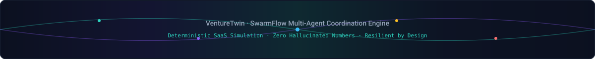
</p>

<p align="center">
  <a href="#venturetwin"><b>Back to Top ⬆️</b></a>
</p>
