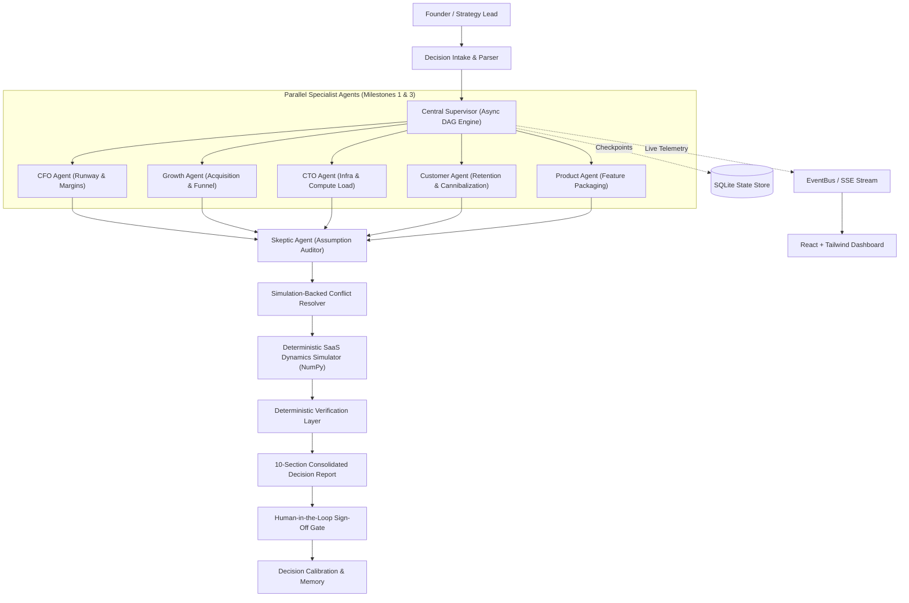

# VentureTwin

> **AI Flight Simulator & Operational Digital Twin for SaaS CEOs**  
> *Built for the SwarmFlow: Multi-Agent Task Coordination Engine Hackathon*

[](file:///Users/omrajput/Desktop/Projects/VentureTwin/tests)
[](file:///Users/omrajput/Desktop/Projects/VentureTwin/ui/scripts/check-no-fake-numbers.mjs)
[](#architecture)

---

## 🎯 Executive Summary

**VentureTwin** is a decision stress-test platform and operational digital twin for SaaS pricing and packaging decisions. When a founder or leadership team asks a high-stakes question (e.g. *"Should we launch a free plan?"*), VentureTwin orchestrates a virtual executive board of specialized AI agents running in parallel, detects disagreements, resolves conflicts via deterministic simulation rather than voting, survives runtime agent failures, and produces one consolidated, verified decision report.

**Core Pitch:** *"An orchestration engine where agents disagree, conflicts are resolved by simulation instead of voting, no number comes from an LLM, and the system survives an agent failure mid-run."*

---

## 🏆 SwarmFlow Hackathon Milestone Scorecard

| Milestone | Implementation in VentureTwin | Status |
|---|---|---|
| **1. Agent Role Design** | 6 specialized roles (`CFO`, `Growth`, `CTO`, `Customer`, `Product`, `Skeptic`) with divergent objectives, private tools, and structured Pydantic `Finding` outputs. Registry includes extensible placeholders (`Ops`, `Market`, `Risk`). | `[MVP-REAL]` |
| **2. Task Decomposition Engine** | Natural-language query parser + `TaskDAG` generator. Decomposes decisions into parallel specialist root tasks and downstream synthesis nodes with cycle detection. | `[MVP-REAL]` |
| **3. Supervisor Architecture** | Async DAG supervisor dispatching independent tasks concurrently via `asyncio`, managing task states, and emitting typed events over an `EventBus`. | `[MVP-REAL]` |
| **4. Agent Communication Protocol** | Standardized `Finding`, `Assumption`, and `Evidence` schema enforcement. Malformed or hallucinated responses are strictly rejected. | `[MVP-REAL]` |
| **5. Shared State Management** | Typed `WorkflowState` tracking findings, assumptions, conflicts, simulation runs, and SQLite checkpointing after each task completion with seamless resume. | `[MVP-REAL]` |
| **6. Conflict Detection & Resolution** | Detectors for contradictory recommendations, non-overlapping assumption ranges, and missing evidence. Settle impasses via deterministic dual-run simulation deltas. | `[MVP-REAL]` |
| **7. Failure Detection & Recovery** | Fault injection hook (`timeout`, `exception`, `bad_output`), backoff retry, degraded mode fallback, and event bus telemetry logging. | `[MVP-REAL]` |
| **8. Workflow Verification** | Skeptic auditing layer + deterministic algorithmic audits: unit consistency, financial tie-outs, provenance verification, and simulation data traceability. | `[MVP-REAL]` |
| **9. Final Output Generation** | 10-section consolidated decision report, scenario matrix (conservative/expected/optimistic), sensitivity tornado chart, bisection flip-point search, and human approval gate. | `[MVP-REAL]` |

---

## 🏗️ Architecture



---

## ⚖️ Real vs. Mocked (Strict Transparency)

- **What is REAL (`[MVP-REAL]`):**
  - Multi-agent orchestration, task DAG decomposition, parallel execution.
  - Deterministic 24-month SaaS dynamics simulation model.
  - Monte Carlo sampling and One-At-A-Time (OAT) Tornado sensitivity analysis.
  - Bisection root-finding for exact decision flip points.
  - Simulation-based conflict resolution (no voting, no LLM choosing winners).
  - Runtime fault injection and autonomous recovery.
  - Verification layer that detects data tampering.
  - FastAPI backend and React frontend.
- **What is SEEDED (`[MVP-MOCK]`):**
  - Company dataset: `NimbusDesk` synthetic Series A SaaS telemetry (`data/synthetic_company.json`).
  - Historical decisions: 4 seeded past decisions for calibration error analysis (`data/seeded_decisions.json`).
  - LLM Provider: Runs in `mock` mode by default for 100% deterministic, zero-token test runs; swappable to `real` mode with `GEMINI_API_KEY` or `OPENAI_API_KEY`.

---

## 🚀 Getting Started

### 1. Prerequisites
- Python 3.11+
- Node.js v18+ and npm

### 2. Backend Setup
```bash
# Clone the repository
git clone https://github.com/omsrajput977/VentureTwin.git
cd VentureTwin

# Create and activate virtual environment
python3 -m venv .venv
source .venv/bin/activate

# Install Python dependencies
pip install -r <(pip list --format=freeze) # or:
pip install fastapi uvicorn pydantic numpy scipy pytest pytest-asyncio httpx
```

### 3. Frontend Setup
```bash
cd ui
npm install
npm run build
cd ..
```

### 4. Running the Application
```bash
# Start the FastAPI server (serves API and built React UI)
./.venv/bin/uvicorn api.app:app --host 0.0.0.0 --port 8000 --reload
```
Open your browser at **[http://localhost:8000/](http://localhost:8000/)**.

To run the React development server with hot module reloading:
```bash
cd ui
npm run dev
```

---

## 🧪 Automated Test Suite

Run the full pytest suite (37 tests across unit, integration, and acceptance criteria):
```bash
./.venv/bin/pytest
```

Run UI no-fake-numbers audit:
```bash
node ui/scripts/check-no-fake-numbers.mjs
```

---

## 📜 Demo Script

See [docs/DEMO_SCRIPT.md](file:///Users/omrajput/Desktop/Projects/VentureTwin/docs/DEMO_SCRIPT.md) for a step-by-step 3-minute hackathon judge walkthrough.
