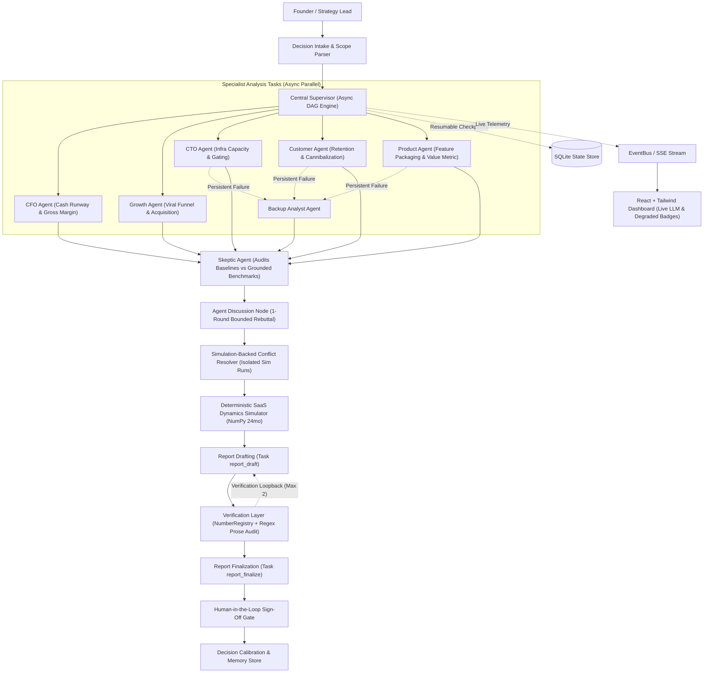

# VentureTwin

> **Operational Digital Twin & AI Flight Simulator for SaaS Leadership**  
> *Built for the SwarmFlow: Multi-Agent Task Coordination Engine Hackathon*

[](https://github.com/omsrajput977/VentureTwin/actions/workflows/ci.yml)
[](https://github.com/omsrajput977/VentureTwin)
[](ui/scripts/check-no-fake-numbers.mjs)
[](#why-a-custom-executor-instead-of-langgraph)
[](#acceptance-criteria-verification)

---

## 🎯 Executive Summary

**VentureTwin** is a decision stress-test platform and operational digital twin for SaaS pricing and packaging decisions. When leadership asks a high-stakes question (*"Should we launch a free plan?"*), VentureTwin orchestrates a virtual executive board of specialized AI agents running in parallel, audits claims through an adversarial Skeptic, settles parameter conflicts through deterministic simulation rather than voting, survives runtime agent crashes, and produces a consolidated, rigorously verified decision report.

**Core Thesis:** *"An orchestration engine where agents genuinely disagree, conflicts are settled by empirical simulation instead of LLM voting, zero numbers are fabricated by LLMs, and the workflow survives agent failures mid-run."*

> [!IMPORTANT]
> **Recommended Hackathon Demo Mode:** The primary demo should be run in **`replay`** mode (replaying real recorded Gemini responses with zero network delay or key requirement) or **`real`** mode (with a live `GEMINI_API_KEY`). Fast **`mock`** mode is also provided for local offline testing and CI test execution.

---

## 🏆 SwarmFlow Hackathon Milestone Scorecard

| Milestone | Implementation in VentureTwin | Status |
|---|---|---|
| **1. Agent Role Design** | 6 specialized roles (`CFO`, `Growth`, `CTO`, `Customer`, `Product`, `Skeptic`) with divergent objectives, private tools, structured Pydantic `Finding` outputs, and unified `llm_call()` supporting `mock`, `real`, `record`, and `replay` modes. | `Implemented` |
| **2. Task Decomposition Engine** | Natural-language query parser + `TaskDAG` generator with explicit Freemium MVP specialization (and friendly guidance for price changes). Parallel specialist root tasks, critique, bounded discussion, simulation, and two-phase report DAG with cycle detection. | `Implemented` |
| **3. Supervisor Architecture** | Async DAG supervisor dispatching independent tasks concurrently via `asyncio`, managing task kinds (`agent_analysis`, `skeptic_audit`, `discussion`, `conflict_resolution`, `simulation`, `report_draft`, `verification`, `report_finalize`), and emitting typed events over an `EventBus`. | `Implemented` |
| **4. Agent Communication Protocol** | Standardized `Finding`, `Assumption`, and `Evidence` schema enforcement with a bounded 1-round peer rebuttal discussion node (`task_agent_discussion`). | `Implemented` |
| **5. Shared State Management** | Typed `WorkflowState` tracking findings, assumptions, conflicts, simulation runs, and SQLite checkpointing after each task completion with seamless resume. | `Implemented` |
| **6. Conflict Detection & Resolution** | Ordinal contradiction detector ($\ge 2$ step difference required) and grouped parameter range conflict detection. Impasses are settled strictly via deterministic isolated-parameter simulation runs. | `Implemented` |
| **7. Failure Detection & Recovery** | Fault injection hook (`timeout`, `exception`, `bad_output`), instant timeout simulation, core task resilience (fails fast if supervisor tasks fail terminally), and automated `BackupAnalyst` delegation before degraded mode fallback. | `Implemented` |
| **8. Workflow Verification** | `NumberRegistry` tracking every report number with resolvable sources (`sim:`, `mc:`, `company:`, `flip:`, `tornado:`, `model_config:`, `calc:`), regex prose scanner detecting untraced figures, unit consistency, financial tie-outs, simulation provenance verification, and bounded loopback on verification failure. | `Implemented` |
| **9. Final Output Generation** | 10-section consolidated decision report, scenario matrix (conservative/expected/optimistic), sensitivity tornado chart, bisection flip-point search, execution plan gates, dynamic calibration error history, and human approval gate. | `Implemented` |

---

## 🏗️ Architecture



---

## 🕹️ LLM Modes (Mock / Real / Record / Replay)

VentureTwin supports four distinct LLM execution modes configured via `LLM_MODE`:

1. **`mock` (Default for Testing & CI):**
   - Completely offline and deterministic with zero external dependencies.
   - Generates realistic, specialized assumption proposals for each agent role using illustrative heuristic ranges.
   - Ideal for continuous integration and rapid regression testing (148 tests run in <12 seconds).
2. **`real` (Live Provider Mode):**
   - Direct live API calls to Google Gemini, OpenAI, or Anthropic.
   - Enforces Pydantic output schemas, structured prompt guidance with `SIM_PARAMS` definitions, inlined bounds, and JSON auto-repair retries.
   - Throttled by an asynchronous concurrency semaphore (`LLM_MAX_CONCURRENCY=2`) and exponential backoff retry to handle rate limits and 429 quota exhaustion.
3. **`record` (Cassette Generation):**
   - Executes live calls against the chosen LLM provider and securely records serialized request/response pairs into `tests/cassettes/`.
   - Strip sensitive tokens and headers automatically.
4. **`replay` (Recommended Offline Demo):**
   - Replays recorded live interactions from `tests/cassettes/` bit-for-bit without requiring an API key or incurring network latency.
   - Guarantees 100% reproducible live-agent behavior for hackathon evaluations.

---

## 🔑 Running with Google Gemini

### 1. Configure Environment
Copy `.env.example` to `.env` and set your Google Gemini API key:
```bash
cp .env.example .env
```
Edit `.env`:
```env
LLM_MODE=real
LLM_PROVIDER=gemini
LLM_MODEL=gemini-2.5-flash
GEMINI_API_KEY=your_actual_gemini_api_key_here
LLM_MAX_CONCURRENCY=2
```

### 2. Inspect Available Gemini Models
Run the helper script to query which Gemini models are available for your API key:
```bash
python scripts/list_gemini_models.py
```

### 3. Verify Live Connectivity
Run the diagnostic check to probe API latency and structured JSON parsing:
```bash
python scripts/check_gemini.py
```

### 4. Execute a Live Demo Run
Run the full multi-agent workflow live against Gemini and inspect the generated real run report:
```bash
python scripts/run_real_demo.py
```
Results and live metrics will be written to [`docs/REAL_RUN_REPORT.md`](docs/REAL_RUN_REPORT.md).

---

## ⚖️ What is Deterministic vs. LLM-Generated

To prevent hallucinations in high-stakes financial decisions, VentureTwin strictly enforces **Hard Rule R2**:

| Capability | Component Responsible | Determinism |
|---|---|---|
| Strategic Hypotheses & Claims | Specialized LLM Agents (`CFO`, `Growth`, `CTO`, etc.) | LLM-Generated |
| Parameter Ranges (`low`, `base`, `high`) | Specialized LLM Agents | LLM-Generated |
| Counter-Arguments & Criticisms | `Skeptic Agent` | LLM-Generated |
| Rebuttal Stances & Concessions | Specialized LLM Agents | LLM-Generated |
| **All Financial Numbers (MRR, Cash, Runway)** | Deterministic SaaS Dynamics Simulator (`simulation/`) | **100% Deterministic (Python/NumPy)** |
| **Conflict Settlement & Winner Selection** | Isolated Simulation Deltas (`conflict/resolver.py`) | **100% Deterministic** |
| **Strategy Feasibility & Rankings** | Constraint Evaluator (`report/decision_logic.py`) | **100% Deterministic** |
| **Sensitivity Tornado & Directional Flip Points** | Bisection Search & OAT Variance Engine | **100% Deterministic** |
| **Multi-Strategy Monte Carlo (`p_best`, `p_feasible`)** | Shared Random Seeded Generator (500 draws) | **100% Deterministic** |
| **Audit & Verification Verification** | `NumberRegistry` & Regex Prose Scanner | **100% Deterministic** |

---

## 🔍 What is Synthetic (Strict Transparency)

All company data in VentureTwin is synthetic and clearly disclosed:
- **`NimbusDesk` Operational Baseline (`data/synthetic_company.json`):** A realistic Series A B2B customer support platform ($110.4k MRR, $1.65M cash, 13.2 months runway, 655 paying customers, 75% gross margin). Every number is internally consistent and verified.
- **SaaS Industry Benchmarks (`data/benchmarks.json`):** Realistic industry research benchmarks (freemium conversion rates, churn, ARPU) used by the Skeptic agent to challenge unfounded agent optimism.
- **Historical Decisions Memory (`data/seeded_decisions.json`):** 4 seeded historical decisions used by the Calibration Engine to track model drift between prediction and actual outcomes over time.
- **Synthetic Data Badge:** The user interface prominently and permanently displays a **"Synthetic Data"** badge across all views.

---

## ⚡ Why a Custom Executor Instead of LangGraph?

While LangGraph is popular for cyclic conversational bots, VentureTwin was intentionally built on a purpose-designed **Async Directed Acyclic Graph (DAG) Engine** (`orchestrator/`):

1. **Explicit Task Kinds & Targeted Dispatch:**
   Each task has an explicit typed kind (`agent_analysis`, `skeptic_audit`, `discussion`, `conflict_resolution`, `simulation`, `report_draft`, `verification`, `report_finalize`). This allows different resilience policies: specialist agent tasks degrade gracefully upon failure, while supervisor simulation tasks fail terminally with checkpointing.
2. **True Async Parallelism with Concurrency Control:**
   Root specialist agents execute concurrently via native `asyncio.gather` bounded by a provider-level concurrency semaphore (`LLM_MAX_CONCURRENCY=2`), preventing 429 quota exhaustion.
3. **Transparent Checkpoint Resume:**
   Every task completion commits an immutable JSON snapshot to a local SQLite database (`venturetwin_checkpoints.db`), enabling zero-loss resume after unexpected interruptions.
4. **Deterministic Simulation Isolation:**
   When conflicts arise, the engine executes branch simulations in isolated environments rather than passing state through conversational loops, ensuring zero prompt drift.
5. **Bounded Verification Loopbacks:**
   If the verification engine detects an untraced number in narrative prose, the DAG performs targeted, bounded re-drafting (up to 2 iterations) rather than unbounded agent chatter.

---

## ⚠️ Known Limitations

- **Domain Scope:** VentureTwin is specialized for B2B SaaS pricing and packaging decisions (Freemium vs. Usage Caps vs. Gated Tiers). Price increase modeling and enterprise custom packaging are planned for v0.2.
- **Time Horizon:** The dynamics model projects 24 months forward with monthly discretization.
- **Single Currency:** All financial telemetry and simulation calculations operate in USD ($).
- **Mock Mode Heuristics:** In `mock` mode, agent findings are generated via deterministic heuristics designed for speed and offline testing. For realistic qualitative analysis, use `real` or `replay` mode.

---

## 🚀 Getting Started

### 1. Prerequisites
- Python 3.11, 3.12, or 3.13
- Node.js v18+ and npm

### 2. Backend Setup
```bash
# Clone the repository
git clone https://github.com/omsrajput977/VentureTwin.git
cd VentureTwin

# Create and activate virtual environment
python3 -m venv .venv
source .venv/bin/activate

# Install Python dependencies
pip install -e ".[dev]"
```

### 3. Frontend Setup
```bash
cd ui
npm install
npm run build
cd ..
```

### 4. Running the Application
```bash
# Start the FastAPI backend server (serves the API and production React UI)
./.venv/bin/uvicorn api.app:app --host 0.0.0.0 --port 8000 --reload
```
Open your browser at **[http://localhost:8000/](http://localhost:8000/)**.

To run the React development server with hot-reloading:
```bash
cd ui
npm run dev
```

---

## 🧪 Acceptance Criteria Verification

Run the full pytest suite (148 passed, 3 skipped across all 11 hackathon criteria):
```bash
./.venv/bin/pytest -v
```

Run the strict UI number audit (verifies zero hardcoded numbers, fake currency, or mock statuses exist in frontend source):
```bash
cd ui
npm run prebuild
```

Run Section 3 Comprehensive Acceptance Suite:
```bash
./.venv/bin/pytest tests/test_acceptance_v4.py -v
```

---

## 📜 Demo Script

Follow [`docs/DEMO_SCRIPT.md`](docs/DEMO_SCRIPT.md) for a step-by-step 3-minute hackathon judge walkthrough showcasing parallel agent dispatch, live failure recovery, empirical conflict resolution, and the human approval gate.
