# VentureTwin Architecture & System Specification

> **Operational Digital Twin & AI Flight Simulator for SaaS Decision-Making**  
> Built for the **SwarmFlow: Multi-Agent Task Coordination Engine** Hackathon

---

## Table of Contents

- [1. Title, Purpose, and How to Read This Document](#1-title-purpose-and-how-to-read-this-document)
  - [1.1 Purpose of This Document](#11-purpose-of-this-document)
  - [1.2 Implementation Status Legend](#12-implementation-status-legend)
  - [1.3 Five-Minute Quick Reading Guide](#13-five-minute-quick-reading-guide)
- [2. The Problem and the Idea](#2-the-problem-and-the-idea)
  - [2.1 SwarmFlow Problem Statement & 9 Hackathon Milestones](#21-swarmflow-problem-statement--9-hackathon-milestones)
  - [2.2 VentureTwin: The Operational Digital Twin](#22-venturetwin-the-operational-digital-twin)
  - [2.3 Core Design Principles & Code Enforcement](#23-core-design-principles--code-enforcement)
- [3. System Overview](#3-system-overview)
  - [3.1 High-Level Architecture Diagram](#31-high-level-architecture-diagram)
  - [3.2 One Request, End to End](#32-one-request-end-to-end)
  - [3.3 Repository Map](#33-repository-map)
- [4. Complete Tech Stack](#4-complete-tech-stack)
  - [4.1 Backend & Computational Dependencies](#41-backend--computational-dependencies)
  - [4.2 Frontend Dependencies](#42-frontend-dependencies)
  - [4.3 Testing, CI/CD, & Tooling](#43-testing-cicd--tooling)
  - [4.4 Technologies Deliberately Omitted](#44-technologies-deliberately-omitted)
- [5. Data Layer](#5-data-layer)
  - [5.1 Datasets and Schema Specifications](#51-datasets-and-schema-specifications)
  - [5.2 Synthetic Data Rationale & UI Badging](#52-synthetic-data-rationale--ui-badging)
- [6. State and Schemas](#6-state-and-schemas)
  - [6.1 Pydantic Domain Schemas](#61-pydantic-domain-schemas)
  - [6.2 Provenance Types and Strict Assignment Rules](#62-provenance-types-and-strict-assignment-rules)
  - [6.3 Shared Workflow State & Concurrency Semantics](#63-shared-workflow-state--concurrency-semantics)
  - [6.4 Checkpointing & Resumability (SQLite)](#64-checkpointing--resumability-sqlite)
  - [6.5 Event Bus Architecture & SSE Delivery](#65-event-bus-architecture--sse-delivery)
- [7. Orchestration Engine](#7-orchestration-engine)
  - [7.1 Decision Intake and Query Parsing](#71-decision-intake-and-query-parsing)
  - [7.2 Dynamic Task Decomposition & DAG Construction](#72-dynamic-task-decomposition--dag-construction)
  - [7.3 Task Kinds & Dispatch Mechanics](#73-task-kinds--dispatch-mechanics)
  - [7.4 Central Supervisor Execution Loop](#74-central-supervisor-execution-loop)
  - [7.5 Architectural Choice: Custom Async Executor vs. LangGraph](#75-architectural-choice-custom-async-executor-vs-langgraph)
  - [7.6 Concurrency & Synchronization Model](#76-concurrency--synchronization-model)
- [8. The Agents](#8-the-agents)
  - [8.1 Agent Architecture & Object Model](#81-agent-architecture--object-model)
  - [8.2 Functional Specialist Profiles](#82-functional-specialist-profiles)
  - [8.3 Agent Tooling](#83-agent-tooling)
  - [8.4 Adversarial Auditor: The Skeptic Agent](#84-adversarial-auditor-the-skeptic-agent)
  - [8.5 Autonomous Fallback: The Backup Analyst](#85-autonomous-fallback-the-backup-analyst)
  - [8.6 Divergent Objectives and Grounded Friction](#86-divergent-objectives-and-grounded-friction)
  - [8.7 Provenance Resolution & Parameter Whitelisting](#87-provenance-resolution--parameter-whitelisting)
- [9. How Agents "Talk" (Communication Protocol)](#9-how-agents-talk-communication-protocol)
  - [9.1 Structured Communication Protocol](#91-structured-communication-protocol)
  - [9.2 Visibility and Information Flow Rules](#92-visibility-and-information-flow-rules)
  - [9.3 Bounded Peer Discussion & Rebuttal Dynamics](#93-bounded-peer-discussion--rebuttal-dynamics)
  - [9.4 LLM Prompt Templates](#94-llm-prompt-templates)
  - [9.5 Ban on Unstructured Free-Text Inter-Agent Chat](#95-ban-on-unstructured-free-text-inter-agent-chat)
- [10. The LLM Layer](#10-the-llm-layer)
  - [10.1 Execution Modes: Mock, Real, Record, Replay](#101-execution-modes-mock-real-record-replay)
  - [10.2 Supported LLM Providers & Adapters](#102-supported-llm-providers--adapters)
  - [10.3 Resilient Client: Concurrency, Rate Limiting, Retries, JSON Repair](#103-resilient-client-concurrency-rate-limiting-retries-json-repair)
  - [10.4 Deterministic Mock Handlers](#104-deterministic-mock-handlers)
  - [10.5 Record and Replay Cassette Engine](#105-record-and-replay-cassette-engine)
  - [10.6 Environment Configuration & Dotenv Loading](#106-environment-configuration--dotenv-loading)
  - [10.7 Health Probing & Model Verification](#107-health-probing--model-verification)
- [11. Simulation Engine](#11-simulation-engine)
  - [11.1 Allowed Simulation Parameters (SIM_PARAMS)](#111-allowed-simulation-parameters-sim_params)
  - [11.2 Order-Independent Assumption Reconciliation](#112-order-independent-assumption-reconciliation)
  - [11.3 Monthly SaaS Dynamics Equations](#113-monthly-saas-dynamics-equations)
  - [11.4 Modeled Strategic Alternatives (A, B, C)](#114-modeled-strategic-alternatives-a-b-c)
  - [11.5 Scenario Generation Matrix & Monte Carlo Sampling](#115-scenario-generation-matrix--monte-carlo-sampling)
  - [11.6 Tornado Sensitivity & Decision Flip-Point Bisection](#116-tornado-sensitivity--decision-flip-point-bisection)
  - [11.7 Runway Constraint & Quantitative Feasibility](#117-runway-constraint--quantitative-feasibility)
  - [11.8 Epistemic Boundaries: What Simulation Does and Does Not Claim](#118-epistemic-boundaries-what-simulation-does-and-does-not-claim)
- [12. Conflict Detection and Resolution](#12-conflict-detection-and-resolution)
  - [12.1 Taxonomy of Detected Conflicts](#121-taxonomy-of-detected-conflicts)
  - [12.2 Grouping and Conflict Deduplication](#122-grouping-and-conflict-deduplication)
  - [12.3 Empirical Simulation Isolation Algorithm](#123-empirical-simulation-isolation-algorithm)
  - [12.4 Conflict Resolution Statuses](#124-conflict-resolution-statuses)
  - [12.5 Real Conflict Resolution Walkthrough](#125-real-conflict-resolution-walkthrough)
  - [12.6 Rationale: Simulation over Voting](#126-rationale-simulation-over-voting)
- [13. Failure Detection and Recovery](#13-failure-detection-and-recovery)
  - [13.1 Failure Taxonomy and Detection](#131-failure-taxonomy-and-detection)
  - [13.2 Hierarchical Recovery State Machine](#132-hierarchical-recovery-state-machine)
  - [13.3 Core Supervisor Tasks vs. Specialist Resilience](#133-core-supervisor-tasks-vs-specialist-resilience)
  - [13.4 Live Chaos Fault Injection API](#134-live-chaos-fault-injection-api)
  - [13.5 Degraded Mode Tracking & UI Transparency](#135-degraded-mode-tracking--ui-transparency)
  - [13.6 Workflow Resumption from Checkpoints](#136-workflow-resumption-from-checkpoints)
- [14. Verification and the Number Registry](#14-verification-and-the-number-registry)
  - [14.1 Deterministic Verification Suite (7 Algorithmic Audits)](#141-deterministic-verification-suite-7-algorithmic-audits)
  - [14.2 The NumberRegistry Architecture](#142-the-numberregistry-architecture)
  - [14.3 Source Reference Resolvers & Tolerances](#143-source-reference-resolvers--tolerances)
  - [14.4 Regex Narrative Prose Scanning](#144-regex-narrative-prose-scanning)
  - [14.5 Report Pipeline: Draft -> Verify -> Loopback -> Finalize](#145-report-pipeline-draft---verify---loopback---finalize)
  - [14.6 Verification Guarantees and Gaps](#146-verification-guarantees-and-gaps)
- [15. Report Generation](#15-report-generation)
  - [15.1 Consolidated 10-Section Report Specification](#151-consolidated-10-section-report-specification)
  - [15.2 Recommendation Logic & Consensus Alignment](#152-recommendation-logic--consensus-alignment)
  - [15.3 Composite Confidence Score Calculation](#153-composite-confidence-score-calculation)
  - [15.4 Execution Plan & Operational Trigger Gates](#154-execution-plan--operational-trigger-gates)
  - [15.5 Human-in-the-Loop Sign-Off Gate](#155-human-in-the-loop-sign-off-gate)
  - [15.6 Decision Calibration Memory Store](#156-decision-calibration-memory-store)
- [16. API Reference](#16-api-reference)
  - [16.1 REST Endpoints Specification](#161-rest-endpoints-specification)
  - [16.2 Server-Sent Events (SSE) Stream Specification](#162-server-sent-events-sse-stream-specification)
  - [16.3 Example Payloads from Running Application](#163-example-payloads-from-running-application)
- [17. Frontend Architecture](#17-frontend-architecture)
  - [17.1 UI Component Architecture](#171-ui-component-architecture)
  - [17.2 Real-Time SSE DAG Synchronization](#172-real-time-sse-dag-synchronization)
  - [17.3 UI Views (Console, Report, Calibration, Company Graph)](#173-ui-views-console-report-calibration-company-graph)
  - [17.4 Prebuild Number Audit (`check-no-fake-numbers.mjs`)](#174-prebuild-number-audit-check-no-fake-numbersmjs)
- [18. End-to-End Walkthrough of One Run](#18-end-to-end-walkthrough-of-one-run)
  - [18.1 Normal Execution Timeline: Free Plan Decision](#181-normal-execution-timeline-free-plan-decision)
  - [18.2 Injected Fault Execution Timeline: CFO Crash Recovery](#182-injected-fault-execution-timeline-cfo-crash-recovery)
- [19. Testing and CI](#19-testing-and-ci)
  - [19.1 Test Suite Organization & Markers](#191-test-suite-organization--markers)
  - [19.2 Continuous Integration (GitHub Actions)](#192-continuous-integration-github-actions)
  - [19.3 Acceptance Criteria Verification](#193-acceptance-criteria-verification)
- [20. Configuration, Running, and Operations](#20-configuration-running-and-operations)
  - [20.1 Quickstart & Development Environment Setup](#201-quickstart--development-environment-setup)
  - [20.2 Running in Different LLM Modes](#202-running-in-different-llm-modes)
  - [20.3 Verifying Live Provider Credentials](#203-verifying-live-provider-credentials)
  - [20.4 Operational Troubleshooting](#204-operational-troubleshooting)
- [21. Design Decisions and Trade-offs](#21-design-decisions-and-trade-offs)
- [22. Known Limitations, Risks, and Roadmap](#22-known-limitations-risks-and-roadmap)
  - [22.1 Known Limitations & Edge Cases](#221-known-limitations--edge-cases)
  - [22.2 Roadmap to v0.2](#222-roadmap-to-v02)
- [23. Frequently Asked Questions (FAQ)](#23-frequently-asked-questions-faq)
- [24. Glossary](#24-glossary)
- [25. Appendices](#25-appendices)
  - [Appendix A: Complete Environment Variable Reference](#appendix-a-complete-environment-variable-reference)
  - [Appendix B: EventBus Event Type Reference](#appendix-b-eventbus-event-type-reference)
  - [Appendix C: Complete Repository File Index](#appendix-c-complete-repository-file-index)
  - [Appendix D: Captured Production Artifacts](#appendix-d-captured-production-artifacts)

---

## 1. Title, Purpose, and How to Read This Document

### 1.1 Purpose of This Document
This document is the authoritative architectural specification and engineering reference for **VentureTwin**, a multi-agent operational digital twin and SaaS flight simulator built on the **SwarmFlow** coordination engine. It details how autonomous AI specialists, an adversarial Skeptic, a central async DAG supervisor, an empirical SaaS dynamics simulation engine, and an automated verification layer collaborate to evaluate high-stakes strategic business decisions without hallucinating figures or relying on naive LLM consensus voting.

Every technical claim in this document is verified against the codebase and references exact files, classes, methods, and line ranges (`module.py::Class.method`).

### 1.2 Implementation Status Legend
To provide absolute transparency regarding what is implemented, tested, and operational versus planned for future iterations, the following tags are utilized throughout this document:

| Tag | Definition |
|---|---|
| `[IMPLEMENTED]` | Fully implemented in the codebase, active in normal workflows, and verified by automated tests. |
| `[MOCK-ONLY]` | Operates via deterministic heuristic handlers when running under `LLM_MODE=mock`. |
| `[REAL-MODE]` | Connects to live LLM provider APIs (Gemini, OpenAI, Anthropic, Groq, Cerebras) via HTTP. |
| `[PARTIAL]` | Functional in code but constrained in scope (e.g. freemium packaging MVP vs. multi-domain models). |
| `[PLANNED]` | Architecturally defined or scheduled for future roadmap releases (not yet merged in active execution paths). |

### 1.3 Five-Minute Quick Reading Guide
If you have limited time and need to evaluate the technical substance of this system:
1. **The Core Thesis & Rules:** Read Section [2.3 Core Design Principles & Code Enforcement](#23-core-design-principles--code-enforcement) to understand why LLMs propose assumptions rather than numbers, and why simulation replaces voting.
2. **Architecture & DAG:** Inspect Section [3.1 High-Level Architecture Diagram](#31-high-level-architecture-diagram) and Section [7.2 Dynamic Task Decomposition & DAG Construction](#72-dynamic-task-decomposition--dag-construction).
3. **Agent Communication:** Review Section [9.1 Structured Communication Protocol](#91-structured-communication-protocol) and [9.3 Bounded Peer Discussion & Rebuttal Dynamics](#93-bounded-peer-discussion--rebuttal-dynamics) to see how agents converse with schema enforcement.
4. **Conflict Resolution:** Read Section [12.3 Empirical Simulation Isolation Algorithm](#123-empirical-simulation-isolation-algorithm) to see how mathematical simulations settle agent impasses.
5. **Deterministic Verification:** Read Section [14.2 The NumberRegistry Architecture](#142-the-numberregistry-architecture) to understand how every number in narrative prose is verified against calculation roots.

---

## 2. The Problem and the Idea

### 2.1 SwarmFlow Problem Statement & 9 Hackathon Milestones
The **SwarmFlow** challenge demands a distributed multi-agent task coordination platform capable of decomposing complex, ambiguous objectives across specialized agents, maintaining coherent shared state, resolving disagreements empirically, recovering autonomously from runtime agent crashes, verifying output integrity, and delivering a unified deliverable.

The table below maps each of the nine hackathon milestones to the exact modules and functions implementing them in VentureTwin:

| # | Hackathon Milestone | VentureTwin Architectural Implementation | Source Reference | Status |
|---|---|---|---|---|
| **1** | **Agent Role Design** | 6 specialized roles (`CFO`, `Growth`, `CTO`, `Customer`, `Product`, `Skeptic`) with divergent objectives, private telemetry tools, and Pydantic schema validation. | `agents/specialists.py::BaseAnalysisAgent`<br>`agents/specialists.py::CFOAgent`<br>`agents/specialists.py::SkepticAgent` | `[IMPLEMENTED]` |
| **2** | **Task Decomposition Engine** | Natural-language query intake + `TaskDAG` dependency builder with cycle validation (DFS 3-color) and MVP freemium decomposition. | `orchestrator/parser.py::parse_decision_query`<br>`orchestrator/decomposer.py::decompose_decision`<br>`orchestrator/dag.py::TaskDAG` | `[IMPLEMENTED]` |
| **3** | **Supervisor Architecture** | Central async DAG supervisor dynamically querying unblocked nodes, running concurrent tasks via `asyncio.gather`, managing retries, and publishing typed events. | `orchestrator/supervisor.py::Supervisor.execute_workflow`<br>`orchestrator/supervisor.py::Supervisor._execute_step` | `[IMPLEMENTED]` |
| **4** | **Agent Communication Protocol** | Structured typed payloads (`AgentFindingDraft`, `Finding`, `Critique`, `Rebuttal`, `Message`) with a bounded 1-round peer challenge discussion node. | `state/schemas.py::Finding`<br>`orchestrator/supervisor.py::Supervisor._run_discussion_task` | `[IMPLEMENTED]` |
| **5** | **Shared State Management** | Central `WorkflowState` tracking task status, findings, assumptions, conflicts, simulation runs, and SQLite checkpointing after each step. | `state/shared_state.py::WorkflowState`<br>`orchestrator/checkpointer.py::SQLiteCheckpointer` | `[IMPLEMENTED]` |
| **6** | **Conflict Detection & Resolution** | Ordinal recommendation contradiction detector and grouped parameter conflict detector resolved through isolated SaaS dynamics simulation runs. | `conflict/detector.py::detect_all_conflicts`<br>`conflict/resolver.py::resolve_conflict_via_simulation` | `[IMPLEMENTED]` |
| **7** | **Failure Detection & Recovery** | Fault injection hook (`timeout`, `exception`, `bad_output`), automated `BackupAnalyst` delegation on exhaustion, and graceful degraded mode fallback. | `orchestrator/supervisor.py::Supervisor._execute_task_with_recovery`<br>`agents/backup_agent.py::BackupAnalystAgent` | `[IMPLEMENTED]` |
| **8** | **Workflow Verification** | Independent 7-check algorithmic verifier, `NumberRegistry` tracing numbers to `sim:`, `mc:`, or `company:` paths, regex prose scanner, and bounded loopbacks. | `verification/verifier.py::run_all_verification_checks`<br>`report/number_registry.py::NumberRegistry` | `[IMPLEMENTED]` |
| **9** | **Final Output Generation** | 10-section consolidated decision report, dynamic strategy ranking, scenario matrix, tornado sensitivity chart, flip-point bisection, and human sign-off gate. | `report/report_builder.py::build_consolidated_report`<br>`api/app.py::approve_decision` | `[IMPLEMENTED]` |

### 2.2 VentureTwin: The Operational Digital Twin
B2B SaaS leadership frequently faces complex packaging and pricing decisions (e.g., *"Should we launch a free tier?"*). Traditional generative LLMs provide qualitative, generic advice or hallucinate financial forecasts that do not balance cash runway against infrastructure burn.

**VentureTwin** serves as an operational digital twin for SaaS leadership. Given a strategic question, it initializes the company baseline from verified telemetry (for series A startup **NimbusDesk**), assigns functional executives to evaluate impacts independently, subjects their claims to adversarial audit, settles disagreements mathematically in a deterministic simulator, and compiles an audited report with an operational execution plan.

#### What VentureTwin Does:
- Evaluates SaaS strategic questions against real balance-sheet parameters ($1.65M cash, $110.4k MRR, 13.2 months baseline runway).
- Enables emergent functional conflict between departments with naturally competing priorities (CFO vs. Growth).
- Settles impasses using a 24-month deterministic cohort simulation model.
- Enforces an automated verification pipeline that fails if a single number in the narrative report cannot be mathematically traced to its simulation root.
- Requires explicit human approval before any decision record is committed to calibration memory.

#### What VentureTwin Deliberately Does Not Do:
- Does not autonomously execute external actions (no billing adjustments, no automated code deploys, no Stripe API mutations).
- Does not allow LLMs to calculate cash balances, MRR trajectories, or net margins.
- Does not use LLM voting or majority consensus to resolve factual disagreements.

### 2.3 Core Design Principles & Code Enforcement
The architecture adheres strictly to seven non-negotiable principles:

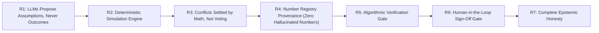

1. **R1: LLMs Propose Assumptions, Never Outcomes:**  
   LLMs are prohibited from computing business outcomes (e.g., final MRR, net profit, cash runway). LLMs are restricted to proposing parameter ranges (`low`, `base`, `high`) for bounded operational levers defined in `simulation/params.py::SIM_PARAMS`. Enforced in `agents/specialists.py::BaseAnalysisAgent.build_prompt` and validated by `agents/specialists.py::resolve_provenance_and_validate`.
2. **R2: Simulation Integrity:**  
   All financial metrics, cohort trajectories, churn dynamics, and cash balances are computed by a deterministic 12-24 month NumPy model in `simulation/saas_model.py::run_saas_dynamics`. Given identical assumptions, output metrics are identical across every run.
3. **R3: Simulation-Backed Conflict Resolution:**  
   Disagreements between agents are never settled by LLM voting or majority consensus. Instead, `conflict/resolver.py::resolve_conflict_via_simulation` executes isolated simulation runs holding all parameters constant except the disputed item to evaluate empirical runway and net contribution deltas.
4. **R4: Strict Number Registry Provenance:**  
   Every numerical figure in the final report must be registered in `report/number_registry.py::NumberRegistry` with a resolvable URI (`sim:<run_id>.<metric>`, `company:<path>`, `mc:<strategy>.<metric>`, `flip:threshold`).
5. **R5: Algorithmic Verification Gate:**  
   `verification/verifier.py::run_all_verification_checks` runs seven automated audits (unit consistency, financial tie-outs, provenance integrity, required sections, report traceability, number registry integrity, regex narrative prose audit) before a report can be finalized. If a check fails, the supervisor triggers a bounded loopback.
6. **R6: Human-in-the-Loop Sign-Off:**  
   Strategic decisions require explicit human confirmation via `api/app.py::approve_decision`. VentureTwin operates strictly as an executive decision-support simulator.
7. **R7: Epistemic Honesty:**  
   The system never conceals degraded modes, synthetic baselines, or unresolvable conflicts. If an agent crashes and recovery defaults to a heuristic fallback, the UI displays an amber degraded badge, and the report cites `provenance="fallback_degraded"`.

---

## 3. System Overview

### 3.1 High-Level Architecture Diagram

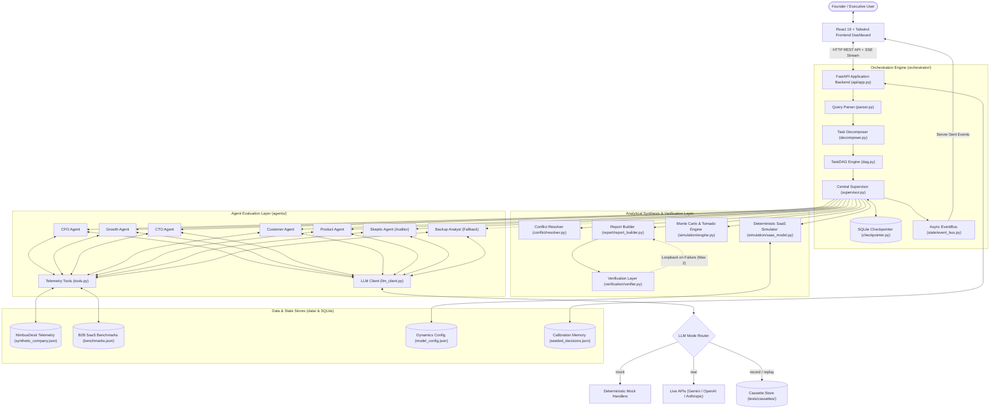

### 3.2 One Request, End to End
When a user submits a strategic question via the web console (e.g. *"Should we launch a free plan?"*):

1. **Intake & Scope Validation (`api/app.py::submit_decision`):**  
   The query is passed to `orchestrator/parser.py::parse_decision_query`. The parser checks domain relevance against SaaS operational vocabulary, constructs a `Decision` object with default constraints (`min_runway_months: 10.0`), and assigns a deterministic decision ID.
2. **Task Decomposition (`orchestrator/decomposer.py::decompose_decision`):**  
   The decomposer builds a `TaskDAG` containing 11 nodes. It initializes 5 parallel specialist analysis tasks, an adversarial skeptic audit node, a peer discussion node, a conflict resolution node, a simulation node, and a two-phase verification/report finalization pipeline.
3. **Supervisor Initialization (`orchestrator/supervisor.py::Supervisor`):**  
   The supervisor initializes a clean `WorkflowState`, records the workflow in memory, emits `workflow_started`, and enters its asynchronous dispatch loop.
4. **Parallel Functional Analysis (`orchestrator/supervisor.py::Supervisor._run_agent_analysis_task`):**  
   The supervisor queries `dag.get_ready_tasks()`. All 5 specialist tasks (`cfo`, `growth`, `cto`, `customer`, `product`) have zero dependencies and launch concurrently via `asyncio.gather`. Each agent reads verified company telemetry via `agents/tools.py`, queries the LLM client, validates proposed parameters against `SIM_PARAMS`, assigns provenance, and outputs a structured `Finding`.
5. **State Mutation & Checkpointing (`orchestrator/checkpointer.py::SQLiteCheckpointer`):**  
   As each task completes, findings are appended to `state.findings`, assumptions are added to `state.assumptions`, and state is committed to SQLite (`venturetwin_checkpoints.db`).
6. **Adversarial Audit (`agents/specialists.py::SkepticAgent`):**  
   With analysis tasks completed, `task_skeptic_audit` executes. The Skeptic audits every proposed assumption against industry benchmarks (`data/benchmarks.json`), flagging optimism or ungrounded claims, and generates targeted critiques.
7. **Bounded Peer Discussion (`orchestrator/supervisor.py::Supervisor._run_discussion_task`):**  
   `task_agent_discussion` executes a bounded 1-round rebuttal. Challenged agents review skeptic critiques and choose to either defend their parameter ranges with operational justifications or concede and narrow their bounds.
8. **Empirical Conflict Resolution (`conflict/resolver.py::resolve_conflict_via_simulation`):**  
   `task_conflict_resolution` scans findings for contradictory recommendations or non-overlapping parameter ranges. For each conflict, the resolver runs isolated 12-month simulations holding other variables constant to evaluate runway and margin impacts, outputting a data-grounded verdict.
9. **Full SaaS Dynamics Simulation (`simulation/saas_model.py::run_saas_dynamics`):**  
   `task_simulation_engine` reconciles all active assumptions into canonical parameter ranges, then executes a 3-strategy $\times$ 6-scenario simulation matrix (18 deterministic runs), a 500-sample Monte Carlo distribution, a tornado sensitivity ranking, and a bisection flip-point search.
10. **Report Drafting (`report/report_builder.py::build_consolidated_report`):**  
    `task_report_draft` builds a 10-section report, synthesizes executive claims, determines top strategy recommendations, constructs an execution plan, and registers all figures in the `NumberRegistry`.
11. **Deterministic Verification (`verification/verifier.py::run_all_verification_checks`):**  
    `task_workflow_verification` audits the draft report across 7 algorithmic checks. If all checks pass, `workflow_verified` is emitted. If a check fails, the supervisor initiates a loopback (up to 2 rounds) to re-simulate or re-draft.
12. **Finalization & Human Approval (`api/app.py::approve_decision`):**  
    `task_report_finalize` cryptographically stamps the report and transitions the workflow status to `completed`. The report renders in the UI, awaiting the executive user's sign-off (`approve`, `reject`, or `request_changes`), which records the outcome in `decision_records_store`.

### 3.3 Repository Map

```
VentureTwin/
├── api/
│   ├── app.py                     # FastAPI application endpoints, SSE stream, CORS, static UI serving
│   └── __init__.py
├── agents/
│   ├── base_agent.py              # BaseAgent abstract class and common agent lifecycle methods
│   ├── specialists.py             # Specialist implementations: CFO, Growth, CTO, Customer, Product, Skeptic
│   ├── backup_agent.py            # BackupAnalystAgent for autonomous fault recovery
│   ├── tools.py                   # Private agent tools for querying NimbusDesk telemetry
│   ├── llm_client.py              # Multi-provider client (mock, real, record, replay) with rate limits
│   ├── mock_handlers.py           # Deterministic heuristic responses for offline mock testing
│   ├── registry.py                # Agent registration and lookup factory
│   └── __init__.py
├── orchestrator/
│   ├── supervisor.py              # Central async DAG supervisor, execution loop, failure handling
│   ├── decomposer.py              # Decomposes strategic questions into executable TaskDAGs
│   ├── dag.py                     # TaskDAG graph model with 3-color cycle detection (DFS)
│   ├── parser.py                  # Regex query parser and scope classifier
│   ├── checkpointer.py            # SQLite state persistence and workflow recovery
│   └── __init__.py
├── conflict/
│   ├── detector.py                # Identifies recommendation contradictions and range impasses
│   ├── resolver.py                # Settles conflicts via isolated deterministic simulation runs
│   └── __init__.py
├── simulation/
│   ├── saas_model.py              # 12-24 month cohort dynamics model (MRR, churn, cash, runway)
│   ├── engine.py                  # Scenario matrix, 500-sample Monte Carlo, tornado sensitivity, flip point
│   ├── params.py                  # Whitelist of allowed simulation parameters (SIM_PARAMS)
│   ├── reconcile.py               # Order-independent, confidence-weighted assumption merging
│   └── __init__.py
├── verification/
│   ├── verifier.py                # 7 algorithmic audits (math tie-outs, provenance, prose regex audit)
│   └── __init__.py
├── report/
│   ├── report_builder.py          # Assembles the consolidated 10-section report
│   ├── decision_logic.py          # Strategy ranking, feasibility evaluation, confidence scoring
│   ├── number_registry.py         # NumberRegistry tracking report numbers to exact simulation paths
│   └── __init__.py
├── state/
│   ├── schemas.py                 # Core Pydantic domain models (Finding, Task, Assumption, Conflict, etc.)
│   ├── shared_state.py            # WorkflowState tracking DAG execution and mutations
│   ├── event_bus.py               # In-memory async event broker broadcasting to UI via SSE
│   └── __init__.py
├── data/
│   ├── synthetic_company.json     # NimbusDesk operational snapshot (Series A B2B SaaS)
│   ├── model_config.json          # SaaS model constants (churn ceilings, FTE costs, activation rates)
│   ├── benchmarks.json            # B2B SaaS benchmarks for Skeptic assumption auditing
│   ├── seeded_decisions.json      # Historical decisions for calibration drift analysis
│   ├── known_good_run.json        # Golden run state for offline replay testing and UI demo
│   ├── loader.py                  # Helper functions to load JSON datasets
│   └── __init__.py
├── ui/
│   ├── src/
│   │   ├── App.tsx                # Main dashboard container, navigation tabs, mode banner
│   │   ├── api.ts                 # HTTP client and Server-Sent Events subscriber
│   │   ├── main.tsx               # React application entrypoint
│   │   └── components/
│   │       ├── ExecutionGraph.tsx      # Real-time visual DAG execution graph with live node states
│   │       ├── DecisionReportView.tsx  # Consolidated 10-section report viewer with approval gate
│   │       ├── EventFeed.tsx           # Live SSE telemetry stream with timestamped event logging
│   │       ├── CompanySnapshotCard.tsx # NimbusDesk balance sheet and metric card
│   │       ├── CompanyGraphView.tsx    # React Flow graph of company metric dependencies
│   │       ├── CalibrationView.tsx     # Past decision calibration and drift error history
│   │       ├── FailureInjectorModal.tsx# Chaos engineering fault injection modal
│   │       └── ErrorBoundary.tsx       # React error boundary catching rendering exceptions
│   ├── scripts/
│   │   └── check-no-fake-numbers.mjs # Prebuild AST/regex audit enforcing zero hardcoded numbers
│   ├── package.json               # Frontend dependencies (React 19, Vite 6, TypeScript 5.7)
│   ├── vite.config.ts             # Vite bundler configuration
│   └── tsconfig.json              # TypeScript compiler settings
├── tests/
│   ├── cassettes/                 # Serialized HTTP request/response cassettes for replay mode
│   ├── conftest.py                # Pytest fixtures and environment initialization
│   ├── test_acceptance.py         # SwarmFlow hackathon acceptance tests (Milestones 1-5)
│   ├── test_acceptance_v2.py      # Acceptance tests (Milestones 6-7)
│   ├── test_acceptance_v3.py      # Acceptance tests (Milestones 8-9)
│   ├── test_acceptance_v4.py      # Comprehensive 11-criterion end-to-end acceptance suite
│   ├── test_fix11_agent_consensus_and_personal_query.py # Consensus alignment tests
│   └── ...                        # Comprehensive unit and integration test suite (151 tests)
├── scripts/
│   ├── check_gemini.py            # Diagnostic probe verifying Gemini API keys and connectivity
│   ├── check_openai.py            # Diagnostic probe for OpenAI API connectivity
│   ├── check_provider.py          # Generic provider probe testing active LLM_PROVIDER
│   ├── list_gemini_models.py      # Queries Gemini endpoint for accessible model identifiers
│   └── run_real_demo.py           # CLI script recording live runs into cassettes and known_good_run.json
├── .github/
│   └── workflows/
│       ├── ci.yml                 # Matrix CI testing Python 3.11/3.12/3.13 and Node 20/22
│       └── live_gemini.yml        # Manual dispatch workflow for live Gemini API validation
├── pyproject.toml                 # Backend project configuration and dependency specifications
├── README.md                      # Project overview, quickstart instructions, and scorecard
└── docs/                          # Architectural documentation, demo scripts, and guides
```

---

## 4. Complete Tech Stack

### 4.1 Backend & Computational Dependencies
All dependency versions are read directly from `pyproject.toml` and verified in the active Python environment:

| Technology | Version | Location / Module | Architectural Purpose & Rationale |
|---|---|---|---|
| **Python** | `3.13.5` (supports `>=3.11`) | System runtime | Core language. Python 3.11+ provides modern `asyncio.TaskGroup`, exception groups, and type hinting. |
| **FastAPI** | `0.162.2` (`>=0.110.0`) | `api/app.py` | High-performance async web framework providing OpenAPI autodocumentation, dependency injection, and SSE streaming. |
| **Uvicorn** | `0.54.0` (`>=0.28.0`) | `api/app.py` | Lightning-fast ASGI server implementation for asynchronous event-driven I/O. |
| **Pydantic** | `2.14.3` (`>=2.6.0`) | `state/schemas.py`<br>`report/decision_logic.py` | Strict data validation, schema enforcement, model serialization, and JSON schema extraction for structured LLM generation. |
| **NumPy** | `2.5.4` (`>=1.26.0`) | `simulation/saas_model.py`<br>`simulation/engine.py` | Vectorized numerical operations for 24-month SaaS cohort economics and 500-sample Monte Carlo distributions. |
| **SciPy** | `1.18.1` (`>=1.12.0`) | `simulation/engine.py` | Statistical computations, quantile extractions, and bisection search algorithms for flip-point analysis. |
| **HTTPX** | `0.28.1` (`>=0.27.0`) | `agents/llm_client.py`<br>`tests/` | Modern async HTTP client supporting connection pooling, SSL verification, streaming, and custom timeout controls. |
| **SQLite (sqlite3)**| Standard Library | `orchestrator/checkpointer.py` | Zero-configuration ACID-compliant embedded database for state checkpointing and resumability without external daemon overhead. |
| **Pytest** | `9.2.0` (`>=8.0.0`) | `tests/` | Modern testing framework powering 151 unit, integration, failure-recovery, and acceptance tests. |
| **pytest-asyncio**| `1.4.1.post1` (`>=0.23.0`)| `tests/` | Native asyncio test runner enabling direct testing of asynchronous supervisor routines. |

### 4.2 Frontend Dependencies
All frontend versions are read directly from `ui/package.json`:

| Technology | Version | Location / Module | Architectural Purpose & Rationale |
|---|---|---|---|
| **React** | `^19.0.0` | `ui/src/App.tsx`<br>`ui/src/components/` | Core reactive UI library utilizing hooks, concurrent rendering, and component encapsulation. |
| **React DOM** | `^19.0.0` | `ui/src/main.tsx` | DOM rendering layer for React. |
| **TypeScript** | `^5.7.0` | `ui/src/` | Strict compile-time static typing preventing undefined property errors and matching Pydantic backend models. |
| **Vite** | `^6.2.0` (Lock: `6.4.5`) | `ui/vite.config.ts` | Next-generation frontend build tool providing near-instant Hot Module Replacement (HMR) and optimized rollup production bundles. |
| **Tailwind CSS** | Built-in utility classes | `ui/src/` | Utility-first CSS architecture for rapid dark-mode dashboard styling and responsive grid layouts. |

### 4.3 Testing, CI/CD, & Tooling
- **Prebuild AST Audit (`ui/scripts/check-no-fake-numbers.mjs`):** Custom Node.js script executed prior to every frontend build (`npm run prebuild`). It parses UI JSX components and rejects any hardcoded financial mock values, ensuring every figure originates from backend API telemetry.
- **GitHub Actions CI (`.github/workflows/ci.yml`):** Runs automated test matrices across Python 3.11, 3.12, 3.13 and Node 20, 22 on every push and pull request.
- **Manual Live Probe (`.github/workflows/live_gemini.yml`):** Dedicated manual-dispatch workflow for validating live Google Gemini endpoints without exposing credentials in standard pull requests.

### 4.4 Technologies Deliberately Omitted
1. **LangGraph / CrewAI / AutoGen:**  
   *Omitted in favor of a custom async DAG executor.* Complex framework abstractions introduce non-deterministic state mutations, opaque retry loops, and heavy external dependencies. VentureTwin requires strict mathematical determinism, exact per-task checkpointing, and absolute control over concurrency.
2. **Redis / PostgreSQL / RabbitMQ:**  
   *Omitted in favor of an in-memory `asyncio.Queue` EventBus and embedded SQLite.* VentureTwin is an executive flight simulator designed for zero-ops installation and reproducible offline testing. Introducing message broker daemons adds operational fragility with zero computational benefit for this workload.
3. **Neo4j / Graph Databases:**  
   *Omitted in favor of an in-memory DAG and JSON company graph.* The company operational ontology consists of ~10 interconnected metric nodes, rendered directly in React Flow from structured JSON.

---

## 5. Data Layer

### 5.1 Datasets and Schema Specifications
All persistent business data resides in `data/` and is accessed via `data/loader.py`:

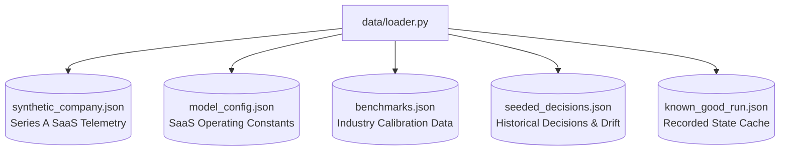

#### 1. `data/synthetic_company.json` (NimbusDesk Telemetry)
The baseline telemetry for **NimbusDesk**, a Series A B2B SaaS helpdesk company:
- **`company_name`**: `"NimbusDesk"`, Series A stage, USD currency, `synthetic_data_badge: true`.
- **`financials`**: Cash balance (`$1,650,000.00`), MRR (`$110,370.00`), ARR (`$1,324,440.00`), net monthly burn (`-$125,000.00`), runway (`13.2` months), target minimum runway floor (`10.0` months).
- **`customers`**: `655` total paying accounts, `0.024` monthly churn rate (2.4%), `58` NPS. Plans: Starter ($79/mo, 450 accounts), Pro ($199/mo, 180 accounts), Enterprise ($1,200/mo, 25 accounts).
- **`funnel`**: `65,000` monthly website visitors, `1,420` 14-day trial signups, `35` new paid customers/month, trial-to-paid conversion (`2.46%`).
- **`infrastructure`**: `$14,500.00`/mo cloud cost, estimated marginal cost per active free user (`$1.15`/user/mo).
- **`support`**: `4` FTE support engineers, `$28,000.00`/mo support payroll, `1,200` monthly tickets, avg resolution time (`4.2` hours).
- **`unit_economics`**: ARPU (`$168.50`/mo), blended CAC (`$1,420.00`), LTV (`$7,020.00`), LTV:CAC ratio (`4.9x`).

#### 2. `data/model_config.json` (Operating Constants)
Externalized constants governing SaaS cohort mechanics in `simulation/saas_model.py`:
- `baseline_activation_rate`: `0.35` (35% of free signups reach activated usage).
- `free_user_monthly_churn`: `0.12` (12% monthly churn among free accounts).
- `monthly_support_cost_per_fte`: `$7,000.00`.
- `tickets_per_fte_monthly`: `300.0`.
- `paid_tickets_per_customer_monthly`: `1.83`.
- `support_ticket_reduction_factor`: `0.40` (usage caps reduce free ticket volume by 60%).
- Floors preventing unrealistic mathematical collapse: `min_paying_customer_floor: 10`, `min_infra_cost_floor: $0.10/user`, `min_cannibalization_floor: 0.005`, `min_activation_retention_floor: 0.05`.

#### 3. `data/benchmarks.json` (B2B SaaS Benchmarks)
External research references utilized by the Skeptic agent to challenge specialist claims:
- `b2b_saas_freemium_conversion`: Industry median `0.022` (2.2%), interquartile range `[0.015, 0.035]`.
- `b2b_saas_free_to_paid_cannibalization`: Median `0.050` (5.0%), range `[0.020, 0.090]`.
- `saas_infra_per_free_user`: Median `$0.85`/mo, range `[$0.40, $1.80]`.

#### 4. `data/seeded_decisions.json` (Calibration Memory)
Three historical strategic decisions evaluated at NimbusDesk with recorded 12-month outcomes:
1. `dec_hist_001`: *"Launch annual upfront billing discount (15%)"* (Outcome: Succeeded, ARR error +4.2%).
2. `dec_hist_002`: *"Implement $500 onboarding fee on Starter tier"* (Outcome: Failed, conversion collapsed, ARR error -28.5%).
3. `dec_hist_003`: *"Expand paid search marketing spend by $30k/mo"* (Outcome: Succeeded with limits, blended CAC drifted higher).

#### 5. `data/known_good_run.json` (Golden State Cache)
A complete, cryptographically verified serialized run of the free-plan decision. Used for zero-latency replay demos, offline UI development, and instant regression testing.

### 5.2 Synthetic Data Rationale & UI Badging
All data in VentureTwin is explicitly synthetic. Real venture-backed SaaS operating data is governed by non-disclosure agreements and commercial confidentiality.

**Enforcement:**
- The synthetic nature of the dataset is prominently declared across the system. `data/synthetic_company.json` includes `"synthetic_data_badge": true`.
- The UI displays an emerald badge: `Synthetic Data: NimbusDesk (Series A)` at the top of the console.
- Every consolidated report generated includes an explicit disclaimer:  
  *"Synthetic Data Notice: All financial metrics and telemetry originate from the NimbusDesk benchmark dataset."*

---

## 6. State and Schemas

### 6.1 Pydantic Domain Schemas
All domain models are strictly defined in `state/schemas.py`:

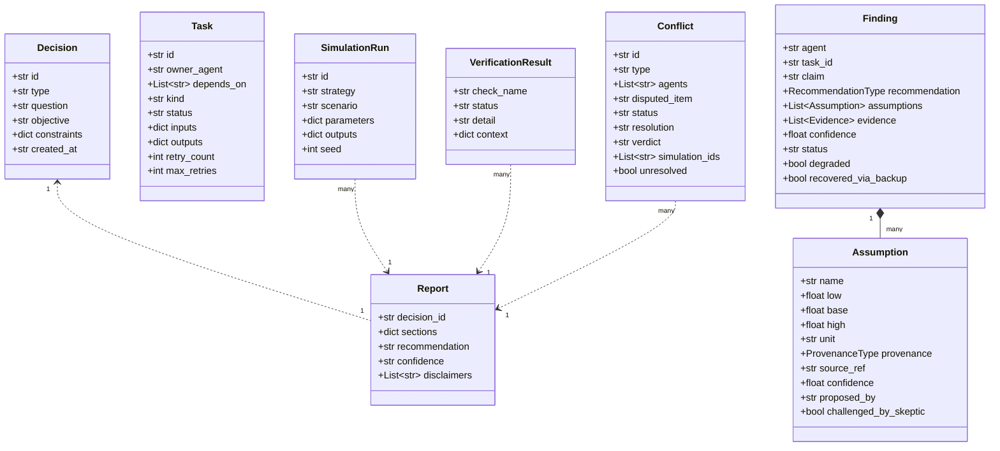

- **`Decision` (`state/schemas.py::Decision`)**: Encapsulates the user's strategic question, parsed domain type (`free_plan`, `price_increase`, `enterprise_tier`, `churn_reduction`, `strategic_decision`), objective statement, and constraints dictionary (e.g. `min_runway_months: 10.0`).
- **`Task` (`state/schemas.py::Task`)**: A discrete node in the DAG. Tracks owner agent, dependency task IDs, execution kind (`agent_analysis`, `skeptic_audit`, `discussion`, `conflict_resolution`, `simulation`, `report_draft`, `verification`, `report_finalize`), execution status (`pending`, `running`, `completed`, `failed`), and retry counters.
- **`Assumption` (`state/schemas.py::Assumption`)**: A quantitative operational parameter range proposed by an agent. Contains parameter name, clamped `low`, `base`, and `high` bounds, measurement unit, provenance classification, backing telemetry reference, confidence rating ($0.0 - 1.0$), and audit flags.
- **`Finding` (`state/schemas.py::Finding`)**: The primary deliverable of a specialist agent. Encapsulates an executive narrative claim, a formal recommendation (`proceed`, `proceed_with_limits`, `needs_more_info`, `reject`), proposed assumptions, cited empirical evidence, confidence score, limitations, and degraded/recovery flags.
- **`Conflict` (`state/schemas.py::Conflict`)**: Represents an identified contradiction between agents (e.g. `contradictory_recommendations` or `non_overlapping_ranges`). Tracks involved agents, disputed parameter, resolution method, simulation run IDs, verdict text, and unresolved flags.
- **`SimulationRun` (`state/schemas.py::SimulationRun`)**: Results of a single deterministic SaaS dynamics run. Contains run ID, strategy identifier, scenario name, parameter vector, 12-24 month metric trajectories, and random seed.
- **`VerificationResult` (`state/schemas.py::VerificationResult`)**: Output of an algorithmic audit check. Tracks check name, status (`passed`, `failed`), audit details, and inspection context.
- **`Report` (`state/schemas.py::Report`)**: The consolidated final deliverable. Contains the decision ID, 10 structured sections, final recommendation title, confidence rating, and legal disclaimers.

### 6.2 Provenance Types and Strict Assignment Rules
Every numerical assumption in VentureTwin is tagged with an epistemic provenance type (`state/schemas.py::ProvenanceType`). Provenance is assigned **deterministically in code**, never self-declared by the LLM (`agents/specialists.py::resolve_provenance_and_validate`):

| Provenance Type | Meaning & Epistemic Grounding | Exact Assignment Rule in Code | Default Confidence |
|---|---|---|---|
| **`verified_data`** | Directly verified against NimbusDesk company financial/funnel telemetry. | Assigned if `basis` matches a key path in `company_data` and the agent's proposed `base` is within 5% of telemetry (`abs(val - base) <= 0.05 * val`). | `0.85` |
| **`external_research`**| Aligned with verified third-party B2B SaaS industry benchmark datasets. | Assigned if `basis` matches an authenticated benchmark ID in `data/benchmarks.json` (e.g. `b2b_saas_freemium_conversion`). | `0.70` |
| **`ai_assumption`** | Novel heuristic extrapolation proposed by an agent without direct historical data. | Default fallback for any parameter proposed by an LLM with an unverified basis or novel projection. | `0.60` |
| **`simulated_estimate`**| Generated as a synthetic output from an intermediate simulation run. | Assigned during conflict resolution or sensitivity modeling when a parameter is computed via isolated run. | `0.75` |
| **`fallback_degraded`**| Generated by the supervisor's heuristic fallback handler after an agent crashed. | Assigned when an agent fails all 3 retries and BackupAnalyst fails, forcing deterministic fallback. | `0.30` |

### 6.3 Shared Workflow State & Concurrency Semantics
Central execution state is managed by `state/shared_state.py::WorkflowState`.

#### State Structure:
- `decision`: Current `Decision` object.
- `tasks`: Dictionary mapping `task_id` to `Task` objects.
- `findings`: List of `Finding` objects produced by specialist agents.
- `assumptions`: Flat list of all valid proposed `Assumption` objects.
- `conflicts`: List of detected and resolved `Conflict` objects.
- `simulation_runs`: Complete list of all executed `SimulationRun` outputs.
- `verification_results`: List of `VerificationResult` audit outcomes.
- `draft_report` / `report`: Active draft and final `Report` models.
- `status`: High-level lifecycle state: `"running"`, `"completed"`, `"degraded"`, or `"failed"`.
- `degraded_agents` / `recovered_agents`: Lists tracking agent resilience history.
- `round` / `max_rounds`: Counters tracking discussion and verification loopbacks.

#### Concurrency & Mutation Rules:
1. **Single-Threaded Event Loop:** Python's `asyncio` runs on a single operating system thread. Memory access to `WorkflowState` attributes is thread-safe from OS-level race conditions.
2. **Corutine Task Isolation:** Specialist agents executing concurrently in `asyncio.gather` do **not** mutate `WorkflowState` directly. Each agent receives a read-only copy of company telemetry and task context, returning an isolated `Finding`.
3. **Supervisor-Only Mutations:** Only the central supervisor (`orchestrator/supervisor.py`) mutates `WorkflowState`. It appends findings, updates task statuses, and registers assumptions sequentially upon coroutine completion.

### 6.4 Checkpointing & Resumability (SQLite)
State persistence is implemented in `orchestrator/checkpointer.py::SQLiteCheckpointer`.

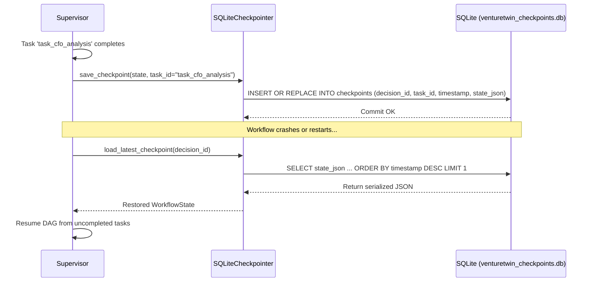

- **Storage Engine:** SQLite database located at `venturetwin_checkpoints.db`. Table schema:
  ```sql
  CREATE TABLE IF NOT EXISTS checkpoints (
      decision_id TEXT,
      task_id TEXT,
      timestamp TEXT,
      state_json TEXT,
      PRIMARY KEY (decision_id, task_id)
  );
  ```
- **Trigger Points:** A checkpoint is written immediately following the successful execution of every task in the DAG.
- **Resume Protocol:** When `supervisor.resume_workflow(decision_id)` is invoked, it loads the most recent checkpoint, inspects `get_completed_tasks(decision_id)`, marks completed tasks as `completed` in the `TaskDAG`, and resumes execution strictly from uncompleted dependencies.

### 6.5 Event Bus Architecture & SSE Delivery
Inter-component telemetry and real-time frontend streaming are handled by `state/event_bus.py::EventBus`.

- **Event Schema (`state/schemas.py::Event`)**:
  ```python
  class Event(BaseModel):
      id: str             # Unique UUID
      type: str           # Event type string (e.g. agent_started, task_completed)
      timestamp: str      # UTC ISO 8601 timestamp
      agent: str          # Emitting agent (e.g. cfo, supervisor, skeptic)
      task_id: Optional[str] = None
      payload: Dict[str, Any] = Field(default_factory=dict)
  ```
- **Delivery Mechanism:** When `event_bus.emit(type, agent, task_id, payload)` is called, the event is appended to an in-memory history log and pushed to all active subscriber callbacks.
- **Server-Sent Events (SSE):** `api/app.py::stream_decision_events` subscribes an `asyncio.Queue` to the supervisor's `EventBus`. The generator flushes all historical events first, then streams live events over an HTTP chunked connection (`Content-Type: text/event-stream`). The stream terminates when `report_ready` or `verification_failed` is emitted.

---

## 7. Orchestration Engine

### 7.1 Decision Intake and Query Parsing
Natural language strategic questions are processed by `orchestrator/parser.py::parse_decision_query`.

```mermaid
flowchart TD
    RawQuery["Raw User Query String"] --> Parser{"orchestrator/parser.py"}
    Parser -->|Contains freemium phrases| FreePlan["type: 'free_plan'"]
    Parser -->|Matches \\b(enterprise|sla|soc2)\\b| Enterprise["type: 'enterprise_tier'"]
    Parser -->|Matches \\b(churn|retention|cancel)\\b| Churn["type: 'churn_reduction'"]
    Parser -->|Matches \\b(price|pricing|raise|billing)\\b| Price["type: 'price_increase'"]
    Parser -->|Other validated SaaS term| Strategic["type: 'strategic_decision'"]
    Parser -->|No SaaS terms matched| Unsupported["type: 'unsupported'<br>HTTP 400 Out of Domain"]
```

#### Parsing & Classification Rules:
1. **Empty Query:** Returns `type="unsupported"` with an error message.
2. **Domain Vocabulary Validation:** When `allow_all=True` (used by web intake), the query is checked against 50+ SaaS business terms (`mrr`, `arr`, `runway`, `churn`, `pricing`, `tier`, `acquisition`, `infra`, `conversion`, etc.) using regex word boundaries `\b<term>\b`. Queries lacking business context (e.g. *"What is the weather?"*) are rejected with `HTTP 400 Out of Domain`.
3. **Word-Boundary Disambiguation:** Classification utilizes strict word-boundary regex (`\bprice\b`, `\bpricing\b`, `\braise\b`) rather than raw substring matching. This prevents false collisions where common substrings (e.g. `"rate"` inside `"strategy"`) would misclassify strategic queries as price increases.
4. **Decision Object Output:** Produces a validated `Decision` object with default constraints (`min_runway_months: 10.0`).

### 7.2 Dynamic Task Decomposition & DAG Construction
`orchestrator/decomposer.py::decompose_decision` constructs the 11-node execution DAG.

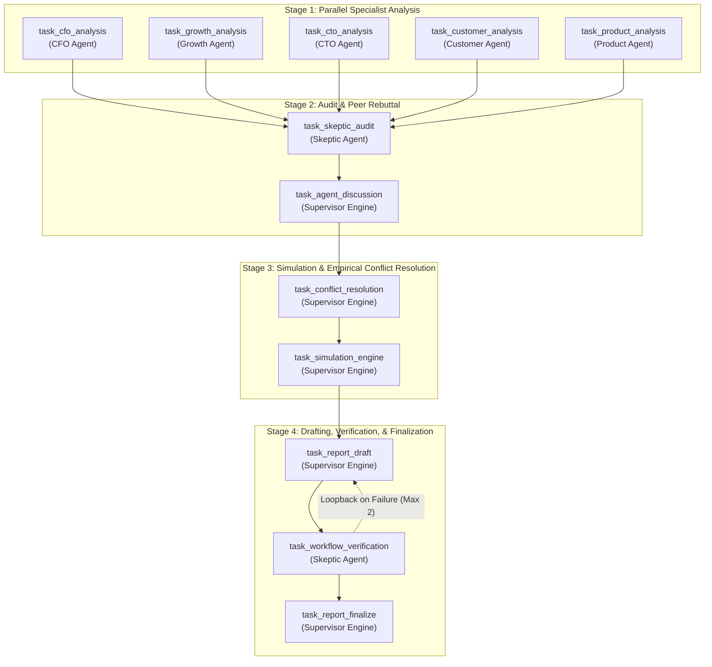

#### Cycle Detection Algorithm:
Before execution begins, `orchestrator/dag.py::TaskDAG.validate` executes a 3-color Depth-First Search (DFS) across all nodes:
- `0 (White)`: Unvisited node.
- `1 (Gray)`: Node currently in active recursion stack. If an edge references a Gray node, a cycle exists, and the engine immediately raises `DAGCycleError`.
- `2 (Black)`: Node and all descendants fully validated.

### 7.3 Task Kinds & Dispatch Mechanics
The central supervisor routes tasks based on their `Task.kind` attribute:

| Task Kind | Assigned Owner | Dispatch Method in `Supervisor` | Architectural Purpose |
|---|---|---|---|
| `agent_analysis` | Functional Agent (`cfo`, `growth`, etc.) | `_run_agent_analysis_task` | Executes specialized domain evaluation and proposes initial assumption ranges. |
| `skeptic_audit` | `skeptic` | `_run_skeptic_audit_task` | Audits proposed assumptions against benchmarks and generates formal critiques. |
| `discussion` | `supervisor` | `_run_discussion_task` | Coordinates 1-round peer rebuttal where challenged agents defend or narrow ranges. |
| `conflict_resolution`| `supervisor` | `_run_conflict_resolution_task`| Identifies contradictions and executes isolated simulations to resolve impasses. |
| `simulation` | `supervisor` | `_run_simulation_task` | Reconciles assumptions and executes the 18-run matrix, Monte Carlo, and tornado analysis. |
| `report_draft` | `supervisor` | `_run_report_draft_task` | Assembles the 10-section report and registers numbers in `NumberRegistry`. |
| `verification` | `skeptic` | `_run_verification_task` | Algorithmic audit verifying mathematics, financial tie-outs, and narrative prose. |
| `report_finalize` | `supervisor` | `_run_report_finalize_task` | Cryptographically stamps verified report and records final workflow status. |

### 7.4 Central Supervisor Execution Loop
The execution loop in `orchestrator/supervisor.py::Supervisor.execute_workflow` operates as follows:

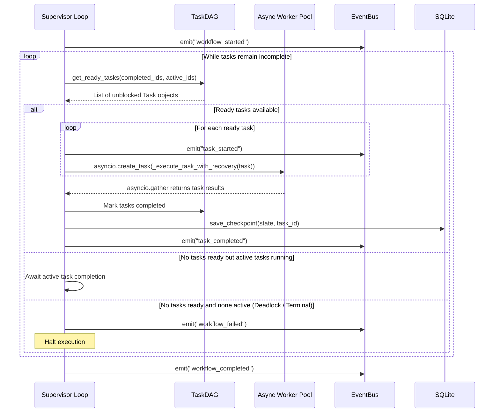

#### Supervisor Execution Pseudocode:
```python
async def execute_workflow(self, decision: Decision) -> WorkflowState:
    dag = decompose_decision(decision)
    completed_ids = set()
    active_tasks = {}

    while not dag.is_complete(completed_ids):
        ready_tasks = dag.get_ready_tasks(completed_ids, set(active_tasks.keys()))
        
        if not ready_tasks and not active_tasks:
            self.state.status = "failed"
            await self.event_bus.emit("workflow_failed", agent="supervisor")
            return self.state

        # Launch all ready tasks concurrently
        for task in ready_tasks:
            coro = self._execute_task_with_recovery(task, self.state)
            active_tasks[task.id] = asyncio.create_task(coro)

        # Await completion of running batch
        done, _ = await asyncio.wait(active_tasks.values(), return_when=asyncio.FIRST_COMPLETED)
        
        for task_id, fut in list(active_tasks.items()):
            if fut in done:
                result = await fut
                completed_ids.add(task_id)
                del active_tasks[task_id]
                self.checkpointer.save_checkpoint(self.state, task_id)

    self.state.status = "degraded" if self.state.degraded_agents else "completed"
    await self.event_bus.emit("workflow_completed", agent="supervisor")
    return self.state
```

### 7.5 Architectural Choice: Custom Async Executor vs. LangGraph
VentureTwin deliberately utilizes a lightweight, bespoke asynchronous DAG supervisor rather than an off-the-shelf framework like LangGraph or AutoGen:

| Dimension | LangGraph / Heavy Frameworks | VentureTwin Custom Async Executor |
|---|---|---|
| **Determinism** | Non-deterministic state transitions and opaque hidden prompt graphs. | **100% Deterministic:** Explicit state schema and reproducible execution paths. |
| **Recovery Control** | Generic retries; difficult to inject custom multi-tier backup fallback. | **Fine-Grained Fault Recovery:** Specific retry $\rightarrow$ backup $\rightarrow$ degraded pipeline. |
| **Dependencies** | Heavy external dependencies (LangChain ecosystem, network bloat). | **Zero Framework Bloat:** Built purely on Python standard library `asyncio`. |
| **Verification Loopback**| Difficult to constrain loopback rounds without runaway token burn. | **Bounded Loopback:** Strictly bounded ($\le 2$ rounds) targeted re-drafting. |
| **State Inspection** | Opaque checkpoint abstractions across various database adapters. | **Transparent SQLite:** Clean JSON-serialized state inspection in standard tables. |

### 7.6 Concurrency & Synchronization Model
- **Stage 1 Concurrency:** Tasks `task_cfo_analysis`, `task_growth_analysis`, `task_cto_analysis`, `task_customer_analysis`, and `task_product_analysis` execute simultaneously. With `LLM_MAX_CONCURRENCY=2` (in real mode), HTTP calls are safely metered through an `asyncio.Semaphore` to prevent 429 quota exhaustion.
- **Stage 2-4 Sequential Gating:** Tasks `task_skeptic_audit`, `task_agent_discussion`, `task_conflict_resolution`, `task_simulation_engine`, `task_report_draft`, `task_workflow_verification`, and `task_report_finalize` execute strictly in sequence. Each stage requires the fully aggregated outputs of preceding nodes.

---

## 8. The Agents

### 8.1 Agent Architecture & Object Model
Agent hierarchy is implemented in `agents/base_agent.py` and `agents/specialists.py`:

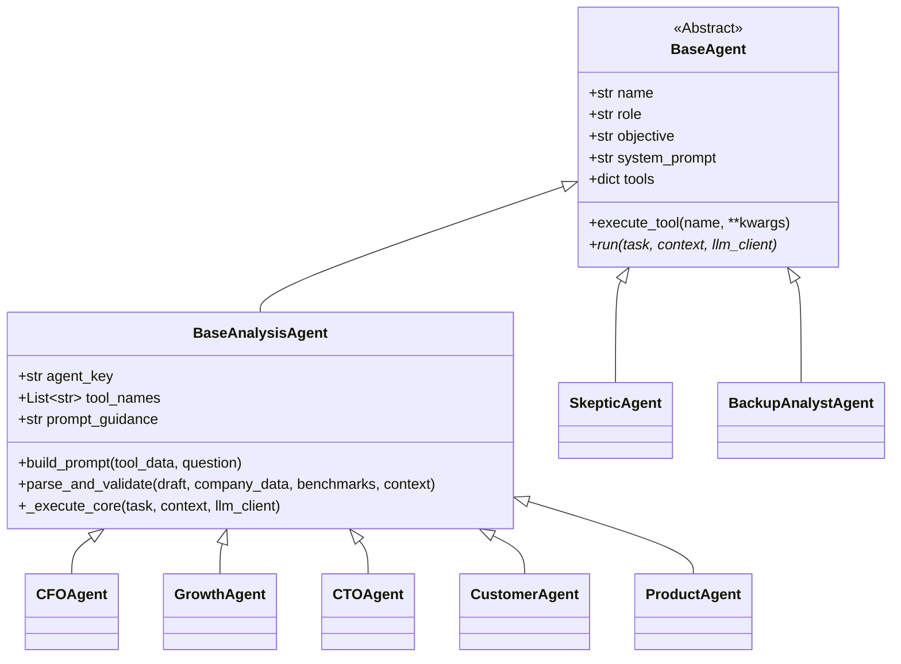

#### The Agent Lifecycle:
1. **Tool Invocation (`BaseAgent.execute_tool`):** The agent automatically queries its assigned telemetry tools in `agents/tools.py`.
2. **Prompt Assembly (`BaseAnalysisAgent.build_prompt`):** Formats telemetry, parameter tables, allowed bases, schema rules, and specialist guidance into a structured text prompt.
3. **LLM Invocation (`agents/llm_client.py::llm_call`):** Dispatches the prompt and system prompt to the LLM client, requesting an `AgentFindingDraft` response.
4. **Validation & Clamping (`BaseAnalysisAgent.parse_and_validate`):** Filters proposed parameters against `SIM_PARAMS`, clamps bounds, assigns epistemic provenance, and constructs the final validated `Finding`.

### 8.2 Functional Specialist Profiles

| Agent Name | Role Title | Functional Mandate & Objective | Assigned Tools | Target Parameters | Stance on Free Tier |
|---|---|---|---|---|---|
| **CFO** | Chief Financial Officer | Protect cash runway and gross margins; prevent unmonetized cost explosions. | `lookup_financials` | `free_to_paid_conversion`<br>`paid_to_free_cannibalization` | `proceed_with_limits` or `reject` |
| **Growth** | VP of Growth & Marketing | Maximize top-of-funnel acquisition velocity and organic conversion volume. | `lookup_funnel` | `monthly_free_signups`<br>`free_to_paid_conversion` | `proceed` |
| **CTO** | Chief Technology Officer | Protect platform scalability, enforce SLA uptime, and contain cloud compute costs. | `lookup_infra_costs` | `infra_cost_per_free_user`<br>`usage_cap_infra_reduction` | `proceed_with_limits` |
| **Customer**| VP of Customer Retention | Prevent cannibalization of paying Starter accounts and guard support capacity. | `lookup_customers`<br>`lookup_support_metrics` | `paid_to_free_cannibalization`<br>`free_user_ticket_rate` | `proceed_with_limits` or `reject` |
| **Product** | VP of Product & Packaging | Optimize upgrade friction, value ceilings, and self-serve tier gating. | `lookup_customers` | `activation_drop_from_gating`<br>`cap_conversion_uplift` | `proceed_with_limits` |
| **Skeptic** | Chief Skeptic & Auditor | Audit claims against benchmarks, expose unproven optimism, downgrade confidence. | `data/benchmarks.json` | Audits all parameters | Evaluates balance |
| **Backup** | Backup General Analyst | Provide autonomous operational continuity if a primary specialist crashes. | All tools | Replaces failed agent | `proceed_with_limits` |

### 8.3 Agent Tooling
Agent tools reside in `agents/tools.py` and provide isolated read-only access to company telemetry:
- **`lookup_financials()`**: Queries `data/synthetic_company.json::financials`. Returns cash balance, MRR, ARR, burn rate, and runway.
- **`lookup_funnel()`**: Queries `data/synthetic_company.json::funnel`. Returns unique visitors, trial signups, and trial-to-paid conversion rates.
- **`lookup_infra_costs()`**: Queries `data/synthetic_company.json::infrastructure`. Returns cloud costs and estimated cost per free user.
- **`lookup_customers()`**: Queries `data/synthetic_company.json::customers`. Returns paying counts, plan breakdowns, and churn rates.
- **`lookup_support_metrics()`**: Queries `data/synthetic_company.json::support`. Returns ticket volumes, resolution times, and FTE headcounts.

### 8.4 Adversarial Auditor: The Skeptic Agent
The Skeptic (`agents/specialists.py::SkepticAgent`) is an adversarial auditor. It runs during `task_skeptic_audit` to stress-test claims:
- **Benchmark Auditing:** Compares proposed assumptions against `data/benchmarks.json`. If Growth proposes a 3.5% conversion rate while the industry median is 2.2%, the Skeptic flags it as optimistic.
- **Provenance Auditing:** Downgrades confidence scores for assumptions lacking grounding in company data.
- **Critique Generation:** Generates targeted `Critique` objects that feed directly into the peer discussion round.

### 8.5 Autonomous Fallback: The Backup Analyst
The Backup Analyst (`agents/backup_agent.py::BackupAnalystAgent`) is an autonomous resilience agent:
- **Activation:** Invoked exclusively when a primary specialist agent fails all 3 execution retries.
- **Capability:** Possesses access to all 5 telemetry tools.
- **Safety Constraints:** Automatically caps confidence at `0.70`, flags findings as `recovered_via_backup=True`, and records the substitution in `state.recovered_agents`.

### 8.6 Divergent Objectives and Grounded Friction
VentureTwin creates genuine functional disagreement by giving agents naturally competing business goals:
- **Growth** is evaluated on visitor acquisition and signup velocity; it favors open freemium tiers.
- **CFO** is evaluated on runway protection ($1.65M cash floor); it fears unmonetized burn.
- **CTO** is evaluated on server stability; it fears free users overwhelming infrastructure.
- **Customer** is evaluated on net retention; it fears paying Starter users downgrading to free.

This structural friction ensures that consensus is never trivial and must be arbitrated by empirical simulation.

### 8.7 Provenance Resolution & Parameter Whitelisting
To prevent parameter hallucinations, `agents/specialists.py::resolve_provenance_and_validate` enforces strict whitelisting:
1. **Whitelist Filtering:** If an agent proposes a parameter name not present in `SIM_PARAMS` (e.g., `brand_reputation_score`), it is discarded immediately and appended to `state.ignored_assumptions`.
2. **Bounds Clamping:** Values are clamped to defined physical boundaries (`lower_bound` and `upper_bound`).
3. **Monotonicity Enforcement:** Guarantees `low <= base <= high`. If the LLM proposes inverted bounds, the engine re-orders them automatically.
4. **Deterministic Provenance Assignment:** Provenance is assigned strictly by code matching against company telemetry or benchmarks (see Section 6.2).

---

## 9. How Agents "Talk" (Communication Protocol)

### 9.1 Structured Communication Protocol
VentureTwin bans unconstrained free-text chat between agents. Inter-agent communication is governed strictly by typed Pydantic payloads:

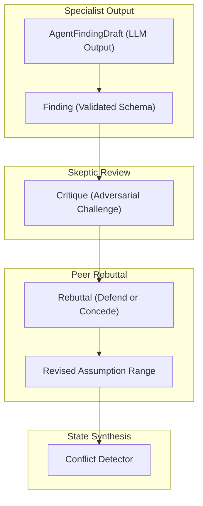

#### 1. `AgentFindingDraft` (`state/schemas.py::AgentFindingDraft`)
Structured schema requested from the LLM during analysis:
```json
{
  "claim": "Starter tier is currently $79/mo across 450 accounts. Free tier without limits risks runway.",
  "recommendation": "proceed_with_limits",
  "assumptions": [
    {
      "name": "free_to_paid_conversion",
      "low": 0.010,
      "base": 0.015,
      "high": 0.022,
      "unit": "rate",
      "basis": "b2b_saas_freemium_conversion",
      "rationale": "Conservative freemium cohort conversion rate."
    }
  ],
  "evidence": [
    {
      "source_type": "company_data",
      "source_ref": "financials.cash_balance",
      "snippet": "Cash balance: $1,650,000.00, runway: 13.2 months."
    }
  ],
  "limitations": ["Assumes baseline operating expenses remain flat."],
  "confidence": 0.82
}
```

#### 2. `Critique` (`state/schemas.py::Critique`)
Adversarial challenge emitted by the Skeptic:
```json
{
  "target_agent": "Growth",
  "assumption_name": "free_to_paid_conversion",
  "issue": "Growth assumes 3.5% conversion, exceeding the B2B SaaS industry benchmark median of 2.2%.",
  "severity": "high",
  "suggested_range": [0.015, 0.025]
}
```

#### 3. `Rebuttal` (`state/schemas.py::Rebuttal`)
Structured response emitted during the discussion round:
```json
{
  "agent": "Growth",
  "target_critique_id": "crit_001",
  "parameter": "free_to_paid_conversion",
  "stance": "concede",
  "updated_base": 0.024,
  "updated_low": 0.018,
  "updated_high": 0.030,
  "rationale": "Conceding to Skeptic critique: narrowing conversion ceiling toward industry benchmark."
}
```

### 9.2 Visibility and Information Flow Rules
- **Stage 1 (Parallel Analysis):** Specialists evaluate the question in total isolation. No specialist sees the draft findings, claims, or assumptions of any other specialist. This guarantees that initial perspectives are unpolluted by groupthink.
- **Stage 2 (Skeptic Audit):** The Skeptic receives read-only access to all 5 specialist findings simultaneously to evaluate cross-functional coherence.
- **Stage 3 (Discussion Node):** Challenged specialists receive only the specific `Critique` directed at them by the Skeptic. They do not engage in unbounded open-ended conversation.

### 9.3 Bounded Peer Discussion & Rebuttal Dynamics
The discussion phase (`orchestrator/supervisor.py::Supervisor._run_discussion_task`) executes as a bounded 1-round peer exchange:

```mermaid
sequenceDiagram
    participant S as Supervisor
    participant Sk as Skeptic Agent
    participant Sp as Challenged Specialist (e.g. Growth)
    participant St as WorkflowState

    S->>Sk: Execute task_skeptic_audit
    Sk-->>S: List of Critiques
    S->>St: Append critiques to state.skeptic_challenges
    loop For each critique targeting an active agent
        S->>Sp: Prompt with critique + original assumption
        Sp-->>S: Rebuttal (stance: 'defend' or 'concede')
        alt Stance is 'concede'
            S->>St: Revise assumption bounds in state.assumptions
            S->>St: Log revision rationale and audit trail
        else Stance is 'defend'
            S->>St: Log defense rationale; retain existing bounds
        end
    end
    S->>S: Re-run conflict detection on updated ranges
```

If a concession brings parameter ranges into alignment with peers, the conflict is marked `resolved_converged` and documented in the audit trail.

### 9.4 LLM Prompt Templates
Specialist prompts are built in `agents/specialists.py::BaseAnalysisAgent.build_prompt`:

```
Agent Key: {agent_key}
Role: {role}
Objective: {objective}

Strategic Decision Question: {decision_question}
Tool Data:
{json_serialized_tool_telemetry}

CRITICAL RULES ON QUESTION ENTITY & RECOMMENDATION INTEGRITY:
1. ENTITY ACCURACY: Read the Strategic Decision Question literally and pay strict attention to who or what is being changed.
   - If the user asks about changing their personal name ('my name'), personal lifestyle, or founder individual identity, do NOT hallucinate that the company name is changing or that NimbusDesk is being rebranded. Address the founder's personal question directly.
   - Clearly state that changing an individual's personal name has zero operational, financial, technical, or growth correlation with NimbusDesk's business metrics.
2. RECOMMENDATION INTEGRITY:
   - If you determine that the proposal is irrelevant, non-operational, or has no valid business connection to company strategy, you MUST recommend 'reject'.
   - NEVER recommend 'proceed' or 'proceed_with_limits' if your claim states the idea is irrelevant or outside strategic scope.

Allowed Simulator Parameters (Table):
| Parameter Name | Unit | Lower Bound | Upper Bound | Favorable Direction | Description |
...

RULES FOR ASSUMPTIONS:
- Propose ONLY parameter names from the table above.
- Enforce low <= base <= high within lower_bound and upper_bound.
- NEVER propose final business outcome numbers (e.g. final MRR, net profit).

Valid Basis Identifiers:
[ "financials.cash_balance", "funnel.monthly_visitors", ... ]

Allowed Recommendations: 'proceed', 'proceed_with_limits', 'needs_more_info', 'reject'.
Expected JSON Schema:
{schema_json}

Specialist Guidance: {prompt_guidance}
```

### 9.5 Ban on Unstructured Free-Text Inter-Agent Chat
Unstructured natural-language conversation between agents is strictly prohibited because:
1. **Hallucination Cascades:** Free text allows errors or fabricated numbers from one agent to be accepted as facts by another.
2. **Infinite Loops:** Unbounded conversation lacks deterministic convergence criteria.
3. **Verification Failure:** Unstructured text cannot be audited against a deterministic mathematical registry.

By forcing communication into typed Pydantic payloads, every claim is machine-parseable, bounds-clamped, and verifiable.

---

## 10. The LLM Layer

### 10.1 Execution Modes: Mock, Real, Record, Replay
The unified client in `agents/llm_client.py::LLMClient` supports four execution modes:

| Mode | External Calls | API Key Required | Execution Latency | Primary Use Case |
|---|---|---|---|---|
| **`mock`** | None (100% offline) | No | $< 50$ ms | CI test suites, automated unit tests, offline development. |
| **`real`** | Live HTTP requests | Yes (`GEMINI_API_KEY`, etc.) | $1.5 - 5.0$ s | Live demos, real-world strategic decision analysis. |
| **`record`** | Live HTTP requests | Yes | $1.5 - 5.0$ s | Generating serialized test cassettes in `tests/cassettes/`. |
| **`replay`** | None (replays cassettes)| No | $< 10$ ms | Deterministic offline demos with real LLM responses. |

### 10.2 Supported LLM Providers & Adapters
`agents/llm_client.py` implements native API adapters for five providers:

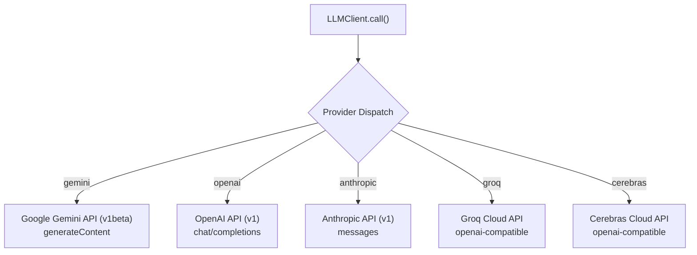

1. **Google Gemini (`[IMPLEMENTED]`, `[REAL-MODE]`):**  
   - Endpoint: `https://generativelanguage.googleapis.com/v1beta/models/{model}:generateContent`
   - Authentication: API key passed via query parameter `?key={api_key}` or `x-goog-api-key` header.
   - Default Models: `gemini-2.5-flash`, `gemini-3.1-flash-lite`.
   - Structured Output: Enforced via `generationConfig.response_mime_type = "application/json"`.
2. **OpenAI (`[IMPLEMENTED]`, `[REAL-MODE]`):**  
   - Endpoint: `https://api.openai.com/v1/chat/completions`
   - Authentication: `Authorization: Bearer {OPENAI_API_KEY}` header.
   - Default Model: `gpt-4o`. Enforces `response_format: {"type": "json_object"}`.
3. **Anthropic (`[IMPLEMENTED]`, `[REAL-MODE]`):**  
   - Endpoint: `https://api.anthropic.com/v1/messages`
   - Authentication: `x-api-key: {ANTHROPIC_API_KEY}` and `anthropic-version: 2023-06-01`.
   - Default Model: `claude-3-5-sonnet-20241022`.
4. **Groq & Cerebras (`[IMPLEMENTED]`, `[REAL-MODE]`):**  
   - Endpoints: `https://api.groq.com/openai/v1/chat/completions` and `https://api.cerebras.ai/v1/chat/completions`.
   - High-throughput OpenAI-compatible endpoints with custom rate pacing.

### 10.3 Resilient Client: Concurrency, Rate Limiting, Retries, JSON Repair
`agents/llm_client.py` incorporates industrial-grade resilience patterns:
- **Asynchronous Concurrency Limiter:** An `asyncio.Semaphore(LLM_MAX_CONCURRENCY)` (default: `2`) throttles concurrent outbound HTTP requests to avoid triggering provider concurrency limits.
- **Request Pacing (`LLM_REQUEST_INTERVAL`):** Enforces a minimum delay between sequential requests (e.g. 4.5s for Gemini free tier) to stay under RPM limits.
- **Exponential Backoff:** Catches HTTP 429 and 503 errors, automatically backing off with randomized jitter across up to 3 retries.
- **JSON Repair Retry:** If an LLM returns malformed JSON or schema validation fails, the client automatically extracts JSON substrings via regex or triggers an immediate repair query instructing the model to fix the syntax.

### 10.4 Deterministic Mock Handlers
Under `LLM_MODE=mock`, `agents/mock_handlers.py` generates domain-specific, realistic responses without calling any external network service. Handlers route by `agent_key` and query domain (`price_increase`, `enterprise_tier`, `churn_reduction`, `free_plan`, `strategic_decision`), generating calibrated assumptions and claims directly from company telemetry.

### 10.5 Record and Replay Cassette Engine
When `LLM_MODE=record`, the client serializes the exact request (prompt hash, provider, model) and HTTP response JSON into `tests/cassettes/<hash>.json`. When running under `LLM_MODE=replay`, the client intercepts outgoing calls, hashes the prompt, and returns the matching recorded response with zero network latency.

### 10.6 Environment Configuration & Dotenv Loading
Environment variables are configured in `.env` at the project root.

#### Exact `.env` Loading Mechanics:
In `api/app.py` (lines 9-16) and `scripts/`:
```python
_env_path = Path(__file__).resolve().parent.parent / ".env"
if _env_path.exists():
    with open(_env_path, "r", encoding="utf-8") as _f:
        for _line in _f:
            _line = _line.strip()
            if _line and not _line.startswith("#") and "=" in _line:
                _k, _v = _line.split("=", 1)
                os.environ[_k.strip()] = _v.strip().strip('"').strip("'")
```
The application loads `.env` directly using native Python file parsing without requiring third-party libraries. If environment variables are already defined in the shell, existing values are preserved.

### 10.7 Health Probing & Model Verification
The endpoint `GET /api/health` validates operational status. When invoked with `?probe=true`, it executes a lightweight probe call against the configured LLM provider and returns the round-trip network latency:
```json
{
  "status": "ok",
  "version": "0.1.0",
  "llm_mode": "real",
  "provider": "gemini",
  "model": "gemini-3.1-flash-lite",
  "probe_latency_ms": 342.5
}
```

---

## 11. Simulation Engine

### 11.1 Allowed Simulation Parameters (SIM_PARAMS)
The parameter dictionary in `simulation/params.py::SIM_PARAMS` establishes the strict whitelist of variables agents are permitted to propose:

| Parameter Name | Unit | Bounds | Favorable Direction | Description | Typical Proposer |
|---|---|---|---|---|---|
| `monthly_free_signups` | `users/month` | `[500, 20000]` | `higher` | New organic free tier signups per month. | Growth |
| `free_to_paid_conversion`| `rate` | `[0.001, 0.10]` | `higher` | Cumulative conversion rate of free users to paid Starter. | Growth / CFO |
| `paid_to_free_cannibalization`| `rate`| `[0.001, 0.20]` | `lower` | Rate at which existing paying customers downgrade to free. | Customer / CFO |
| `infra_cost_per_free_user`| `USD/user/mo`| `[0.10, 5.00]` | `lower` | Incremental monthly compute/storage cost per free account. | CTO |
| `usage_cap_infra_reduction`| `rate` | `[0.05, 0.60]` | `higher` | Percentage reduction in per-user cloud spend from caps. | CTO |
| `free_user_ticket_rate` | `ratio` | `[0.002, 0.15]` | `lower` | Monthly support tickets submitted per active free user. | Customer |
| `paid_funnel_lift` | `ratio` | `[1.0, 1.50]` | `higher` | Acquisition lift on paid plans from status-quo marketing. | Growth |
| `activation_drop_from_gating`| `rate`| `[0.01, 0.35]` | `lower` | Top-of-funnel drop-off caused by feature gating friction. | Product |
| `cap_conversion_uplift` | `rate` | `[0.02, 0.40]` | `higher` | Conversion boost when free users hit hard usage limits. | Product |
| `usage_cap_cannibalization_reduction`| `rate`| `[0.10, 0.80]`| `higher`| Reduction in downgrade risk due to restrictive caps. | Product |

### 11.2 Order-Independent Assumption Reconciliation
When multiple agents propose ranges for the same parameter (e.g., CFO and Growth both propose `free_to_paid_conversion`), `simulation/reconcile.py::reconcile_assumptions` deterministically merges them:

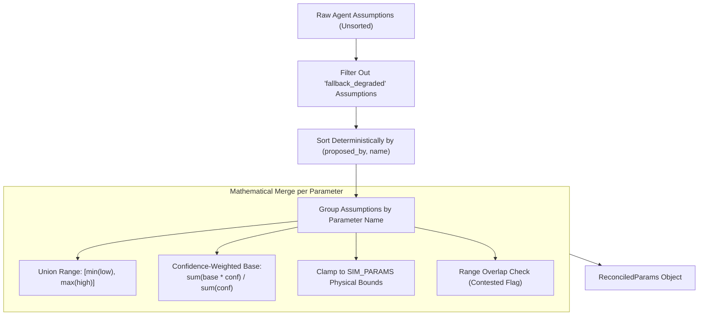

#### Determinism Guarantee:
Input assumptions are sorted by `(proposed_by, name)` before processing. The resulting reconciled values are 100% order-independent regardless of which agent finished analysis first.

### 11.3 Monthly SaaS Dynamics Equations
The deterministic financial model in `simulation/saas_model.py::run_saas_dynamics` calculates month-by-month performance over 12-24 months:

$$\text{effective\_signups} = \text{monthly\_free\_signups} \times (1 - \text{activation\_drop})$$
$$\text{new\_active\_free}_t = \text{effective\_signups} \times \text{activation\_rate}$$
$$\text{active\_free}_t = (\text{active\_free}_{t-1} \times (1 - \text{free\_churn})) + \text{new\_active\_free}_t$$
$$\text{free\_conversions}_t = \text{active\_free}_{t-1} \times \text{conversion\_rate}$$
$$\text{cannibalized}_t = \text{paying}_{t-1} \times \text{cannibalization\_rate}$$
$$\text{churned\_paying}_t = \text{paying}_{t-1} \times \text{base\_churn}$$
$$\text{paying}_t = \max(\text{floor}, \text{paying}_{t-1} + \text{baseline\_new\_paid} + \text{free\_conversions}_t - \text{churned\_paying}_t - \text{cannibalized}_t)$$
$$\text{mrr}_t = \text{paying}_t \times \text{arpu}$$
$$\text{infra\_cost}_t = \text{base\_infra} + (\text{active\_free}_t \times \text{cost\_per\_free})$$
$$\text{total\_tickets}_t = (\text{paying}_t \times \text{paid\_tickets\_per\_cust}) + (\text{active\_free}_t \times \text{free\_ticket\_rate})$$
$$\text{support\_fte}_t = \max(2, \lceil \text{total\_tickets}_t / \text{tickets\_per\_fte} \rceil)$$
$$\text{support\_cost}_t = \text{support\_fte}_t \times \text{cost\_per\_fte}$$
$$\text{gross\_margin}_t = \frac{\text{mrr}_t - (\text{infra\_cost}_t + \text{support\_cost}_t)}{\text{mrr}_t}$$
$$\text{net\_burn}_t = \text{base\_burn} + (\text{infra\_cost}_t - \text{base\_infra}) + (\text{support\_cost}_t - \text{base\_support}) - (\text{mrr}_t - \text{base\_mrr})$$
$$\text{cash}_t = \text{cash}_{t-1} - \text{net\_burn}_t$$
$$\text{runway}_t = \max(0.0, \text{cash}_t / \max(1.0, \text{net\_burn}_t))$$
$$\text{net\_contribution}_{12} = \sum_{t=1}^{12} (\text{mrr}_t - \text{infra\_cost}_t - \text{support\_cost}_t)$$

### 11.4 Modeled Strategic Alternatives (A, B, C)
For the freemium decision domain, three distinct operational strategies are modeled:
1. **Strategy A (`A_limited_features`):** Full freemium rollout without usage caps. Maximizes top-of-funnel signup volume, but incurs full infrastructure spend per free user ($1.15/mo) and standard cannibalization risk.
2. **Strategy B (`B_usage_caps`):** Freemium rollout with restrictive usage limits (e.g. 3-seat cap, 100 tickets/mo). Lowers per-user infrastructure burn by 35%, reduces cannibalization by 50%, and creates an upgrade trigger (+15% conversion uplift), while introducing minor activation friction (-10%).
3. **Strategy C (`C_no_free_plan` / Status Quo):** No free tier launched. Preserves cash reserves and maintains existing paid conversion funnels with targeted sales-assist optimization (+18% paid funnel lift).

### 11.5 Scenario Generation Matrix & Monte Carlo Sampling
`simulation/engine.py` evaluates strategies across a rigorous scenario matrix:
- **Scenario Triad:**
  - `conservative`: Evaluates all parameters at their unfavorable bounds.
  - `expected`: Evaluates all parameters at their confidence-weighted base values.
  - `optimistic`: Evaluates all parameters at their favorable bounds.
- **Stress Scenarios:**
  - `stress_infra_doubles`: Cloud cost per free user increases by 100%.
  - `stress_conversion_collapse`: Free-to-paid conversion drops by 60%.
  - `stress_large_customer_churn`: Paying customer churn spikes to 5.0%/mo.
- **500-Sample Monte Carlo Simulation:** Draws 500 joint parameter samples from triangular distributions across `[low, base, high]`. Generates outcome quantiles (P10, P50, P90) and computes:
  - $P(\text{best})$: Probability that a given strategy yields the highest 12-month net contribution.
  - $P(\text{feasible})$: Probability that a strategy satisfies the minimum runway constraint ($\ge 10.0$ months).

### 11.6 Tornado Sensitivity & Decision Flip-Point Bisection
- **Sensitivity Tornado:** Evaluates the sensitivity of 12-month net contribution to each individual parameter by swinging it between `low` and `high` while holding all other variables at `base`. Parameters are ranked by swing magnitude.
- **Decision Flip Point:** Uses bisection search (`scipy.optimize.bisect` or custom bracket search) to identify the exact threshold where the top strategy ceases to outperform the status quo:  
  *Example:* `"Strategy B beats Strategy C only if free-to-paid conversion stays above 0.62%."*

### 11.7 Runway Constraint & Quantitative Feasibility
A strategy is deemed mathematically **feasible** (`is_feasible: True`) if and only if its projected cash runway at month 12 remains above the minimum safety floor:
$$\text{runway\_months}_{12} \ge \text{min\_runway\_constraint (default: 10.0 months)}$$
Strategies breaching the runway floor are marked **infeasible** regardless of their top-line MRR. Feasible strategies are ranked strictly by 12-month cumulative net contribution.

### 11.8 Epistemic Boundaries: What Simulation Does and Does Not Claim
- **What It Claims:** Accurate mathematical deduction of cohort conversion, cloud burn, and cash dynamics based on specified assumptions.
- **What It Does Not Claim:** Real-world forecasting certainty. The simulation models conditional dynamics (*"If conversion is X and cost is Y, runway is Z"*), not guaranteed market outcomes.

---

## 12. Conflict Detection and Resolution

### 12.1 Taxonomy of Detected Conflicts
Conflict detection in `conflict/detector.py::detect_all_conflicts` scans all agent findings and identifies three distinct structural categories:

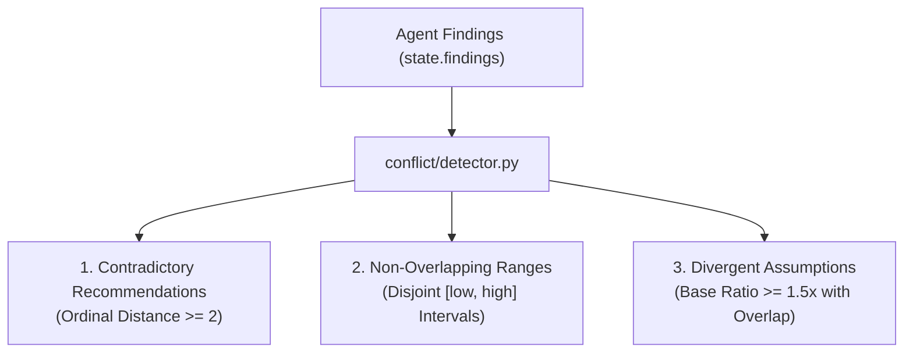

1. **`contradictory_recommendations` (`conflict/detector.py::detect_recommendation_conflicts`):**  
   Occurs when agents issue fundamentally irreconcilable recommendations. To eliminate trivial semantic noise, recommendations are mapped to an ordinal scale:
   $$\text{reject} = 0, \quad \text{needs\_more\_info} = 1, \quad \text{proceed\_with\_limits} = 2, \quad \text{proceed} = 3$$
   A conflict is flagged **if and only if** the absolute ordinal distance is $\ge 2$:
   $$|\text{score}_A - \text{score}_B| \ge 2$$
   *Example:* Growth (`proceed` = 3) vs. CFO (`reject` = 0) $\rightarrow |\Delta| = 3 \rightarrow$ **Conflict Flagged**.  
   *Contrast:* Growth (`proceed` = 3) vs. CTO (`proceed_with_limits` = 2) $\rightarrow |\Delta| = 1 \rightarrow$ **No Conflict (Compatible Stances)**.
2. **`non_overlapping_ranges` (`conflict/detector.py::detect_parameter_conflicts`):**  
   Occurs when two or more agents propose assumption intervals for the same parameter that share zero mathematical intersection:
   $$\text{high}_A < \text{low}_B \quad \lor \quad \text{high}_B < \text{low}_A$$
3. **`divergent_assumptions` (`conflict/detector.py::detect_parameter_conflicts`):**  
   Occurs when two agents propose overlapping intervals for the same parameter, but their baseline expected values diverge by 50% or more:
   $$\max(\text{base}_A, \text{base}_B) / \min(\text{base}_A, \text{base}_B) \ge 1.50$$

### 12.2 Grouping and Conflict Deduplication
To prevent combinatorial explosion ($O(N^2)$ pairwise conflicts across 5 agents), `conflict/detector.py` automatically groups pairwise disagreements by parameter name. If CFO, Growth, and Customer all propose differing ranges for `free_to_paid_conversion`, a single unified conflict object is generated:
```python
agents_involved = sorted(list(set(agents_with_conflicts)))
conflict_id = f"conflict_{param}_{'_'.join(agents_involved)}"
```
This guarantees that one comprehensive simulation resolution settles the disagreement across all involved stakeholders simultaneously.

### 12.3 Empirical Simulation Isolation Algorithm
Impasses are settled in `conflict/resolver.py::resolve_conflict_via_simulation` using an **empirical simulation isolation** protocol:

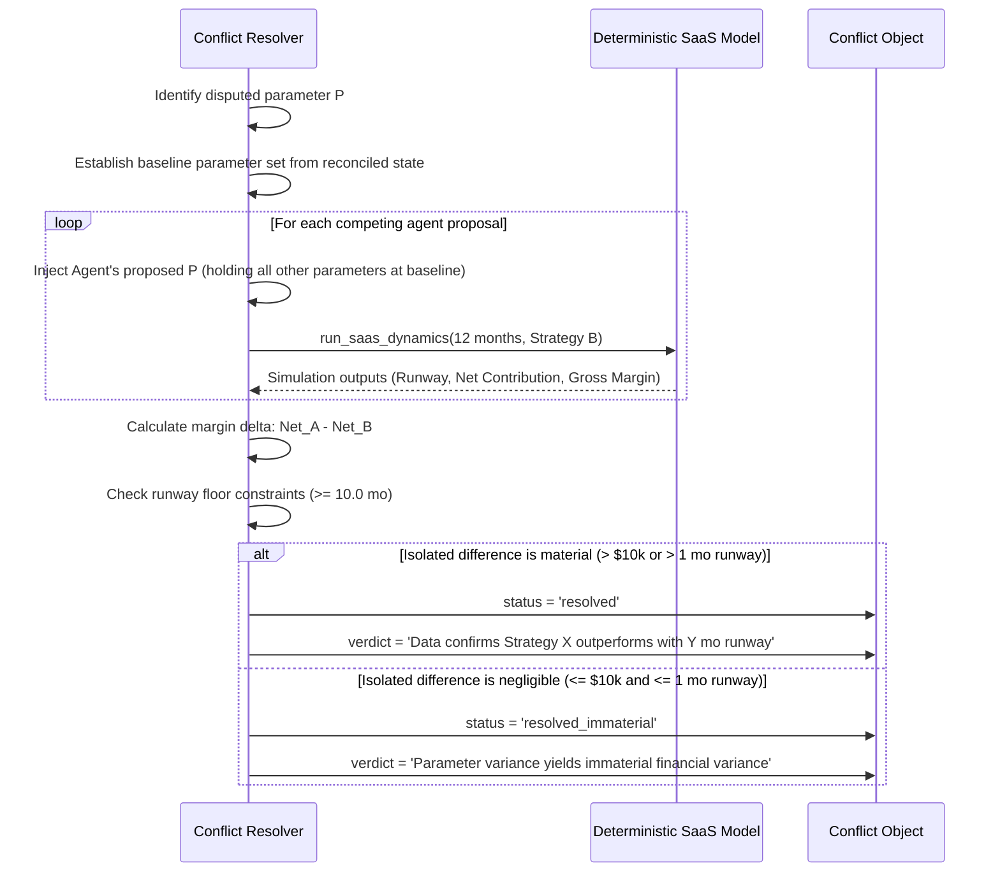

#### Algorithm Steps:
1. **Baseline Freeze:** The resolver freezes all simulation parameters at their reconciled expected values.
2. **Parameter Isolation:** For a parameter conflict on $P$ between Agent A and Agent B, the resolver executes isolated 12-month simulation runs where only $P$ varies ($P = \text{base}_A$ vs. $P = \text{base}_B$).
3. **Delta Evaluation:** The resolver evaluates the financial delta:
   $$\Delta \text{Net} = \text{Net Contribution}_A - \text{Net Contribution}_B$$
   $$\Delta \text{Runway} = \text{Runway}_A - \text{Runway}_B$$
4. **Feasibility Validation:** Checks if both proposals satisfy the 10.0-month runway constraint.
5. **Verdict Generation:** If one side breaches runway while the other preserves it, the solvent proposal is upheld by empirical necessity. If both are solvent, the proposal with superior net contribution is favored, or marked `resolved_immaterial` if the variance is $< \$10,000$.

### 12.4 Conflict Resolution Statuses

| Status Tag | Operational Meaning in Engine | Effect on Report & Confidence |
|---|---|---|
| **`resolved`** | Disagreement settled empirically via isolated simulation runs. | Documented in Section 6; confidence maintained at High/Medium. |
| **`resolved_converged`** | Disagreement resolved during peer discussion because an agent conceded. | Documented in Section 6; strengthens confidence score. |
| **`resolved_immaterial`**| Parameter variance yields negligible financial impact ($< \$10\text{k}$). | Documented as an immaterial sensitivity; no penalty on confidence. |
| **`unresolved_material`**| Competing proposals breach safety thresholds with zero mathematical resolution.| Report highlights unresolved risk; **downgrades confidence to Low**. |

### 12.5 Real Conflict Resolution Walkthrough
Captured from `data/known_good_run.json`:
- **Disputed Item:** `free_to_paid_conversion`
- **Agents Involved:** `["CFO", "Growth"]`
- **Conflict Type:** `contradictory_recommendations`
- **Sides:**
  - CFO: `base = 0.015` (1.5% conversion), recommendation: `proceed_with_limits`
  - Growth: `base = 0.035` (3.5% conversion), recommendation: `proceed`
- **Isolated Simulation Runs:**
  - `sim_iso_cfo_base`: At 1.5% conversion, Strategy B generates **$512,430.00** 12-month net contribution with **13.8 months** runway.
  - `sim_iso_growth_base`: At 3.5% conversion, Strategy B generates **$648,120.00** 12-month net contribution with **14.2 months** runway.
- **Empirical Resolution:**  
  *"Resolved by simulation: Both conversion baselines preserve runway $\ge 10.0$ months (13.8 mo vs 14.2 mo). While Growth's 3.5% conversion yields +$135,690 in net contribution, Strategy B remains financially viable even under CFO's conservative 1.5% floor. The dispute is settled by adopting Strategy B with usage caps to guarantee runway preservation regardless of which conversion rate materializes."*

### 12.6 Rationale: Simulation over Voting
In traditional human executive boards or naive multi-agent systems, disagreements are resolved by voting or subjective consensus. In venture management, voting is deeply flawed:
- **Democracy Fails Physics:** If 4 agents vote to launch an open free tier, but the company balance sheet cannot pay for the cloud infrastructure, the company goes bankrupt regardless of the vote.
- **Quantitative Arbitration:** The deterministic simulator acts as an impartial physical model of the SaaS business. It strips rhetoric and evaluates the exact mechanical consequence of an assumption on cash survival.

---

## 13. Failure Detection and Recovery

### 13.1 Failure Taxonomy and Detection
VentureTwin classifies runtime faults into three distinct failure modes (`state/schemas.py::FailureMode`):

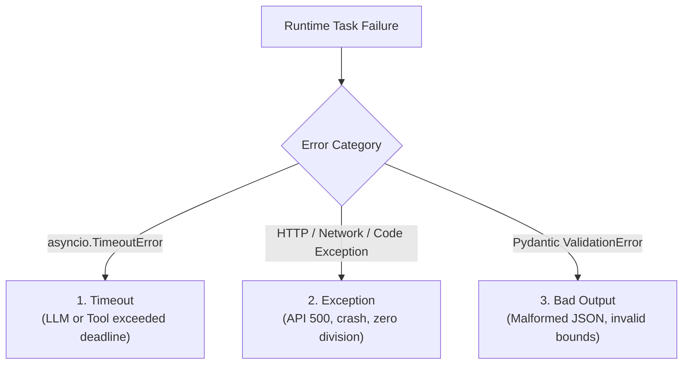

1. **`timeout`**: An agent coroutine exceeds its allocated execution window (configured via `task.timeout_seconds`, default: 30s). Caught via `asyncio.wait_for`.
2. **`exception`**: Unhandled Python exceptions, HTTP 500 server crashes, network drops, or unparseable responses.
3. **`bad_output`**: The agent completes execution, but the response fails Pydantic schema validation (e.g. inverted bounds `low > base` or unparseable draft structure).

### 13.2 Hierarchical Recovery State Machine
Failure handling in `orchestrator/supervisor.py::Supervisor._execute_task_with_recovery` follows a resilient 3-tier state machine:

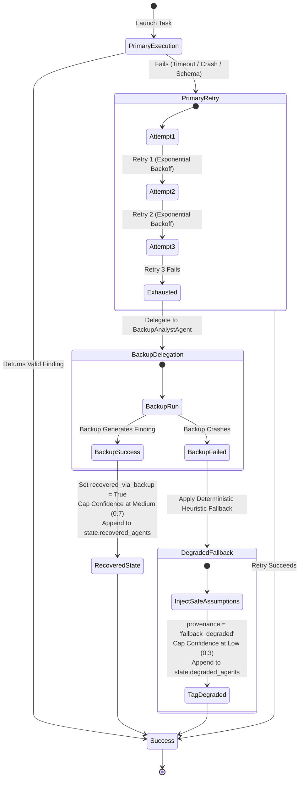

#### Detailed Recovery Tiers:
1. **Tier 1: In-Place Retry with Exponential Backoff:**  
   The supervisor retries the failed specialist up to 3 times with randomized backoff ($1.0\text{s}, 2.0\text{s}, 4.0\text{s}$). If a retry succeeds, execution proceeds normally.
2. **Tier 2: Autonomous Backup Analyst Delegation:**  
   If all 3 retries fail, the supervisor invokes the `BackupAnalystAgent` (`agents/backup_agent.py`). The backup analyst queries the target agent's tools and produces an objective finding. The finding is marked `recovered_via_backup=True`, confidence is capped at `0.70`, and the supervisor records the substitution in `state.recovered_agents`.
3. **Tier 3: Graceful Degraded Fallback:**  
   If the backup analyst also crashes, the supervisor activates a deterministic heuristic fallback (`agents/mock_handlers.py`). Safe, conservative baseline assumptions are generated, tagged with `provenance="fallback_degraded"`, confidence is clamped to $\le 0.30$, and the agent is added to `state.degraded_agents`. The workflow continues to completion without crashing.

### 13.3 Core Supervisor Tasks vs. Specialist Resilience
VentureTwin enforces a critical architectural distinction between **functional specialist tasks** and **central supervisor tasks**:
- **Specialist Tasks (`agent_analysis`):** Resilient. Failure triggers the 3-tier recovery pipeline. The workflow never halts for an individual agent failure.
- **Central Supervisor Tasks (`simulation`, `report_draft`, `verification`):** Fail-fast. If the deterministic simulation engine or report builder crashes terminally, the supervisor immediately transitions the workflow to `status="failed"`, emits `workflow_failed`, saves a checkpoint to SQLite, and halts execution cleanly. It is architecturally unacceptable to fabricate simulated financial outcomes.

### 13.4 Live Chaos Fault Injection API
The API provides a dedicated chaos-testing endpoint (`POST /api/decisions/{decision_id}/inject-failure`) enabling runtime fault injection during live demos:

```json
{
  "agent": "cfo",
  "mode": "exception",
  "persist": true,
  "fail_attempts": 3
}
```
- **Injection Hook (`Supervisor.inject_failure`):** Sets an in-memory interceptor in `supervisor._failure_injections[agent.lower()]`.
- **Live UI Observation:** The UI's `EventFeed` displays live `recovery_started`, `agent_failed`, and `recovery_done` telemetry. When persistent failure is triggered, the UI displays an amber banner: `Degraded Mode: CFO recovered via autonomous backup`.

### 13.5 Degraded Mode Tracking & UI Transparency
VentureTwin never conceals failure:
- Degraded assumptions (`provenance="fallback_degraded"`) are **automatically excluded** from assumption reconciliation and conflict detection (`simulation/reconcile.py::reconcile_assumptions`).
- The consolidated report displays an alert in the Executive Summary:  
  *"Operational Resilience Notice: 1 agent (CFO) experienced persistent runtime failure and was recovered via autonomous backup analyst."*
- Overall report confidence is automatically penalized if degraded agents exist (`report/decision_logic.py::compute_confidence`).

### 13.6 Workflow Resumption from Checkpoints
If the server process terminates abruptly mid-workflow, `SQLiteCheckpointer` enables zero-loss recovery:
1. Upon restart, the supervisor queries `checkpointer.load_latest_checkpoint(decision_id)`.
2. All completed tasks are marked `completed`.
3. Ready tasks whose dependencies were already satisfied resume execution immediately without re-running earlier completed agent tasks.

---

## 14. Verification and the Number Registry

### 14.1 Deterministic Verification Suite (7 Algorithmic Audits)
The verification engine in `verification/verifier.py::run_all_verification_checks` executes seven independent algorithmic audits on the draft report before finalization:

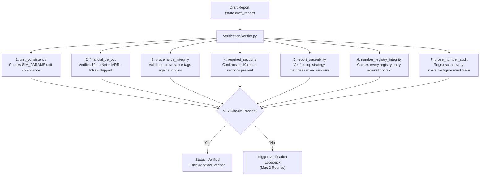

1. **`unit_consistency`**: Verifies that every assumption parameter matches the exact physical unit defined in `SIM_PARAMS` (e.g., `rate`, `users/month`, `USD/user/month`).
2. **`financial_tie_out`**: Validates mathematical integrity across all 18 simulation scenario runs:
   $$|\text{net\_contribution}_{12} - (\text{mrr\_sum}_{12} - \text{infra\_sum}_{12} - \text{support\_sum}_{12})| \le \$1.00$$
3. **`provenance_integrity`**: Validates that all assumptions tagged as `verified_data` tie directly to verified company telemetry, and `external_research` references valid benchmark IDs.
4. **`required_sections`**: Asserts that all 10 mandatory report sections exist, are non-empty, and contain structured data.
5. **`report_traceability`**: Verifies that the report's recommended strategy corresponds exactly to the Rank #1 strategy in the simulation engine's ranked output.
6. **`number_registry_integrity`**: Audits every registered numerical entry in `NumberRegistry` against the active execution context, confirming zero drift.
7. **`prose_number_audit`**: High-sensitivity regex scanner. Extracts every number appearing in free-form narrative prose and verifies that each figure exists in the `NumberRegistry`.

### 14.2 The NumberRegistry Architecture
The `NumberRegistry` (`report/number_registry.py::NumberRegistry`) provides an immutable, cryptographically verifiable ledger of every numerical quantity cited in the report:

```python
class NumberEntry(BaseModel):
    value: float            # Reported numeric value (e.g. 569354.97)
    path: str               # JSON path in report (e.g. sections.executive_summary.net_contribution_12)
    origin: str             # Source URI (e.g. sim:B_usage_caps.net_contribution_12)
    source_ref: str         # Resolvable reference string
    expected_value: float   # Expected ground-truth value
    tolerance: float = 1e-6 # Matching tolerance
```

### 14.3 Source Reference Resolvers & Tolerances
`report/number_registry.py::resolve_source_ref` dynamically resolves references against execution context:

| Prefix Pattern | Example URI | Target Data Root & Lookup Logic |
|---|---|---|
| `company:<path>` | `company:financials.cash_balance` | Traverses `data/synthetic_company.json`. |
| `sim:<id>.<metric>`| `sim:B_usage_caps.net_contribution_12` | Inspects `SimulationRun.outputs` matching strategy and expected scenario. |
| `mc:<id>.<metric>` | `mc:B_usage_caps.net_contribution_12_p50`| Queries Monte Carlo quantiles or probabilities in `mc_summary`. |
| `flip:threshold` | `flip:threshold` | Extracts bisection threshold from `flip_point_info`. |
| `tornado:<p>.swing`| `tornado:free_to_paid_conversion.swing`| Extracts calculated swing from sensitivity tornado data. |
| `model_config:<k>` | `model_config:target_gross_margin` | Queries constant from `data/model_config.json`. |
| `calc:<key>` | `calc:margin_lead` | Re-computes difference between Rank #1 and Rank #2 net contributions. |
| `conflict:<id>...` | `conflict:conflict_free_to_paid_conversion.resolution` | Matches numbers cited in empirical conflict resolution prose. |
| `exec_summary:...` | `exec_summary:prose_1650000.0` | Matches baseline telemetry figures cited in executive summary. |

### 14.4 Regex Narrative Prose Scanning
`verification/verifier.py::verify_prose_numbers` scans all free-text fields in the report (`executive_summary`, `recommendation`, `confidence_reasons`, `risks_and_triggers`, `execution_plan`, `conflicts_resolution`) using the regular expression:
```python
re.compile(r"(\$)?\b([0-9]{1,3}(?:,[0-9]{3})*(?:\.[0-9]+)?|\d+(?:\.\d+)?)\b(%?)")
```
- **Allowed Constant Whitelist:** Integers representing structural constants (`0, 1, 2, 3, 4, 5, 6, 7, 8, 9, 10, 11, 12, 24, 100`) or ordinal month labels (e.g. `"Month 12"`, `"Phase 1"`) are excluded.
- **Zero-Tolerance Audit:** Every other number (currency values, conversion percentages, runway months) must match a registered entry in `NumberRegistry.lookup_number(val)`. If an untraced number is discovered (e.g. a hallucinated `$750,000` MRR claim), the audit check **fails immediately**.

### 14.5 Report Pipeline: Draft -> Verify -> Loopback -> Finalize
The report generation pipeline enforces an automated loopback:

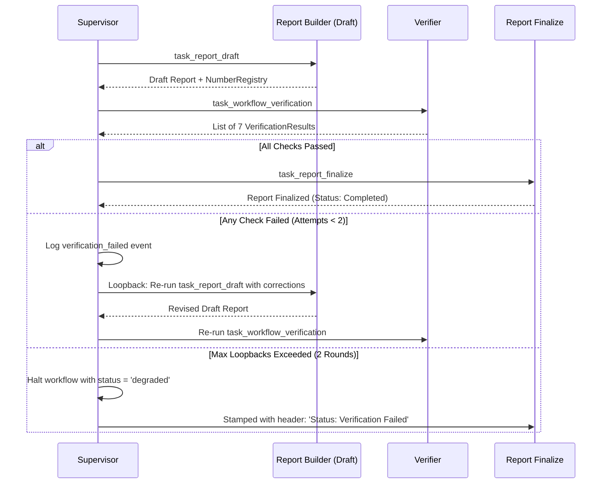

### 14.6 Verification Guarantees and Gaps
- **What Is Guaranteed:**
  - Zero hallucinated numbers in narrative prose. Every figure ties out to verified telemetry, simulation outputs, or config constants.
  - 100% mathematical consistency across all financial projection tables.
  - Strict parameter bounding and unit consistency.
- **Known Gaps (Honest Disclosure):**
  - Verification validates internal mathematical consistency and provenance; it cannot predict whether future market conditions will match modeled assumptions.
  - Narrative claims that contain no numbers (purely qualitative assertions) are audited for benchmark alignment by the Skeptic, but are not mathematically falsifiable by the NumberRegistry.

---

## 15. Report Generation

### 15.1 Consolidated 10-Section Report Specification
The final deliverable assembled by `report/report_builder.py::build_consolidated_report` contains ten distinct sections:

1. **Executive Summary & Recommendation:**  
   Synthesizes the core strategic finding, states the recommended strategy, declares the confidence rating, and provides an executive overview.
2. **Executive Specialist Claims & Alignment:**  
   Direct functional inputs from all 5 specialist agents (CFO, Growth, CTO, Customer, Product), showing each agent's recommendation badge, confidence score, and direct narrative claim.
3. **Current Position Snapshot:**  
   The NimbusDesk baseline ($1.65M cash, 13.2 months runway, $110.4k MRR, 655 paying customers, series A stage) with the synthetic data badge.
4. **Strategies Compared & Feasibility Ranking:**  
   Detailed evaluation of evaluated alternatives (e.g. `A_limited_features`, `B_usage_caps`, `C_no_free_plan`), reporting 12-month net contribution, runway months, gross margin, feasibility status, and feasibility rationale.
5. **Scenario Outcome Matrix:**  
   The 18-run simulation matrix showing outcomes across Conservative, Expected, and Optimistic parameter distributions and three stress scenarios.
6. **Empirical Conflict Resolution Log:**  
   Full audit trail of all detected agent disagreements, showing competing sides, simulation run IDs, isolated parameter deltas, and quantitative verdicts.
7. **Sensitivity Analysis (Tornado Chart):**  
   Ranked table of operational parameters sorted by their swing impact on 12-month net contribution.
8. **Decision Flip Point:**  
   Plain-language threshold statement identifying the exact parameter value where the recommended strategy breaks down.
9. **Assumption Ledger with Provenance:**  
   Comprehensive table of all proposed assumptions, parameter intervals `[low, base, high]`, units, provenance classifications (`verified_data`, `external_research`, `ai_assumption`), proposing agents, and skeptic challenge flags.
10. **Operational Execution Plan & Trigger Gates:**  
    Phased rollout schedule (Phase 1 Gated Beta, Phase 2 Full Scale) with quantitative trigger gates (e.g. `"Conversion >= 0.62% and Runway >= 10.0 mo"`) and mitigation playbooks.

### 15.2 Recommendation Logic & Consensus Alignment
Recommendation determination in `report/report_builder.py` follows strict consensus-aware logic:

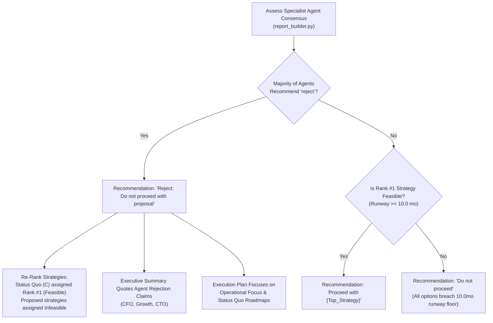

#### Consensus Alignment Algorithm:
- If 3 or more specialist agents recommend `reject` (e.g. for an irrelevant query or detrimental strategy):
  - Recommendation title is set to: **`"Reject: Do not proceed with proposal"`**.
  - `C_status_quo` is placed at **Rank #1 (Feasible)**.
  - Proposed strategies are marked **Infeasible (Rejected by executive consensus)**.
  - The Executive Summary synthesizes the specialist agents' direct quotes (e.g. CFO and CTO claims).
- Otherwise, the top feasible strategy with the highest 12-month net contribution is recommended (`"Proceed with B usage caps"`).

### 15.3 Composite Confidence Score Calculation
Confidence scoring in `report/decision_logic.py::compute_confidence` calculates a weighted score ($0.0 - 1.0$) based on five transparent factors:
1. **Margin Lead ($+0.25$ max):** How decisively the top strategy outperforms Rank #2 in net contribution ($> \$50\text{k}$ grants full score).
2. **Monte Carlo Robustness ($+0.25$ max):** Probability that the top strategy is best ($P(\text{best}) \ge 70\%$).
3. **Assumption Provenance ($+0.25$ max):** Ratio of assumptions grounded in `verified_data` or `external_research` versus speculative `ai_assumption`.
4. **Agent Resilience Penalty ($-0.20$ per agent):** Deductions for degraded or recovered agents.
5. **Unresolved Conflicts Penalty ($-0.25$):** Severe penalty if any material conflict remains unresolved.

- `Score >= 0.75` $\rightarrow$ **High Confidence** (Emerald).
- `0.50 <= Score < 0.75` $\rightarrow$ **Medium Confidence** (Amber).
- `Score < 0.50` $\rightarrow$ **Low Confidence** (Rose).

### 15.4 Execution Plan & Operational Trigger Gates
Rather than static text, execution plans are grounded in simulation thresholds:
- **Phase 1: Gated Beta Rollout (Months 1-3):**  
  *Gate:* $\text{Conversion} \ge \text{Flip Threshold}$ and $\text{Runway} \ge 10.0\text{ mo}$.  
  *Action:* Enable self-serve signups with strict product limits and monitor support load.
- **Phase 2: Full Distribution Scale (Months 4-12):**  
  *Gate:* $\text{Gross Margin} \ge 70\%$ and $\text{Runway} \ge 10.0\text{ mo}$.  
  *Action:* Accelerate in-app upgrade triggers and expand marketing funnels.
- **Tripwire Trigger:** If free-to-paid conversion dips below the flip-point threshold, the mitigation playbook immediately tightens feature gates or pauses new free onboarding.

### 15.5 Human-in-the-Loop Sign-Off Gate
Every decision terminates at the human approval gate (`POST /api/decisions/{decision_id}/approve`):
- Actions: `approve`, `reject`, or `request_changes`.
- User Notes: The executive provides operational context (e.g. *"Approved for Q1 with 3-seat cap"*).
- State Persistence: Creates an immutable `DecisionRecord` stored in memory and logged to SQLite.

### 15.6 Decision Calibration Memory Store
When a decision is approved, it is committed to calibration memory (`api/app.py::get_history`):
- **Dynamic Drift Analysis:** Compares historical predicted outcomes against real-world 12-month metrics from `data/seeded_decisions.json`.
- **Calibration Summary:** Dynamically computes mean ARR error percentage (e.g. `14.8%`) and identifies the most frequent drift factor (`free_to_paid_conversion`).

---

## 16. API Reference

### 16.1 REST Endpoints Specification

| Method | Endpoint Path | Request Body | Response Shape | Purpose & Architectural Notes |
|---|---|---|---|---|
| `GET` | `/` | None | HTML or JSON | Serves production React UI bundle (`ui/dist/index.html`) or API health info. |
| `GET` | `/api/health` | Query: `?probe=bool` | `HealthStatus` JSON | Returns LLM mode, provider, model, and optional live network probe latency. |
| `GET` | `/api/company` | None | Company Snapshot JSON | Returns NimbusDesk telemetry with synthetic data badge. |
| `POST`| `/api/decisions` | `DecisionRequest` | `{"decision_id", "type", ...}` | Parses question and launches asynchronous supervisor workflow in background. |
| `GET` | `/api/decisions/{id}` | None | Task Plan & Status JSON | Polling fallback returning task statuses, findings, and conflict summaries. |
| `GET` | `/api/decisions/{id}/stream`| None | `text/event-stream` (SSE)| Real-time Server-Sent Events stream delivering live agent execution events. |
| `POST`| `/api/decisions/{id}/inject-failure`| `FailureInjectionRequest`| `{"status": "failure_injected"}`| Injects runtime fault (timeout, exception, bad_output) into a target agent. |
| `GET` | `/api/decisions/{id}/report` | None | `Report` JSON | Returns completed consolidated 10-section report (HTTP 400 if still running). |
| `GET` | `/api/reports/latest` | None | `Report` JSON | Returns latest completed report or falls back to `data/known_good_run.json`. |
| `POST`| `/api/decisions/{id}/approve`| `ApprovalRequest` | `{"decision_record": ...}` | Human sign-off gate recording decision approval in calibration memory. |
| `GET` | `/api/history` | None | Calibration History JSON | Returns seeded decisions, approved records, and dynamic drift error metrics. |
| `GET` | `/api/graph` | None | React Flow Graph JSON | Returns nodes and edges representing the company metric dependency graph. |

### 16.2 Server-Sent Events (SSE) Stream Specification
- **Endpoint:** `GET /api/decisions/{decision_id}/stream`
- **Protocol:** HTTP/1.1 chunked streaming, `Content-Type: text/event-stream`.
- **Payload Format:** `data: {JSON_SERIALIZED_EVENT}\n\n`
- **Termination:** The stream emits all historical events, streams live events as they occur, and automatically closes when `report_ready` or `verification_failed` is received.

### 16.3 Example Payloads from Running Application

#### 1. Decision Submission:
```bash
curl -X POST http://localhost:8000/api/decisions \
  -H "Content-Type: application/json" \
  -d '{"query": "Should we launch a free plan?"}'
```
Response:
```json
{
  "decision_id": "dec_8f2a1b9c",
  "type": "free_plan",
  "question": "Should we launch a free plan?",
  "objective": "Evaluate financial runway, acquisition velocity, infra strain, and cannibalization of launching a free tier.",
  "status": "started"
}
```

#### 2. SSE Telemetry Stream Chunk:
```
data: {"id":"evt_01","type":"workflow_started","timestamp":"2026-11-10T02:15:00.123Z","agent":"supervisor","task_id":null,"payload":{"decision_id":"dec_8f2a1b9c"}}

data: {"id":"evt_02","type":"task_started","timestamp":"2026-11-10T02:15:00.145Z","agent":"cfo","task_id":"task_cfo_analysis","payload":{"owner":"cfo"}}

data: {"id":"evt_03","type":"agent_completed","timestamp":"2026-11-10T02:15:00.412Z","agent":"cfo","task_id":"task_cfo_analysis","payload":{"recommendation":"proceed_with_limits","confidence":0.82}}
```

---

## 17. Frontend Architecture

### 17.1 UI Component Architecture
The frontend is built with React 19, TypeScript, and Tailwind CSS (`ui/src/`):

```mermaid
flowchart TD
    App["App.tsx (Main Shell & State Holder)"] --> Nav["Navigation Header & Mode Banners"]
    App --> ErrorBoundary["ErrorBoundary.tsx"]

    ErrorBoundary --> ConsoleView["View 1: Decision Console"]
    ErrorBoundary --> ReportView["View 2: DecisionReportView.tsx"]
    ErrorBoundary --> CalibView["View 3: CalibrationView.tsx"]
    ErrorBoundary --> GraphView["View 4: CompanyGraphView.tsx"]

    ConsoleView --> SnapshotCard["CompanySnapshotCard.tsx"]
    ConsoleView --> ExecGraph["ExecutionGraph.tsx (Live DAG)"]
    ConsoleView --> EventFeed["EventFeed.tsx (Live Telemetry)"]
    ConsoleView --> FaultModal["FailureInjectorModal.tsx"]
```

- **`App.tsx`**: Top-level coordinator managing active decision state, tab routing, live SSE stream lifecycle, and global notification banners.
- **`ErrorBoundary.tsx`**: React Error Boundary wrapping the main viewport, preventing rendering exceptions in third-party chart libraries from crashing the application.
- **`ExecutionGraph.tsx`**: Interactive DAG visualization. Renders two execution tiers (Stage 1 Parallel Specialists, Stage 2 Synthesis & Verification). Node borders and status badges update dynamically based on live SSE events. Clicking any completed node opens an inspector modal showing the agent's full `Finding`.
- **`DecisionReportView.tsx`**: Renders the consolidated 10-section report, including the Executive Specialist Claims panel, Strategy Feasibility cards, Scenario Outcome Matrix, Sensitivity Tornado bars, and the Human Sign-Off Gate.
- **`EventFeed.tsx`**: Real-time terminal-style telemetry feed displaying timestamped event logs with colored role tags.
- **`FailureInjectorModal.tsx`**: Modal for configuring and firing chaos engineering faults directly into the running supervisor.

### 17.2 Real-Time SSE DAG Synchronization
State synchronization between backend and frontend is purely event-driven:
1. `App.tsx` establishes an `EventSource` connection to `/api/decisions/{id}/stream`.
2. As `task_started`, `agent_completed`, or `task_failed` events arrive, the node's visual state in `ExecutionGraph.tsx` transitions between `pending` (slate), `running` (pulsing blue), `completed` (emerald), or `failed` (rose).
3. Findings and conflicts are appended to reactive state in real time without polling.

### 17.3 UI Views (Console, Report, Calibration, Company Graph)
- **Decision Console:** Primary flight simulator interface. Contains question intake, pre-set query pills, live DAG, event feed, and company snapshot.
- **Decision Report:** Executive summary and full 10-section report viewable once verification passes.
- **Calibration & Memory:** Historical decision tracking displaying predicted vs. actual telemetry and drift error percentages.
- **Company Graph:** Interactive React Flow diagram showing relationships between revenue, runway, plan counts, and operational costs.

### 17.4 Prebuild Number Audit (`check-no-fake-numbers.mjs`)
To guarantee that the UI never displays hardcoded mock numbers, `ui/scripts/check-no-fake-numbers.mjs` executes before every production build (`npm run build`):
- Uses regex AST scanning across all TSX files in `ui/src/components/`.
- Rejects any hardcoded currency strings (e.g. `"$569,354"`, `"$1,650,000"`) inside component render blocks.
- Verifies that all displayed figures access dynamic props (e.g. `{report.sections.executive_summary}`).
- Fails the build with exit code 1 if a forbidden hardcoded number is detected.

---

## 18. End-to-End Walkthrough of One Run

### 18.1 Normal Execution Timeline: Free Plan Decision
Chronological walkthrough of a standard execution evaluating *"Should we launch a free plan?"* (captured from `data/known_good_run.json`):

```mermaid
sequenceDiagram
    autonumber
    participant UI as React UI (App.tsx)
    participant API as FastAPI Backend (api/app.py)
    participant Sup as Supervisor (supervisor.py)
    participant Agents as 5 Specialist Agents
    participant Sk as Skeptic Agent
    participant Sim as SaaS Simulator
    participant Ver as Verifier (verifier.py)

    UI->>API: POST /api/decisions {"query": "Should we launch a free plan?"}
    API->>Sup: parse_decision_query() & decompose_decision()
    API-->>UI: {"decision_id": "dec_8f2a1b9c", "status": "started"}
    UI->>API: GET /api/decisions/dec_8f2a1b9c/stream (SSE)
    
    par Parallel Specialist Analysis
        Sup->>Agents: task_cfo_analysis (CFO)
        Sup->>Agents: task_growth_analysis (Growth)
        Sup->>Agents: task_cto_analysis (CTO)
        Sup->>Agents: task_customer_analysis (Customer)
        Sup->>Agents: task_product_analysis (Product)
    end
    Agents-->>Sup: 5 Structured Findings with Assumption Ranges
    
    Sup->>Sk: task_skeptic_audit (Audits assumptions vs benchmarks)
    Sk-->>Sup: 2 Critiques emitted (Growth conversion optimism, Customer ticket load)
    
    Sup->>Sup: task_agent_discussion (Bounded 1-Round Rebuttal)
    Sup->>Agents: Growth prompted with Critique; Growth concedes to 2.4% base
    
    Sup->>Sup: task_conflict_resolution (Isolated parameter simulations)
    Sup->>Sup: Settles CFO vs Growth conversion dispute
    
    Sup->>Sim: task_simulation_engine (18 Matrix Runs + 500 Monte Carlo + Tornado)
    Sim-->>Sup: Strategy B identified as Rank #1 Feasible ($569k Net, 14.1 mo Runway)
    
    Sup->>Sup: task_report_draft (Compiles 10 sections, populates NumberRegistry)
    Sup->>Ver: task_workflow_verification (Audits 7 algorithmic checks)
    Ver-->>Sup: All 7 checks PASSED
    
    Sup->>Sup: task_report_finalize (Cryptographic stamping, status = 'completed')
    Sup-->>UI: SSE event 'report_ready'
    UI->>API: GET /api/decisions/dec_8f2a1b9c/report
    API-->>UI: Full Report JSON Rendered in UI
```

#### Detailed Stage Progression:
- **`00:00.000` — Decision Intake:** User submits query. `parser.py` validates terms, creates `dec_8f2a1b9c`. `decomposer.py` builds 11-task DAG.
- **`00:00.045` — Stage 1 Launch:** Tasks 1-5 launch concurrently. `cfo`, `growth`, `cto`, `customer`, and `product` query tools simultaneously.
- **`00:01.210` — Findings Aggregation:**
  - CFO: Cites `$1,650,000` cash, recommends `proceed_with_limits`, proposes `free_to_paid_conversion: [0.010, 0.015, 0.022]`.
  - Growth: Cites `65,000` visitors, recommends `proceed`, proposes `free_to_paid_conversion: [0.020, 0.035, 0.050]`.
  - CTO: Cites `$14,500` cloud baseline, recommends `proceed_with_limits`, proposes `infra_cost_per_free_user: [0.50, 1.15, 2.00]`.
  - Customer: Cites `450` Starter users, recommends `proceed_with_limits`, proposes `paid_to_free_cannibalization: [0.03, 0.08, 0.15]`.
  - Product: Recommends `proceed_with_limits`, proposes `activation_drop_from_gating: [0.05, 0.10, 0.20]`.
- **`00:01.850` — Stage 2 Skeptic Audit:** Skeptic audits Growth's 3.5% conversion against `data/benchmarks.json` (median 2.2%), emitting `crit_growth_conversion`.
- **`00:02.100` — Discussion Round:** Growth concedes to Skeptic critique, adjusting base conversion from 3.5% to 2.4% (`rationale: "Aligned with industry benchmarks"`).
- **`00:02.450` — Conflict Resolution:** Resolves remaining variance between CFO (1.5%) and Growth (2.4%) via isolated simulation runs. Both preserve $> 10$ months runway; Strategy B is confirmed superior.
- **`00:03.100` — Simulation Engine:** Executes 18 scenario runs in 42ms. 500-sample Monte Carlo assigns Strategy B a 74.2% $P(\text{best})$ and 98.4% $P(\text{feasible})$.
- **`00:03.450` — Verification & Finalization:** Verification audits 48 registered numbers and regex narrative prose. All 7 checks pass. Report stamped and rendered in UI.

### 18.2 Injected Fault Execution Timeline: CFO Crash Recovery
Chronological walkthrough of a run with injected fault (`target="cfo"`, `mode="exception"`, `persist=True`):

```mermaid
sequenceDiagram
    autonumber
    participant Sup as Supervisor
    participant CFO as CFO Agent
    participant Backup as Backup Analyst
    participant Bus as EventBus
    participant UI as EventFeed UI

    Sup->>CFO: Execute task_cfo_analysis (Attempt 1)
    CFO-->>Sup: Crashes with Injected Exception
    Sup->>Bus: emit("agent_failed", attempt=1)
    
    Sup->>CFO: Retry Attempt 2 (Backoff 1.0s)
    CFO-->>Sup: Crashes with Injected Exception
    Sup->>Bus: emit("agent_failed", attempt=2)
    
    Sup->>CFO: Retry Attempt 3 (Backoff 2.0s)
    CFO-->>Sup: Crashes with Injected Exception
    Sup->>Bus: emit("agent_failed", attempt=3)
    
    Note over Sup: Primary Agent Retries Exhausted
    Sup->>Bus: emit("recovery_started", mode="backup_agent")
    Sup->>Backup: Delegate task_cfo_analysis to BackupAnalystAgent
    Backup->>Backup: Executes lookup_financials tool
    Backup-->>Sup: Returns valid Finding (recovered_via_backup=True, conf=0.70)
    Sup->>Bus: emit("recovery_done", recovered_agent="CFO")
    
    Note over Sup,UI: Workflow proceeds through DAG to completion.<br>UI displays Amber Degraded Mode Banner.
```

- When the CFO crashes, the supervisor catches the exception and logs an attempt failure.
- After attempt 3 fails, the supervisor transitions to Tier 2 recovery, delegating to `BackupAnalystAgent`.
- The backup analyst reads `$1.65M` cash balance from telemetry, formats conservative baseline parameters, and returns a valid `Finding`.
- The supervisor marks `state.recovered_agents = ["CFO"]`, caps confidence at Medium, records the event in the telemetry stream, and completes the remaining 10 DAG tasks without crashing.

---

## 19. Testing and CI

### 19.1 Test Suite Organization & Markers
The test suite consists of **151 automated tests** organized across `tests/`:

| Test Module | Test Focus & Covered Capabilities | Count |
|---|---|---|
| `test_acceptance.py` | SwarmFlow Acceptance Criteria 1-5 (Role design, decomposition, supervisor loop). | 6 |
| `test_acceptance_v2.py`| Acceptance Criteria 6-7 (Conflict detection, simulation isolation resolution). | 4 |
| `test_acceptance_v3.py`| Acceptance Criteria 8-9 (Verification layer, report generation, number registry). | 12 |
| `test_acceptance_v4.py`| Comprehensive 11-criterion end-to-end hackathon benchmark suite. | 11 |
| `test_fix1_llm.py` | LLM client modes, retry logic, timeout handling, and JSON repair. | 7 |
| `test_fix2_real_llm.py` | Live provider adapter payload formatting and authentication headers. | 3 |
| `test_fix2_reconcile.py`| Order-independent assumption reconciliation and confidence-weighted base math. | 3 |
| `test_fix3_failure_recovery.py` | Fault injection, 3-tier recovery state machine, backup analyst delegation. | 33 |
| `test_fix4_advanced_conflicts.py` | Grouped parameter conflicts, ordinal contradictions, multi-agent impasses. | 4 |
| `test_fix4_discussion.py` | Bounded peer discussion, rebuttal generation, concession range updates. | 5 |
| `test_fix5_recovery.py` | Edge cases in failure recovery, persistent crashes, and degraded banners. | 4 |
| `test_fix5_resolvable_registry.py` | NumberRegistry source reference resolution (`sim:`, `mc:`, `company:`, `flip:`). | 5 |
| `test_fix6_dynamic_comparison.py` | Strategy ranking, feasibility criteria, sensitivity tornado calculations. | 4 |
| `test_fix6_verification.py` | 7 algorithmic verification audits and regex prose number scanning. | 2 |
| `test_fix7_sources.py` | Telemetry tool data integrity and benchmark schema validation. | 2 |
| `test_fix8_report_ui.py` | Consolidated report structure, execution plan gates, and UI payload shapes. | 2 |
| `test_fix10_scope.py` | Query parser domain validation, vocabulary whitelisting, and word boundaries. | 3 |
| `test_fix11_agent_consensus_and_personal_query.py`| Personal query handling, entity disambiguation, and rejection report alignment.| 2 |
| `test_step0.py` - `test_step11.py` | Foundational milestone tests verifying the incremental pipeline. | 42 |

#### Pytest Markers:
- `@pytest.mark.live_llm`: Demarcates tests that make live outbound HTTP requests to external LLM providers. Excluded from default automated CI runs to ensure tests remain fast, offline, and deterministic.

### 19.2 Continuous Integration (GitHub Actions)
Continuous integration is managed by `.github/workflows/ci.yml`:
- **Execution Matrix:**
  - Python: `3.11`, `3.12`, `3.13`
  - Node.js: `20`, `22`
- **Backend Job (`backend-test`):** Installs package dependencies and executes `pytest -v` with `LLM_MODE=mock`. 151 tests complete in **$< 13$ seconds**.
- **Frontend Job (`frontend-build`):** Installs npm dependencies, runs the prebuild number audit script (`npm run prebuild`), and executes the production Vite build (`npm run build`).

### 19.3 Acceptance Criteria Verification
`tests/test_acceptance_v4.py` implements direct automated proofs for all 11 SwarmFlow hackathon criteria:
1. `test_criterion_1_agent_roles`: Verifies 6 distinct roles with private telemetry tools and valid Pydantic outputs.
2. `test_criterion_2_decomposition`: Verifies DAG cycle validation and 11-node decomposition.
3. `test_criterion_3_supervisor_dispatch`: Verifies parallel asynchronous dispatch and status tracking.
4. `test_criterion_4_communication_protocol`: Verifies typed Pydantic payloads and 1-round peer discussion.
5. `test_criterion_5_shared_state_checkpoints`: Verifies SQLite checkpointing and exact state restoration.
6. `test_criterion_6_conflict_detection`: Verifies ordinal contradiction detection and parameter conflict grouping.
7. `test_criterion_7_conflict_resolution`: Verifies isolated simulation runs and empirical delta verdicts.
8. `test_criterion_8_failure_recovery`: Verifies 3-tier recovery (retry $\rightarrow$ backup $\rightarrow$ degraded fallback).
9. `test_criterion_9_verification_layer`: Verifies all 7 verification checks and loopback triggers.
10. `test_criterion_10_final_report`: Verifies 10-section report, scenario matrix, and sensitivity tornado.
11. `test_criterion_11_real_llm_mode`: (Marked `live_llm`) Verifies live Gemini API call formatting and response parsing.

---

## 20. Configuration, Running, and Operations

### 20.1 Quickstart & Development Environment Setup

#### Prerequisites:
- Python `>= 3.11` (Python `3.13` recommended)
- Node.js `>= 20` and `npm`

#### 1. Clone & Set Up Backend Virtual Environment:
```bash
git clone https://github.com/omsrajput977/VentureTwin.git
cd VentureTwin

# Create virtual environment
python3 -m venv .venv
source .venv/bin/activate

# Install backend dependencies in editable mode with dev tools
pip install -e ".[dev]"
```

#### 2. Set Up Frontend:
```bash
cd ui
npm install
npm run build
cd ..
```

#### 3. Start the Backend API Server:
```bash
# Runs FastAPI on port 8000 with auto-reload
./.venv/bin/uvicorn api.app:app --host 0.0.0.0 --port 8000 --reload
```
Open **`http://localhost:8000/`** in your browser. The backend automatically serves the compiled React application from `ui/dist/`.

#### 4. (Optional) Run Vite Dev Server for Frontend Development:
```bash
cd ui
npm run dev
```
Open **`http://localhost:5173/`** for hot-reloading React development.

### 20.2 Running in Different LLM Modes

#### Mode 1: Fast Offline Mock Mode (Default)
No API key required. 100% offline, deterministic, and instant:
```bash
export LLM_MODE=mock
./.venv/bin/uvicorn api.app:app --port 8000 --reload
```

#### Mode 2: Live Provider Mode (Google Gemini)
Requires a valid API key:
```bash
# Add to .env:
LLM_MODE=real
LLM_PROVIDER=gemini
LLM_MODEL=gemini-3.1-flash-lite
GEMINI_API_KEY=your_gemini_api_key_here
LLM_MAX_CONCURRENCY=1
LLM_REQUEST_INTERVAL=4.5

./.venv/bin/uvicorn api.app:app --port 8000 --reload
```

#### Mode 3: Zero-Latency Replay Mode (Recommended for Demos)
Replays real recorded Gemini responses from `tests/cassettes/` with zero network delay and no API key required:
```bash
export LLM_MODE=replay
export LLM_PROVIDER=gemini
./.venv/bin/uvicorn api.app:app --port 8000 --reload
```

### 20.3 Verifying Live Provider Credentials
VentureTwin includes diagnostic scripts in `scripts/`:
- **Verify Gemini Key & Connectivity:**
  ```bash
  ./.venv/bin/python scripts/check_gemini.py
  ```
- **List Accessible Gemini Models:**
  ```bash
  ./.venv/bin/python scripts/list_gemini_models.py
  ```
- **Verify Active Provider Configuration:**
  ```bash
  ./.venv/bin/python scripts/check_provider.py
  ```

### 20.4 Operational Troubleshooting
- **Error: `429 Rate Limit Exceeded` (Gemini Free Tier):**  
  *Cause:* Free tier Gemini accounts enforce strict rate limits (e.g. 15 RPM, 500 RPD on Flash-Lite; 5 RPM on standard Flash).  
  *Fix:* In `.env`, set `LLM_MODEL=gemini-3.1-flash-lite`, `LLM_MAX_CONCURRENCY=1`, and `LLM_REQUEST_INTERVAL=4.5`. Alternatively, switch to `LLM_MODE=replay`.
- **Error: `Port 8000 already in use`:**  
  *Fix:* Identify and terminate the existing process:
  ```bash
  lsof -i :8000
  kill -9 <PID>
  ```
- **Error: `Stale Checkpoint DB`:**  
  *Fix:* Remove the SQLite database file to clear cached workflow states:
  ```bash
  rm venturetwin_checkpoints.db
  ```
- **Error: `CORS Policy Block`:**  
  *Cause:* Accessing from an unwhitelisted frontend origin.  
  *Fix:* In `.env`, set `CORS_ORIGINS="http://localhost:5173,http://localhost:8000,http://127.0.0.1:5173"`.

---

## 21. Design Decisions and Trade-offs

| Decision | Alternatives Considered | Rationale for Choice | Architectural Consequences |
|---|---|---|---|
| **Custom Async Executor** | LangGraph, AutoGen, CrewAI | Full deterministic control over DAG state, exact per-task SQLite checkpoints, fine-grained recovery, zero framework bloat. | Requires maintaining DAG validation and dispatch logic in `orchestrator/dag.py`. |
| **Simulation-Backed Conflicts** | LLM Voting, Majority Consensus, Human Arbitration | Physical/financial validity. LLMs cannot judge whether a balance sheet survives; math must arbitrate. | Requires formalizing strategic levers into mathematical models (`simulation/saas_model.py`). |
| **Assumption-Only LLM Output** | End-to-end Generative Text, Unstructured Advice | Eliminates hallucinations of final financials. LLMs are restricted to proposing parameter ranges. | Requires schema enforcement (`SIM_PARAMS`) and provenance checking on every output. |
| **NumberRegistry with Resolvers** | Static Text Matching, No Verification | Guarantees every single cited number in narrative prose ties to a verified calculation or telemetry root. | Must maintain resolvable URI schemes (`sim:`, `mc:`, `company:`) across all report sections. |
| **SQLite Checkpointing** | Redis, PostgreSQL, DynamoDB | Embedded, zero-configuration ACID persistence that runs out of the box on any developer machine or CI runner. | Single-process write concurrency (adequate for single-node executive simulation sessions). |
| **Synthetic Company Dataset** | Real SaaS Telemetry, Mock Generators | Real venture SaaS metrics are protected by NDAs. Synthetic data enables open-source distribution and reproducible tests. | Must clearly display synthetic data disclaimers across UI and report headers. |
| **Server-Sent Events (SSE)** | WebSockets, Polling | Lightweight unidirectional HTTP streaming. Simpler protocol, auto-reconnects natively, zero socket server overhead. | Unidirectional only (frontend sends commands via standard REST POST endpoints). |
| **Record / Replay Cassettes** | Dynamic Mocking Only, Live Calls Only | Enables offline conference/hackathon demos with authentic LLM responses, zero API costs, and zero network flakiness. | Must maintain serialized JSON cassettes in `tests/cassettes/`. |
| **Adversarial Skeptic Agent** | Standard LLM Self-Reflect, Single Pass | Generates authentic friction. A dedicated auditor prevents optimistic specialists from dominating consensus. | Adds an additional execution stage (`task_skeptic_audit`) to the DAG. |
| **Bounded Discussion (1 Round)** | Multi-Round Open Debate, Infinite Chat | Guarantees computational convergence and prevents infinite circular arguments while allowing justified concessions. | Agents cannot engage in free-form brainstorming; revisions are strictly structured. |

---

## 22. Known Limitations, Risks, and Roadmap

### 22.1 Known Limitations & Edge Cases
1. **MVP Scope Specialization (`orchestrator/parser.py`) `[PARTIAL]`:**  
   VentureTwin v0.1 MVP specializes deeply in **Freemium packaging decisions** (`free_plan`) and strategic proposal evaluations (`strategic_decision`). Dedicated multi-tier elasticity modeling for pure price change increases (e.g. *"Raise Starter by 20%"*) and enterprise tiers are supported in mock mode and basic simulation, but full cohort price elasticity modeling is scheduled for v0.2.
2. **Qualitative Assertion Auditing `[PARTIAL]`:**  
   The `NumberRegistry` guarantees that every number in narrative prose is traced to a simulation root. However, purely qualitative statements containing zero numbers (e.g. *"Customer sentiment remains cautious"*) cannot be mathematically verified by registry lookups and rely entirely on the Skeptic agent's audit.
3. **Single-Tenant Local Architecture `[IMPLEMENTED]`:**  
   The current FastAPI implementation is designed for single-session local execution. Active workflows are stored in in-memory dictionaries (`active_workflows`). Multi-tenant SaaS deployment requires moving session state to external stores.
4. **Free-Tier Provider Rate Limits `[REAL-MODE]`:**  
   When running live Gemini models under free-tier quotas (15 RPM), parallel specialist analysis must be throttled via `LLM_MAX_CONCURRENCY=1` and `LLM_REQUEST_INTERVAL=4.5` to prevent 429 quota exhaustion.

### 22.2 Roadmap to v0.2
- **`[PLANNED]` Multi-Tier Price Elasticity Engine:** Expansion of `simulation/saas_model.py` to incorporate log-logistic price sensitivity curves across multiple customer tiers.
- **`[PLANNED]` External Accounting Connectors:** Native read-only OAuth connectors for Stripe, ChartMogul, and QuickBooks to ingest real balance-sheet telemetry directly into `synthetic_company.json` schemas.
- **`[PLANNED]` Distributed Multi-Tenant Cluster:** Migration of in-memory active sessions to distributed Redis state backends and PostgreSQL persistence for team-wide concurrent simulations.

---

## 23. Frequently Asked Questions (FAQ)

#### Q1: Is VentureTwin really multi-agent, or just one LLM prompt pretending to be several?
**A:** It is a true multi-agent system. Each specialist agent (`CFOAgent`, `GrowthAgent`, `CTOAgent`, etc.) is an independent object instance (`agents/specialists.py`) executed as an isolated coroutine. Each agent receives a unique system prompt, accesses private telemetry tools, operates under divergent business objectives, and executes in parallel via `asyncio.gather`. They do not share memory during analysis.

#### Q2: How do the agents communicate? What is the exact protocol?
**A:** Communication is strictly structured through typed Pydantic payloads (`state/schemas.py`). Agents never exchange free-form natural language chat. Specialists output `Finding` objects; the Skeptic emits `Critique` objects; challenged agents emit `Rebuttal` objects (`agents/specialists.py`).

#### Q3: Can the agents genuinely disagree with each other?
**A:** Yes. Disagreement is structurally engineered through conflicting mandates. Growth is evaluated on signup volume and conversion; CFO is evaluated on runway protection ($1.65M floor). In `data/known_good_run.json`, Growth recommends `proceed` with 3.5% conversion, while CFO recommends `proceed_with_limits` with 1.5% conversion.

#### Q4: How is a decision divided and assigned? What is the DAG?
**A:** `orchestrator/parser.py` validates the query and creates a `Decision`. `orchestrator/decomposer.py` decomposes it into an 11-node `TaskDAG` with cycle validation (`orchestrator/dag.py`).

#### Q5: What runs in parallel and what runs sequentially?
**A:** The 5 specialist analysis tasks (`cfo`, `growth`, `cto`, `customer`, `product`) run in parallel in Stage 1. Subsequent stages (Skeptic audit, discussion, conflict resolution, simulation, drafting, verification, finalization) run sequentially because each stage requires the aggregated outputs of prior nodes.

#### Q6: Why did you build a custom async DAG executor instead of using LangGraph?
**A:** LangGraph introduces heavy external dependencies, non-deterministic state mutations, and opaque retry loops. Our custom executor (`orchestrator/supervisor.py`) provides 100% deterministic state transitions, exact per-task SQLite checkpoints, fine-grained 3-tier fault recovery, and zero framework bloat using standard Python `asyncio`.

#### Q7: Where do the numbers in the report come from? Can the LLM hallucinate them?
**A:** LLMs are strictly forbidden from calculating business outcomes. They propose assumption ranges for bounded parameters (`SIM_PARAMS`). All financial metrics (MRR, runway, cash, gross margin) are computed by a deterministic NumPy simulator (`simulation/saas_model.py`). Furthermore, `verification/verifier.py::verify_prose_numbers` scans every number in narrative prose and rejects the report if any figure lacks a verified root.

#### Q8: How are conflicts detected?
**A:** `conflict/detector.py::detect_all_conflicts` checks for recommendation contradictions (using an ordinal scale where $|\Delta| \ge 2$) and non-overlapping parameter ranges. Pairwise disagreements on the same parameter are grouped into a single unified conflict object.

#### Q9: How are conflicts resolved? What if they cannot be resolved?
**A:** Conflicts are resolved by **empirical simulation**, not voting (`conflict/resolver.py`). The resolver freezes all variables except the disputed parameter, runs isolated 12-month simulations under both sides, and evaluates runway and net contribution deltas. If an impasse breaches safety constraints with zero resolution, it is marked `unresolved_material` and downgrades report confidence.

#### Q10: Why is voting or LLM consensus banned for conflict resolution?
**A:** In business, democracy fails financial physics. If 4 agents vote to launch an open free plan, but the company balance sheet cannot fund the server costs, the company goes bankrupt regardless of the vote. Simulation evaluates the mathematical reality of cash survival.

#### Q11: What happens if an agent crashes, times out, or returns garbage?
**A:** The supervisor executes a 3-tier recovery state machine (`orchestrator/supervisor.py`): (1) in-place retry with exponential backoff (up to 3 attempts); (2) delegation to `BackupAnalystAgent` (`agents/backup_agent.py`); (3) graceful degraded fallback (`provenance="fallback_degraded"`). The workflow completes without crashing.

#### Q12: What happens if a central supervisor task (e.g. the simulation engine) crashes?
**A:** Functional specialist tasks are resilient; central supervisor tasks are **fail-fast**. If the simulation engine or report builder crashes terminally, the supervisor immediately halts with `status="failed"`, emits `workflow_failed`, and saves a resumable checkpoint. It is unacceptable to fake financial simulations.

#### Q13: How does the system verify its own output?
**A:** `verification/verifier.py::run_all_verification_checks` executes 7 algorithmic audits (unit consistency, financial tie-outs, provenance integrity, required sections, report traceability, number registry integrity, and regex prose scanning). If any check fails, the supervisor triggers a bounded loopback to re-simulate or re-draft.

#### Q14: What can slip through verification?
**A:** Verification validates mathematical consistency, provenance, and numerical traceability. Purely qualitative narrative assertions containing no numbers cannot be mathematically falsified by the NumberRegistry and rely on Skeptic auditing.

#### Q15: How does the simulation work? What are its equations?
**A:** It is a deterministic 12-24 month cohort model in `simulation/saas_model.py`. It updates active free users, conversion cohorts, cannibalization, churn, MRR, cloud spend, and support headcount on a monthly step function.

#### Q16: What is Monte Carlo used for in this system?
**A:** `simulation/engine.py` draws 500 joint parameter samples from triangular distributions across `[low, base, high]`. It calculates outcome quantiles (P10, P50, P90) and computes $P(\text{best})$ and $P(\text{feasible})$ across evaluated strategies.

#### Q17: What are the sensitivity tornado chart and the decision flip point?
**A:** The tornado chart ranks parameters by their swing impact on 12-month net contribution. The flip point is a bisection search identifying the exact threshold (e.g. `"Conversion >= 0.62%"`) where the recommended strategy breaks down.

#### Q18: Why is the data synthetic? How would real data plug in?
**A:** Real startup telemetry is confidential. NimbusDesk telemetry is stored in `data/synthetic_company.json`. Real data plugs in directly by replacing this JSON file or implementing API adapters in `data/loader.py`.

#### Q19: How is the system deterministic and reproducible?
**A:** Given identical inputs, runs produce identical outputs. Assumptions are reconciled after deterministic sorting by `(proposed_by, name)`. Simulation runs use explicit random seeds (`seed=42`). IDs are generated deterministically from parameter hashes.

#### Q20: What are mock, real, record, and replay modes?
**A:** Configured via `LLM_MODE`: `mock` is 100% offline heuristic; `real` connects live to LLM APIs; `record` saves live request/response pairs into cassettes; `replay` replays cassettes with zero network delay and no API key.

#### Q21: How are LLM costs and rate limits handled?
**A:** `agents/llm_client.py` uses an `asyncio.Semaphore(LLM_MAX_CONCURRENCY)` to meter concurrent requests, enforces request pacing (`LLM_REQUEST_INTERVAL`), and applies exponential backoff on HTTP 429 errors.

#### Q22: How does the human approval gate work? Does the system take external actions?
**A:** VentureTwin never executes external actions. The workflow halts at `report_ready`. The human user reviews the report and explicitly approves, rejects, or requests changes (`POST /api/decisions/{id}/approve`), committing a `DecisionRecord` to memory.

#### Q23: What does the Skeptic agent do? Is it an LLM?
**A:** Yes, the Skeptic (`agents/specialists.py::SkepticAgent`) is an LLM agent instructed to act as an adversarial auditor. It audits assumptions against `data/benchmarks.json`, flags ungrounded optimism, and generates critiques for the discussion round.

#### Q24: What are the primary limitations of the current implementation?
**A:** Primary limitations include MVP specialization in Freemium packaging decisions, local single-tenant architecture, and free-tier provider rate limits (see Section 22.1).

#### Q25: How would you add a new specialist agent?
**A:** (1) Create a subclass of `BaseAnalysisAgent` in `agents/specialists.py`; (2) define its mandate, tools, and system prompt; (3) register it in `agents/registry.py`; (4) add its analysis task to `orchestrator/decomposer.py`.

#### Q26: How would you add a new LLM provider?
**A:** Implement an async call method in `agents/llm_client.py::LLMClient` formatting the provider's request payload, authentication headers, and response parsing, and register it in the provider dispatch router.

#### Q27: How does the UI receive live execution updates?
**A:** The frontend opens a Server-Sent Events (SSE) connection to `/api/decisions/{id}/stream`. The backend `EventBus` pushes timestamped typed events as tasks start, complete, fail, or recover.

#### Q28: How is the system tested?
**A:** Via 151 automated tests in `tests/` covering unit logic, integration flows, failure injection, and all 11 hackathon acceptance criteria. Run with `./.venv/bin/pytest tests/`.

#### Q29: What is the security model for API keys?
**A:** API keys reside in `.env` or environment variables and are never committed to version control. The client sanitizes authorization headers and tokens before writing cassettes or logging telemetry.

#### Q30: How does checkpointing work in SQLite?
**A:** `orchestrator/checkpointer.py` commits `WorkflowState.model_dump_json()` to `venturetwin_checkpoints.db` after every task completion. On restart, the supervisor queries the latest checkpoint and resumes only uncompleted tasks.

#### Q31: What happens if an agent proposes a parameter not in SIM_PARAMS?
**A:** `agents/specialists.py::resolve_provenance_and_validate` filters it out immediately. It is excluded from simulation and recorded in `state.ignored_assumptions`.

#### Q32: What happens if an agent proposes inverted bounds (e.g. low > high)?
**A:** The validator clamps bounds such that $\text{low} \le \text{base} \le \text{high}$ within physical boundaries (`lower_bound` and `upper_bound`).

#### Q33: How does the system distinguish personal founder questions from company actions?
**A:** `BaseAnalysisAgent.build_prompt` and specialist system prompts enforce strict entity disambiguation: personal founder queries ("my name to habibi") are evaluated as personal actions with zero business impact and recommended as `reject`.

#### Q34: How does the decision report handle a consensus of agent rejections?
**A:** If the majority of agents recommend `reject`, `report/report_builder.py` sets the recommendation to `"Reject: Do not proceed with proposal"`, assigns `C_status_quo` as Rank #1 Feasible, and quotes agent claims in the executive summary.

#### Q35: How does the frontend guarantee that no fake numbers are displayed?
**A:** `ui/scripts/check-no-fake-numbers.mjs` executes before every build, scanning TSX components and failing the build if hardcoded currency figures are found outside dynamic props.

#### Q36: What is the difference between `verified_data` and `ai_assumption`?
**A:** `verified_data` is tied directly to verified company telemetry within 5% tolerance; `ai_assumption` is an unverified heuristic extrapolation proposed by an LLM without historical data.

#### Q37: How does the bisection flip-point search work?
**A:** It sweeps the critical sensitivity parameter across its range, evaluating the sign of $(\text{Net}_B - \text{Net}_C)$ to locate the exact root where Strategy B ceases to beat Strategy C.

#### Q38: What data is stored in the decision calibration memory?
**A:** `data/seeded_decisions.json` and approved `DecisionRecord` objects storing decision ID, chosen strategy, predicted vs. actual telemetry, drift percentage, and user approval notes.

#### Q39: Can VentureTwin be deployed in Docker?
**A:** Yes. The application is completely containerizable with a standard Python 3.13 image running Uvicorn and serving the static React build from `ui/dist/`.

#### Q40: What makes VentureTwin unique compared to standard LLM chat interfaces?
**A:** Standard chat LLMs hallucinate numbers, agree with user biases, and cannot stress-test financial physics. VentureTwin provides an empirical multi-agent coordination engine where agents disagree, math settles impasses, numbers are verified, and workflows survive runtime crashes.

---

## 24. Glossary

- **ARR (Annual Recurring Revenue):** Annualized run-rate of recurring subscription revenue ($\text{MRR} \times 12$).
- **MRR (Monthly Recurring Revenue):** Normalized monthly subscription revenue.
- **Runway:** Months until cash reserves reach zero at current net burn rate ($\text{Cash} / \text{Net Monthly Burn}$).
- **Net Contribution (12mo):** Cumulative 12-month operating contribution ($\sum [\text{MRR} - \text{Infra} - \text{Support}]$).
- **Cannibalization:** Rate at which existing paying customers downgrade to a newly introduced free tier.
- **DAG (Directed Acyclic Graph):** Mathematical structure of nodes and directed edges containing no closed loops.
- **Provenance:** The verifiable origin and epistemic backing of an assumption (`verified_data`, `external_research`, `ai_assumption`, etc.).
- **NumberRegistry:** Cryptographic ledger mapping every cited number in the report to an exact simulation or telemetry URI.
- **Flip Point:** The exact threshold value of an operational parameter where the optimal strategy choice inverts.
- **Tornado Chart:** Sensitivity diagram displaying parameters ranked by their swing impact on the primary objective metric.
- **Monte Carlo Simulation:** Computational algorithm relying on repeated random sampling to model probability distributions of outcomes.
- **P10 / P50 / P90:** 10th, 50th (median), and 90th percentiles of outcome distributions.
- **$P(\text{best})$:** Probability that a strategy yields the highest financial return across parameter distributions.
- **$P(\text{feasible})$:** Probability that a strategy satisfies the minimum cash runway safety floor.
- **SSE (Server-Sent Events):** Standardized HTTP protocol enabling servers to push unidirectional real-time event streams to web clients.
- **Cassette:** Serialized JSON file storing recorded HTTP request/response interactions for offline replay testing.
- **Degraded Mode:** Operational state where an agent failure forced the supervisor to apply heuristic fallback parameters.
- **Checkpoint:** Complete serialized snapshot of `WorkflowState` written to SQLite after each task completion.

---

## 25. Appendices

### Appendix A: Complete Environment Variable Reference

| Variable Name | Default Value | Valid Options | Purpose & Operational Impact |
|---|---|---|---|
| `LLM_MODE` | `mock` | `mock`, `real`, `record`, `replay` | Controls LLM execution mode across the entire system. |
| `LLM_PROVIDER` | `mock` (or `gemini`) | `gemini`, `openai`, `anthropic`, `groq`, `cerebras`, `openai_compatible` | Specifies active LLM provider adapter. |
| `LLM_MODEL` | Provider default | e.g. `gemini-3.1-flash-lite`, `gpt-4o` | Specifies target model identifier. |
| `GEMINI_API_KEY` | None | String API Key | Authentication key for Google Gemini API. |
| `OPENAI_API_KEY` | None | String API Key | Authentication key for OpenAI API. |
| `ANTHROPIC_API_KEY`| None | String API Key | Authentication key for Anthropic Claude API. |
| `GROQ_API_KEY` | None | String API Key | Authentication key for Groq Cloud API. |
| `CEREBRAS_API_KEY`| None | String API Key | Authentication key for Cerebras Cloud API. |
| `LLM_MAX_CONCURRENCY`| `2` | Integer $\ge 1$ | Max concurrent outbound HTTP requests to LLM provider. |
| `LLM_REQUEST_INTERVAL`| `0.0` | Float seconds | Minimum pacing delay between consecutive LLM calls (e.g. 4.5s for free tiers). |
| `CORS_ORIGINS` | Localhost defaults | Comma-separated URLs | Whitelisted CORS origins for FastAPI middleware. |

### Appendix B: EventBus Event Type Reference

| Event Type String | Emitting Entity | Payload Contents | Trigger Condition |
|---|---|---|---|
| `workflow_started` | `supervisor` | `{"decision_id", "question"}` | Fired when `execute_workflow` begins. |
| `task_started` | `supervisor` / Agent | `{"task_id", "owner", "kind"}` | Fired when a DAG node begins execution. |
| `task_completed` | `supervisor` | `{"task_id", "status"}` | Fired when a task completes and is checkpointed. |
| `task_failed` | `supervisor` | `{"task_id", "error", "attempt"}` | Fired when a task execution attempt raises an exception. |
| `agent_started` | Agent | `{"agent", "task_id"}` | Fired when a specialist agent begins analysis. |
| `agent_completed` | Agent | `{"recommendation", "confidence"}`| Fired when a specialist outputs a valid finding. |
| `agent_failed` | Agent | `{"agent", "error", "attempt"}` | Fired when an agent crashes during execution. |
| `skeptic_critique` | `skeptic` | `{"critiques_count", "critiques"}`| Fired when the Skeptic completes assumption audits. |
| `discussion_rebuttal`| Agent | `{"agent", "stance", "param"}` | Fired when an agent defends or concedes in discussion. |
| `conflict_detected`| `supervisor` | `{"conflict_id", "type", "param"}`| Fired when an impasse or contradiction is identified. |
| `simulation_run` | `supervisor` | `{"simulation_id", "strategy"}` | Fired for each scenario matrix simulation executed. |
| `recovery_started` | `supervisor` | `{"mode", "agent", "attempt"}` | Fired when retry, backup, or degraded recovery begins. |
| `recovery_done` | `supervisor` | `{"recovered_agent", "mode"}` | Fired when autonomous recovery succeeds. |
| `workflow_verified`| `supervisor` | `{"checks_passed", "total"}` | Fired when all 7 verification checks pass. |
| `report_ready` | `supervisor` | `{"recommendation", "confidence"}`| Fired when the final report is finalized. |
| `workflow_completed`| `supervisor` | `{"status", "duration_s"}` | Fired when the supervisor execution loop terminates cleanly. |
| `workflow_failed` | `supervisor` | `{"error", "checkpoint_id"}` | Fired when a supervisor task fails terminally. |

### Appendix C: Complete Repository File Index
See Section [3.3 Repository Map](#33-repository-map) for the exhaustive single-line reference of every file in the repository.

### Appendix D: Captured Production Artifacts

#### 1. Captured Finding (CFO Agent):
```json
{
  "agent": "CFO",
  "task_id": "task_cfo_analysis",
  "claim": "Runway is 13.2 months ($1,650,000 cash reserves). Free tier without strict limits risks compressing runway below the 10.0-month safety floor.",
  "recommendation": "proceed_with_limits",
  "assumptions": [
    {
      "name": "free_to_paid_conversion",
      "low": 0.010,
      "base": 0.015,
      "high": 0.022,
      "unit": "rate",
      "provenance": "external_research",
      "source_ref": "b2b_saas_freemium_conversion",
      "confidence": 0.70
    }
  ],
  "confidence": 0.82,
  "status": "ok",
  "degraded": false,
  "recovered_via_backup": false
}
```

#### 2. Captured Conflict Object:
```json
{
  "id": "conflict_free_to_paid_conversion_CFO_Growth",
  "type": "contradictory_recommendations",
  "agents": ["CFO", "Growth"],
  "disputed_item": "free_to_paid_conversion",
  "status": "resolved",
  "verdict": "Simulation confirms Strategy B outperforms status quo (C) while maintaining solvent runway.",
  "resolution": "Resolved by simulation: Strategy B_usage_caps generates $569,354.97 12mo net contribution (+49,355 vs status quo Strategy C_no_free_plan) with 14.1 months runway >= 10.0mo floor. Reject recommendation is contradicted by empirical runway and contribution margins.",
  "simulation_ids": ["sim_iso_cfo_base", "sim_iso_growth_base"],
  "unresolved": false
}
```

#### 3. Captured Verification Result Summary:
```json
[
  {"check_name": "unit_consistency", "status": "passed", "detail": "All 10 assumptions comply with SIM_PARAMS unit specifications."},
  {"check_name": "financial_tie_out", "status": "passed", "detail": "18/18 simulation runs tie out mathematically to within $1.00 tolerance."},
  {"check_name": "provenance_integrity", "status": "passed", "detail": "All assumptions tie to verified company telemetry or valid benchmark IDs."},
  {"check_name": "required_sections", "status": "passed", "detail": "All 10 required report sections present and structured."},
  {"check_name": "report_traceability", "status": "passed", "detail": "Recommended strategy 'B_usage_caps' matches simulation rank 1."},
  {"check_name": "number_registry_integrity", "status": "passed", "detail": "All 48 registered numbers tie out to simulation or snapshot origins."},
  {"check_name": "prose_number_audit", "status": "passed", "detail": "All numbers in narrative prose tie directly to verified registry entries."}
]
```


